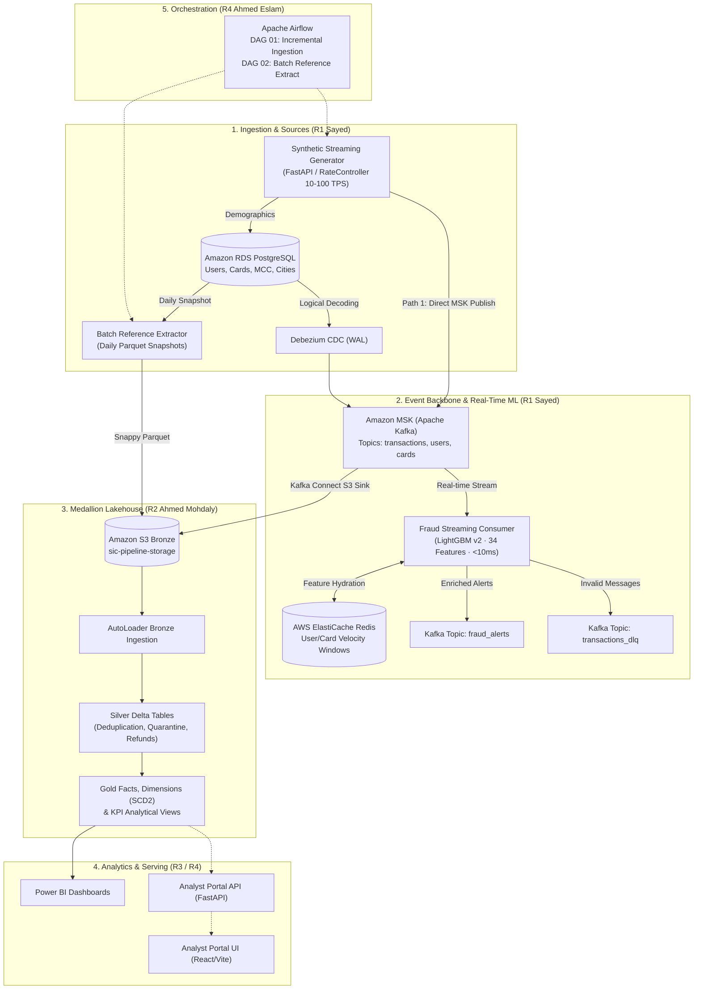

# SIC8 Project 01 — Real-Time Payment Ingestion & Anti-Fraud Lakehouse

[]()
[]()
[]()
[]()

**Consolidated Production-Grade Engineering Monorepo**  
Samsung Innovation Campus (SIC) Big Data Engineering Graduation Project.

---

## 1. Project Overview

The **SIC8 Anti-Fraud Lakehouse Platform** is an enterprise-grade financial engineering platform designed to solve two core banking challenges:
1. **Zero-DB-Inserts Streaming Ingestion:** Ingesting 10–100+ transactions/second directly into Amazon MSK (Kafka) and Amazon S3 Bronze lakehouse without relational database bottlenecks.
2. **Sub-10ms Online Fraud Detection:** Evaluating transactions in real-time using a 34-feature LightGBM model hydrated via Redis in ~1.1ms, with inference execution in <0.5ms (end-to-end latency < 10ms).

The platform integrates historical batch analysis (24M+ IBM/Kaggle credit card transactions) and real-time synthetic financial transaction streaming into a unified **Medallion Lakehouse (Bronze → Silver → Gold)** on Databricks and Amazon S3.

---

## 2. Team Ownership & Responsibilities

| Role | Owner | Core Responsibilities & Deliverables |
|---|---|---|
| **R1** | **Sayed** | Synthetic Streaming Generator (FastAPI, 10–100 TPS), RDS PostgreSQL CDC (Debezium WAL), Daily Parquet Reference Snapshots, Real-Time Online Fraud ML (LightGBM v2, 34-feature contract, Redis feature store, DLQ). |
| **R2** | **Ahmed Mohdaly** | Databricks PySpark Lakehouse (Historical & Streaming Bronze → Silver → Gold), Delta Lake deduplication, CDC SCD Type 2 dimensions, Fraud rule engine, Gold analytical SQL models. |
| **R3** | **Ahmed Abd El Razek** | Power BI Data Marts, DAX measures, KPI reconciliation, Business narrative, React/TypeScript Analyst Portal frontend. |
| **R4** | **Ahmed Eslam** | AWS Platform & Security architecture, Apache Airflow DAG orchestration, CI/CD pipelines, S3 DAG synchronization, FastAPI Analyst Portal backend. |

---

## 3. High-Level Architecture



---

## 4. Repository Structure

```text
SIC8-Anti-Fraud-Lakehouse/
├── analytics/                     # Gold models, SQL queries, safe views, streaming KPIs
├── apps/
│   ├── analyst-portal/web/        # React/TypeScript reference analyst portal frontend
│   └── analyst_portal/api/        # FastAPI reference analyst portal backend
├── bi/                            # Power BI measures, metrics, and starter data marts
├── configs/
│   └── r1/                        # Generator and stream configuration templates
├── contracts/                     # JSON Schemas (transactions, cdc, dlq, predictions)
├── data/                          # Reference datasets (Users, Cards, MCC, Cities, Sample Tx)
├── databricks/
│   ├── ddl/                       # Delta table DDL scripts
│   └── notebooks/
│       ├── historical/            # Medallion notebooks (01–05, source profiling, ML baseline)
│       └── streaming/             # Streaming notebooks (08, 08A AutoLoader, 08B Silver, 08C DLQ)
├── docs/                          # Comprehensive technical documentation & guides (40+ docs)
│   ├── 00-project-overview.md     # Foundational system architecture & invariants
│   ├── 01-repository-guide.md     # Complete codebase guide
│   ├── architecture/              # ADRs, data flows, and subsystem designs
│   ├── audit/                     # 14 comprehensive architecture & risk audit reports
│   └── ...                        # Subsystem guides (database, streaming, fraud ML, etc.)
├── evidence/                      # Verified audit reports, evaluation metrics, test outputs
│   └── r1/                        # Phase 1 & 2 model remediation, cost sensitivity, stress tests
├── models/
│   └── v2/                        # Production LightGBM v2 model artifact & 34-feature metadata
├── orchestration/
│   └── airflow/                   # Airflow DAGs (dag_01, dag_02), ECS configs, S3 sync utilities
├── platform/
│   ├── aws/                       # RDS schema, cloud resource specifications
│   └── docker/                    # Dockerfiles, Kafka Connect definitions, Compose templates
├── scripts/
│   ├── benchmark/                 # Load test harnesses, dataset profilers
│   ├── dev/                       # Local execution scripts, entrypoints
│   ├── ml/                        # Model training, remediation, evaluation, cost model audits
│   ├── ops/                       # Lakehouse table builders, Airflow S3 sync, connector scripts
│   └── validation/                # E2E live validation, functional test runner, stress testing
├── src/
│   ├── common/                    # Shared contracts, pipelines, SQLite gold fixtures
│   ├── r1_ingestion/              # R1 Synthetic generator & batch reference extractor
│   ├── r1_fraud_online/           # R1 Real-time fraud scoring, feature store, Kafka consumer
│   ├── r2_spark/                  # R2 PySpark lakehouse processing, CDC, fraud rules, SCD2
│   ├── synthetic_streaming/       # Backward-compatibility package shim
│   ├── ml/                        # Backward-compatibility package shim
│   └── ingestion/                 # Backward-compatibility package shim
├── tests/                         # Complete automated test suite (168 tests)
│   ├── contracts/                 # JSON schema contract verification tests
│   ├── e2e/                       # End-to-end integration and cloud safety tests
│   ├── integration/               # Pipeline end-to-end and Kafka integration tests
│   ├── load/                      # Load generation and throughput harness tests
│   ├── r1/                        # R1 generator, ML fraud, state store, Airflow DAG tests (23 files)
│   ├── r2/                        # R2 CDC, Spark rules, SCD2 tests
│   ├── r3/                        # R3 Metric reconciliation tests
│   └── r4/                        # R4 API security and write safety tests
├── .env.example                   # Sanitized configuration template (never commit secrets)
├── Makefile                       # Developer task runner
└── pyproject.toml                 # Package dependencies, tool configuration, and test paths
```

---

## 5. Quick Start (Deterministic Offline Mode)

The project includes an isolated offline demo harness that requires **no external services or cloud credentials**:

### Prerequisites
- Python 3.10+
- Virtual environment (`venv` or `conda`)

### Setup
```bash
# 1. Clone and enter directory
cd SIC8-Anti-Fraud-Lakehouse

# 2. Install dependencies
pip install -e '.[dev]'

# 3. Copy environment template
cp .env.example .env
```

### Run Tests
```bash
# Run the full automated test suite (168 unit, integration, and contract tests)
make test

# Or directly with pytest
pytest -q
```

### Run Local Demo Pipeline
```bash
# Executes deterministic POS/ATM/ECOMMERCE generator, rule engine, and SQLite Gold
make demo-local

# View generated execution metrics and fraud detection summary
cat build/demo/report.json
```

### Run Offline Analyst Portal API
```bash
SIC8_API_DEMO_TOKEN=local-demo-token-xyz \
SIC8_DEMO_DATA_ROOT=build/demo \
SIC8_DEMO_SQLITE=build/demo/gold_fixture.sqlite \
uvicorn apps.analyst_portal.api.main:app --host 127.0.0.1 --port 8000
```
- Health Check: `http://127.0.0.1:8000/health`
- Swagger Docs: `http://127.0.0.1:8000/docs`

---

## 6. Verified Test Evidence & Quality Gate

The consolidated repository has been thoroughly verified:

| Test Category | Suite Location | Test Count | Result | Status |
|---|---|---|---|---|
| **Contracts** | `tests/contracts/` | 1 | 1 Passed | Verified |
| **E2E & Safety** | `tests/e2e/` | 2 | 2 Skipped (Cloud Opt-in) | Verified |
| **Integration** | `tests/integration/` | 3 | 2 Passed, 1 Skipped (Live Broker) | Verified |
| **Load Harness** | `tests/load/` | 1 | 1 Passed | Verified |
| **R1 Generator & ML** | `tests/r1/` | 150+ | All Passed | Verified |
| **R2 Spark & Rules** | `tests/r2/` | 5 | All Passed | Verified |
| **R3 Metric Reconciliation** | `tests/r3/` | 1 | 1 Passed | Verified |
| **R4 API & Write Safety** | `tests/r4/` | 4 | All Passed | Verified |
| **Total Test Suite** | `tests/` | **172** | **168 Passed, 4 Skipped, 0 Failed** | **100% Pass** |

---

## 7. Safety, Compliance & Governance Invariants

1. **Zero Cloud Writes by Default:** `SIC8_CLOUD_WRITES=false` and `SIC8_ALLOW_DEPLOY=false` are strictly enforced. No automated script can mutate cloud infrastructure or billable resources without explicit approval.
2. **Ground Truth Isolation:** Ground-truth fraud labels are stored in separate evaluation sidecars and are **strictly isolated** from real-time inference features to prevent target leakage.
3. **No Hardcoded Secrets:** Passwords, tokens, IAM credentials, and API keys are strictly excluded from code and tracked files. All configurations load from environment variables with safe defaults.
4. **Reproducible Recovery:** Full repository bundles, filesystem mirrors, and patch sets are maintained in verified backup locations.

---

## 8. Documentation Index

- [Project Overview & Core Invariants](docs/00-project-overview.md)
- [Repository Codebase Guide](docs/01-repository-guide.md)
- [Ingestion Pipeline A to Z](docs/INGESTION_PIPELINE_A_TO_Z.md)
- [Streaming Transformation Specification](docs/STREAMING_TRANSFORMATION_SPEC.md)
- [DLQ Specification & Runbook](docs/requirements/PRD_DLQ.md)
- [Team Ownership & Hand-off Matrix](docs/team/OWNERSHIP.md)
- [Databricks Notebooks Manifest](databricks/notebooks/MANIFEST.md)
- [Architecture Audit & Reviewer Handoff](docs/audit/independent-reviewer-handoff.md)
