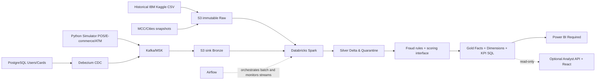

# SIC8 Project 01 — Real-Time Payment Ingestion & Anti-Fraud Lakehouse

**Repository status: PARTIAL IMPLEMENTATION / LOCAL REFERENCE VERIFIED, NOT FULLY DEPLOYED.**

Samsung Innovation Campus Big Data Engineering graduation project, four-member team. Two workstreams remain distinct: historical IBM/Kaggle batch research and synthetic new transaction streaming. Existing verified results from user-provided Databricks execution are recorded in `STATUS.md`, not independently verified from this local container. A real local fixture demonstrates deterministic POS / ECOMMERCE / ATM events, three fraud families, ground-truth isolation, idempotent SQLite Gold counts, and guarded read-only trace API. It is **not** a claim that the original Kafka, Spark Delta, LightGBM, Airflow or Power BI systems are integrated and working here.

## Team

| Owner | Responsibility |
|---|---|
| **R1 Sayed** | Source generator; AWS Kafka ingestion; PostgreSQL/Debezium CDC; reference extracts; online LightGBM/Redis model service |
| **R2 Ahmed Mohdaly** | Databricks Spark; historical Silver; streaming Silver; fraud rules; Gold/SQL; contracts |
| **R3 Ahmed Abd El Razek** | Power BI, analytics reconciliation, optional React analyst portal frontend |
| **R4 Ahmed Eslam** | AWS/Databricks platform configuration, Airflow, CI, monitoring, recovery, optional secured API |

## Architecture at a glance



## Quick start (offline, safe, deterministic)

Requires Python 3.10+, `pytest`, `jsonschema`, `FastAPI`, `httpx`; no cloud services or credentials needed.

```bash
python -m pip install -e '.[dev]'
make test
make demo-local
cat build/demo/report.json
```

Or without `make`:

```bash
PYTHONPATH=. python scripts/dev/demo_local.py --output build/demo
PYTHONPATH=. python -m pytest -q
```

This writes **only** into ignored local `build/demo/`: `raw_events.jsonl`, isolated `isolated_truth.jsonl`, `gold_fixture.sqlite`, and `report.json`. Re-running same fixture is idempotent for SQLite facts. `DEMO_FIXTURE` mode is always visibly labeled.

### Optional read-only local analyst API

```bash
SIC8_API_DEMO_TOKEN=choose-local-token SIC8_DEMO_DATA_ROOT=build/demo SIC8_DEMO_SQLITE=build/demo/gold_fixture.sqlite \
python -m uvicorn apps.analyst_portal.api.main:app --host 127.0.0.1 --port 8000
```

`GET /health` is public and displays DEMO_FIXTURE; `/metrics` and `/trace/{event_id}` require Bearer auth. `/genie/chat` explicitly returns 503 (not configured). Do not expose this reference API publicly; production-grade authentication/rate limits/audit logging still require R4 work.

### Optional local Kafka producer (requires manually started broker)

`platform/docker/compose.yaml` is an **unverified** development-only template, and Docker is not installed in this tool environment. A Kafka producer adapter is available under `src/r1_ingestion/kafka_reference.py` with explicit `allow=True` and local broker allowlist; it is not part of the tested fixture pipeline. Do not claim Kafka E2E until a broker is verified. The S3 JSON wrapper parser under `src/r2_spark/bronze_adapter.py` supports object or encoded-string payloads.

## Existing work protection

- Historical original notebook preserved byte-for-byte under `databricks/notebooks/historical/Untitled-Copy1.ipynb`, recorded hash in `databricks/notebooks/MANIFEST.md`. **Do not run it automatically.**
- Earlier R3 Gold starter draft preserved under `bi/powerbi/previous_gold_starter_v0.1`.
- Actual teammate R1/R3/R4 Git repos, 01–07 Databricks notebook exports, model artifacts, and PBIX were not available in the local workspace and are NOT replaced here. Request owner handoffs per `NEXT_HANDOFF.md`.
- Historical full CSV (~2.35GB) stays in S3, not committed to Git; no live writes performed.

## Operating rules

- Ground truth is evaluation-only, never an inference feature.
- Historical timestamps are timezone-unknown `TIMESTAMP_NTZ`, not UTC; live synthetic event timestamps require UTC.
- Only exact synthetic GPS eligible for impossible-travel rule. City centroids are approximate reference locations.
- Fraud alerts and business transactions have separate grain; currency totals require currency grouping.
- `SIC8_CLOUD_WRITES=false` and `SIC8_ALLOW_DEPLOY=false` by default. No cloud job or migration is triggered by repo setup.

**Start here:** `AUDIT.md` → `docs/team/OWNERSHIP.md` → `contracts/compatibility.md` → `STATUS.md` → `NEXT_HANDOFF.md`. Implementation and deployment are tracked in `docs/requirements/REQUIREMENTS_TRACEABILITY.md`.
