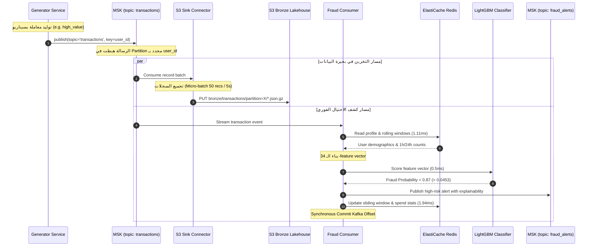

# نظرة عامة على منصة استيعاب البيانات المالية (SIC Platform Overview)
## الدليل التأسيسي الشامل: المشكلة، الحل، والمعمارية الكلية

---

> [!NOTE]
> **مسار الملف:** `docs/00-project-overview.md`  
> **الهدف:** شرح المنصة من المبادئ الأولى (First Principles): ما هي منصة SIC؟ ما هي المشكلة البنكية التي تحلها؟ كيف تتدفق البيانات عبر مسارات الاستيعاب المختلفة؟ وما هي الفروقات الدقيقة بين التصور النظري والتنفيذ البرمجي المعتمد؟

---

## 1. المشكلة البنكية وسياق البيانات التخليقية (Business Context)

### 1.1 لماذا نحتاج بيانات مالية تخليقية (Synthetic Financial Data)؟
في قطاع البنوك والتكنولوجيا المالية (FinTech & Neobanks)، تواجه فرق هندسة البيانات وتطوير نماذج الذكاء الاصطناعي معضلة كبرى:
1. **السرية المصرفية والامتثال القانوني (PCI-DSS & GDPR):** استخدام بيانات حقيقية لبطاقات الائتمان وحسابات العملاء في بيئات التطوير والاختبار أمر محظور قانونياً ويعرض المؤسسة لغرامات بمليارات الدولارات ومخاطر التسريب.
2. **ندرة بيانات الاحتيال الحقيقية (Extreme Class Imbalance):** في الواقع العملي، نسبة المعاملات الاحتيالية لا تتجاوز 0.1% إلى 0.2% من إجمالي حركة الدفع. هذا يجعل تدريب واختبار موديلات الـ Machine Learning أمراً شديد الصعوبة دون القدرة على توليد سيناريوهات احتيال دقيقة ومضبوطة إحصائياً.
3. **اختبارات الحمل وتوسع البنية التحتية (Stress & Load Testing):** كيف يمكنك اختبار قدرة بحيرة البيانات أو محرك كشف الاحتيال على استيعاب 10,000 معاملة في الثانية مع سيناريوهات تأخر البيانات وأخطاء الشبكة دون وجود مُولّد ذكي؟

من هنا ولدت منصة **Synthetic Financial Data Platform (SIC)** لتكون بيئة إنتاجية متكاملة وقابلة للتوسع السحابي (Cloud-Ready)، تضخ معاملات مالية تحاكي الواقع البنكي بكل تعقيداته الإحصائية والزمنية والجغرافية، مع التقاط تعديلات الحسابات وتخزينها في بحيرة بيانات سحابية وتغذية موديل كشف احتيال فوري.

---

## 2. أهداف المنظومة والمتطلبات الهندسية (Core Objectives)

تم تصميم منصة SIC لتحقيق المتطلبات الهندسية الخمسة التالية:

```text
  ┌────────────────────────────────────────────────────────────────────────┐
  │                        SIC PLATFORM CORE INVARIANTS                    │
  ├────────────────────────────────────────────────────────────────────────┤
  │ 1. Zero-DB-Inserts for Stream : البث اللحظي لا يلمس قاعدة البيانات    │
  │ 2. Sub-10ms Fraud Decision    : تقييم المعاملة في أقل من 10 ميلي ثانية│
  │ 3. Automated CDC Demographics : التقاط الحسابات الجديدة عبر الـ WAL   │
  │ 4. Bronze Lakehouse Landing   : تخزين البيانات الخام بصيغ قياسية       │
  │ 5. Resilient Offset Guard     : ضمان عدم ضياع التنبيهات عند الانهيار │
  └────────────────────────────────────────────────────────────────────────┘
```

1. **فصل مسار المعاملات السريعة عن قواعد البيانات (Zero-DB-Inserts):** المعاملات الحية تتدفق بمعدل 10 إلى 100+ معاملة/ثانية؛ كتابتها في قاعدة بيانات علائقية تقليدية يسبب اختناقاً في الـ I/O وتنافساً على الأقفال (Lock Contention). لذلك يتم بث المعاملات اللحظية مباشرة إلى **Amazon MSK (Apache Kafka)** دون إدخالها في PostgreSQL.
2. **التقاط التعديلات العلائقية لحظياً (Automated CDC):** بيانات العملاء والكروت تتطلب اتساقاً علائقياً (ACID)، لذا يتم إدخالها في **Amazon RDS PostgreSQL**، ثم تلتقط أداة **Debezium** التعديلات من سجلات الـ Write-Ahead Log (WAL) وتحولها لأحداث بث مستمرة.
3. **توليد لقطات المرجعيات اليومية (Daily Reference Snapshots):** الجداول الثابتة (أكواد المتاجر والمدن) تُستخرج يومياً بصيغة **Apache Parquet** عالية الكفاءة في الاستعلام.
4. **كشف الاحتيال في أجزاء من الثانية (Sub-10ms ML Inference):** مستهلك مخصص يقرأ من كافكا، يسحب تاريخ العميل من متجر خصائص لحظي (**AWS ElastiCache for Redis**) في 1.11ms، ويشغل موديل **LightGBM** في 0.5ms، ثم يصدر تنبيهاً فورياً عند الاشتباه.
5. **الهبوط المنظم في بحيرة البيانات (Bronze Lakehouse Landing):** تجميع كافة التدفقات في **Amazon S3** تحت البادئة `bronze/` بصيغ قياسية ومضغوطة (`json.gz` للتدفقات السريعة و `snappy.parquet` للبيانات المرجعية) لتغذية محركات Databricks و Athena.

---

## 3. المعمارية الكلية والمسارات الأربعة (System High-Level Architecture)

تتألف المنظومة من أربعة مسارات معمارية منفصلة ومستقلة:

```mermaid
flowchart TD
    %% Global Styling
    classDef comp fill:#0f172a,stroke:#38bdf8,stroke-width:1.5px,color:#f8fafc;
    classDef storage fill:#1e1b4b,stroke:#a855f7,stroke-width:1.5px,color:#f8fafc;
    classDef lake fill:#1c1917,stroke:#f59e0b,stroke-width:2px,color:#f8fafc;
    classDef ml fill:#4c0519,stroke:#f43f5e,stroke-width:2px,color:#f8fafc;

    subgraph PRODUCERS ["1. مصادر البيانات والمولدات (Producers Plane)"]
        direction TB
        GEN["<b>Generator Service & API</b><br/>(FastAPI / RateController 10 TPS)<br/><code>Zero DB Inserts</code>"]
        USER_GEN["<b>User / Card Generator</b><br/>(Dynamic Demographics 10% Ratio)"]
    end
    class GEN,USER_GEN comp;

    subgraph STORAGE_OLTP ["2. قاعدة البيانات التشغيلية (OLTP Layer)"]
        RDS[("<b>Amazon RDS PostgreSQL 18</b><br/><code>wal_level=logical</code><br/>Tables: users, cards, mcc, cities")]
    end
    class RDS storage;

    subgraph STREAMING ["3. طبقة البث الحي والـ CDC (Event Backbone)"]
        MSK["<b>Amazon MSK (Apache Kafka)</b><br/>Topics: transactions, users, cards, fraud_alerts"]
        CONNECT["<b>Kafka Connect (ECS Fargate)</b><br/>- Debezium PostgreSQL Source<br/>- Aiven S3 Sink Connector"]
    end
    class MSK,CONNECT comp;

    subgraph FRAUD_ML ["4. مسار كشف الاحتيال الفوري (Real-Time ML Pipeline)"]
        REDIS[("<b>AWS ElastiCache for Redis</b><br/>(cache.t4g.micro / TLS)<br/>8,346 Profiles + Sliding Windows")]
        CONSUMER["<b>Fraud Streaming Consumer</b><br/>(LightGBM Core / 34 Features)<br/>0.5ms Inference Latency"]
    end
    class REDIS,CONSUMER ml;

    subgraph DESTINATION ["5. بحيرة البيانات (Amazon S3 Bronze Lakehouse)"]
        S3[("<b>Amazon S3: sic-pipeline-storage</b><br/><code>bronze/transactions/</code><br/><code>bronze/users/ & bronze/cards/</code><br/><code>bronze/mcc/ & bronze/cities/</code>")]
    end
    class S3 lake;

    %% Data Flows
    GEN -->|Path 1: TCP Port 9092 / Direct Event| MSK
    USER_GEN -->|Path 2: SQL INSERT (Demographics)| RDS
    RDS -->|Path 2: WAL Logical Decoding| CONNECT
    CONNECT -->|Path 2: Publish CDC Events| MSK
    MSK -->|Path 1 & 2: Consume Events| CONNECT
    CONNECT -->|Path 1 & 2: Flush Micro-batches (json.gz)| S3

    RDS -.->|Path 3: Daily Snapshot (Parquet)| S3

    MSK -.->|Path 4: Stream Transactions| CONSUMER
    CONSUMER <-->|Hydrate State & Update Windows| REDIS
    CONSUMER -->|Emit High-Risk Alerts| MSK
```

---

## 4. المسارات الأربعة المستقلة بالتفصيل

### المسار الأول: البث الحي للمعاملات (Path 1: Real-Time Event Streaming)
* **المسؤول:** كلاس [`GeneratorService`](file:///home/syd/Downloads/archive/src/synthetic_streaming/generator_service.py#L54-L144) مع كلاس [`KafkaEventPublisher`](file:///home/syd/Downloads/archive/src/synthetic_streaming/kafka_publisher.py#L73-L120).
* **آلية النقل:** إرسال غير متزامن عبر بروتوكول TCP المنفذ `9092` مباشرة إلى موضوع `transactions` على Amazon MSK.
* **الضمانات:** `acks="all"` مع تفعيل الـ Idempotence لمنع تكرار الرسائل وضمان وصول كل المعاملات بنجاح.
* **المستقر النهائي:** يستهلك موصل `aiven-s3-sink` المعاملات ويفرغها بنظام الـ Micro-batch (كل 50 سجلاً أو كل 5 ثوانٍ) إلى:  
  `s3://sic-pipeline-storage/bronze/transactions/partition={P}/{start_offset}.json.gz`.

### المسار الثاني: التقاط تعديلات الكيانات (Path 2: Relational Entity CDC)
* **المسؤول:** [`UsersGenerator`](file:///home/syd/Downloads/archive/src/synthetic_streaming/users_generator.py) و [`CardsGenerator`](file:///home/syd/Downloads/archive/src/synthetic_streaming/cards_generator.py) وموصل **Debezium PostgreSQL Connector**.
* **آلية النقل:** عندما يقرر المولد إنشاء مستخدم جديد (بنسبة 10% ديناميكياً)، تُكتب السجلات داخل جدولَي `users` و `cards` في RDS PostgreSQL. يقوم محرك Debezium بقراءة سجل الـ WAL وفك تشفيره عبر المنفذ المنطقي `debezium_cdc_slot` وإرسال أحداث التعديل إلى موضوعي `users` و `cards` على MSK.
* **المستقر النهائي:** يفرغ موصل S3 Sink أحداث التعديل بصيغة JSONL مضغوطة تحت:  
  `s3://sic-pipeline-storage/bronze/users/` و `bronze/cards/`.

### المسار الثالث: الاستخراج الدفعي للمرجعيات (Path 3: Scheduled Batch Reference)
* **المسؤول:** كلاس [`BatchReferenceExtractor`](file:///home/syd/Downloads/archive/src/ingestion/batch_reference_extractor.py#L100-L260).
* **آلية الجدولة:** يعمل يومياً في تمام الساعة 02:00 UTC بواسطة قاعدة Amazon EventBridge أو Airflow DAG 2.
* **آلية النقل:** يقرأ الجداول المرجعية (`merchant_category_codes` التي تضم 914 كود، و `city_reference` التي تضم 1,433 مدينة) مباشرة عبر استعلامات SQL، ويحولها إلى جداول **Apache Arrow** في الذاكرة، ثم يكتبها كملفات **Snappy Parquet** مقسمة سنوياً وشهرياً تحت:  
  `s3://sic-pipeline-storage/bronze/mcc/year={YYYY}/month={MM}/`  
  `s3://sic-pipeline-storage/bronze/cities/year={YYYY}/month={MM}/`.

### المسار الرابع: كشف الاحتيال الفوري (Path 4: Real-Time ML Fraud Inference)
* **المسؤول:** كلاس [`FraudStreamingConsumer`](file:///home/syd/Downloads/archive/src/ml/fraud_consumer.py#L38-L120).
* **آلية العمل:**
  1. يستهلك المعاملة لحظياً من موضوع `transactions`.
  2. يسحب بيانات العميل والكارت وسجل إنفاقه في آخر ساعة و24 ساعة من متجر الخصائص اللحظي **ElastiCache for Redis** في **1.11 ميلي ثانية**.
  3. يبني متجهاً من **34 Feature** (مسافات جغرافية، سرعات انتقال، انحرافات مبالغ، ونوافذ زمنية).
  4. يشغل موديل **LightGBM** المُدرّب ليقيم احتمالية الاحتيال في **0.5 ميلي ثانية**.
  5. إذا تجاوز الاحتمال العتبة المعتمدة (`0.0453`)، يُرسل تنبيهاً غنياً بالتفاصيل وأسباب القرار إلى موضوع `fraud_alerts`.
  6. يحدّث النوافذ الزمنية في Redis مع TTL مدته 48 ساعة.
  7. **Offset Guard:** لا يثبت إزاحة كافكا (`commit`) إلا بعد اكتمال الدورة لضمان عدم ضياع أي تنبيه احتيالي.

---

## 5. دورة حياة معاملة واحدة من البداية للنهاية (End-to-End Transaction Lifecycle)

يوضح المخطط التالي الرحلة الكاملة لحدث مالي واحد عبر كافة المكونات:



---

## 6. جدول مقارنة: التصور النظري مقابل التحقق الكودي الفعلي

تطبيقاً للقاعدة الهندسية الإلزامية **(Rule 2: Source Code Is the Implementation Authority)**، يوضح الجدول التالي المقارنة الصارمة بين ما يُذكر نظرياً وما هو منفذ فعلياً في الكود:

| المكون / الادعاء | التوصيف النظري في الـ Overview | الواقع التنفيذي في الكود المصدري | مستوى التحقق |
| :--- | :--- | :--- | :--- |
| **استيعاب المعاملات** | مسار استيعاب لحظي مباشر فقط | يوجد **مساران**: مسار كافكا اللحظي ومسار الاستخراج التزايدي في Airflow عبر API | **Verified** في `generator_service.py` و `extractor.py` |
| **كتابة المعاملات بالداتابيز** | المعاملات لا تكتب بالداتابيز | مؤكد تماماً: المولد اللحظي يتخطى Postgres تماماً (**Zero-DB-Inserts**) | **Verified** في سطر 265 من `generator_service.py` |
| **تخزين علامات الإزاحة (Watermarks)** | ادعاء نظري بحفظها في DynamoDB | مثبت برمجياً: كلاس `IngestionStateStore` يقرأ ويكتب في DynamoDB مع حماية ذرية | **Verified** في سطر 213 من `src/ingestion/extractor.py` |
| **عدد مواضيع كافكا** | 3 إلى 4 مواضيع | 5 مواضيع رئيسية: `transactions`, `users`, `cards`, `fraud_alerts`, `transaction_dlq` | **Verified** في `config.py` و `register_connectors.sh` |
| **إصدار وخصائص موديل الاحتيال** | موديل LightGBM عام | موديل `v2_remediated` يطلب **34 خاصية بالضبط** وعتبة `0.0453` | **Verified** في `models/v2/model_metadata.json` |
| **بنية الـ Feature Store في Redis** | مجرد كاش مفاتيح وقيم | بنية متقدمة تعتمد على **Redis Sorted Sets (ZSET)** للنوافذ الزمنية و **Hashes** للإحصاءات | **Verified** في `src/ml/state_store.py` |
| **إدارة الفشل في كافكا كونكت** | آلية إعادة محاولة عامة | وجود موضوع DLQ خاص بالموصل باسم `sic_sink_dlq` مع عزل في S3 | **Verified** في `register_connectors.sh` |

---

## 7. حدود المنظومة، الافتراضات، والاعتماديات (Boundaries & Assumptions)

### 7.1 حدود النظام (System Boundaries)
* المنصة مسؤولة عن **استيعاب البيانات (Ingestion)** و **التقييم اللحظي (Inference)** والهبوط في **بحيرة البيانات الخام (Bronze Layer)**.
* عمليات تحويل البيانات وتنظيفها من Bronze إلى Silver و Gold تقع خارج حدود هذا المولد وتتولاها مهام Databricks المنفصلة.

### 7.2 الافتراضات الهندسية (Assumptions)
1. **توزيع مفاتيح المعاملات:** يتم افتراض أن المعاملات موزعة طبيعياً على المستخدمين، وأن استخدام `user_id` كمفتاح توزيع لا يسبب اختلالاً حاداً في البارتشنز (Partition Skew) نظراً لتنوع أرقام المستخدمين التخليقيين.
2. **سعة الذاكرة في Redis:** تم ضبط الـ TTL على 48 ساعة لمنع تضخم الذاكرة على الحجم الافتراضي (`cache.t4g.micro`) مع وجود آلية تنظيف تلقائي للبيانات الأقدم من 7 أيام.

### 7.3 الاعتماديات الخارجية (External Dependencies)
* **خدمات AWS السحابية:** Amazon MSK (Apache Kafka 3.x), Amazon RDS (PostgreSQL 18), AWS ElastiCache (Redis 7.1), Amazon S3, Amazon EventBridge, AWS Secrets Manager, Amazon DynamoDB.
* **محركات المعالجة:** Apache Kafka Connect Distributed Runtime, LightGBM C++ Core, PyArrow, FastAPI, Confluent-Kafka Python Client.

---

## 8. قاموس مصطلحات المنظومة (Project Glossary)

* **SIC (Synthetic Financial Data Platform):** اسم المنصة المختصر لمشروع توليد واستيعاب البيانات المالية التخليقية.
* **Zero-DB-Inserts:** قرار معماري يقضي بعدم تسجيل المعاملات اللحظية في قاعدة بيانات PostgreSQL وبثها مباشرة للـ Message Broker.
* **CDC (Change Data Capture):** تقنية لمراقبة وتسجيل أي تعديل (Insert/Update/Delete) يحدث في قاعدة البيانات من خلال سجلات التعديل (WAL).
* **WAL (Write-Ahead Log):** السجل المتسلسل الأساسي في PostgreSQL الذي تُكتب فيه كل التعديلات قبل تثبيتها على أقراص البيانات لضمان التعافي من الانهيار.
* **Logical Decoding:** قدرة محرك PostgreSQL على فك تشفير محتويات الـ WAL وتحويلها لرسائل منطقية سهلة القراءة لمحركات الـ CDC مثل Debezium.
* **Online Feature Store:** مستودع منخفض زمن الوصول (Low-Latency Cache مثل Redis) يحفظ خصائص العملاء المحدثة لحظياً لتغذية نماذج الذكاء الاصطناعي أثناء معالجة الطلب.
* **Offset Commit Guard:** نمط برمجي في مستهلك كافكا يمنع تثبيت الإزاحة (Offset) إلا بعد التأكد من اكتمال المعالجة وتسليم أي تنبيهات احتيال لضمان عدم ضياع الرسائل (At-Least-Once Delivery).
* **Bronze Lakehouse:** الطبقة الأولى في معمارية بحيرة البيانات (Medallion Architecture) حيث تُخزن البيانات الخام بصيغتها الأصلية المضغوطة قبل أي معالجة أو تنظيف.
* **DLQ (Dead Letter Queue):** طابور مخصص في كافكا أو مجلد عزل في S3 تُوجه إليه الرسائل التالفة التي فشلت في اجتياز اختبارات الجودة لمنع تعطل باقي النظام.
