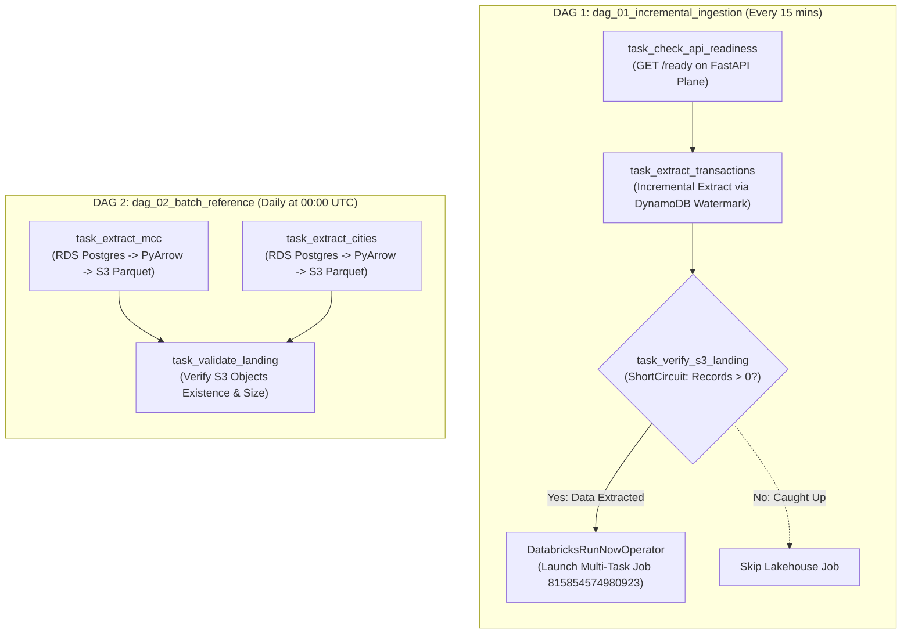

# دليل المعمارية الشامل لمنظومة استيعاب البيانات (SIC Ingestion Pipeline: From A to Z)
## الدليل المرجعي الكامل من المصدر حتى بحيرة البيانات وكشف الاحتيال الفوري
### وثيقة هندسية مرجعية شاملة (Production-Grade Master Engineering Runbook)

---

> [!NOTE]
> **طبيعة الوثيقة:** هذا الدليل هو المرجع الهندسي الشامل والنهائي لمنظومة استيعاب البيانات وتدفقها في منصة **Synthetic Financial Data Platform (SIC)**.
> **لغة الشرح:** العامية المصرية الهندسية الاحترافية والواضحة مع تثبيت كافة المصطلحات التقنية، أسماء الخدمات السحابية على AWS، وأسماء الفئات (Classes) والمتغيرات الإنجليزية كما هي في الكود المصدري.
> **الهدف:** توثيق كل صغيرة وكبيرة في مسارات تدفق البيانات (Real-Time Streaming, CDC, Batch, ML Inference, Orchestration) بحيث يستطيع أي مهندس بيانات أو مهندس معمارية استيعاب المنظومة بالكامل وتشغيلها ومناقشتها في مقابلات الـ System Design.

---

## فهرس المحتويات (Table of Contents)
1. [المفهوم العام والمعمارية الكلية (System Overview & The 4 Ingestion Paths)](#1-المفهوم-العام-والمعمارية-الكلية)
2. [مولد المعاملات والـ API التشغيلي (Generator Service & FastAPI Plane)](#2-مولد-المعاملات-والـ-api-التشغيلي)
3. [قاعدة البيانات التشغيلية وتقنية الـ CDC عبر Debezium](#3-قاعدة-البيانات-التشغيلية-وتقنية-الـ-cdc-عبر-debezium)
4. [القلب النابض: Apache Kafka و Amazon MSK](#4-القلب-النابض-apache-kafka-و-amazon-msk)
5. [بحيرة البيانات: Amazon S3 Bronze Lakehouse](#5-بحيرة-البيانات-amazon-s3-bronze-lakehouse)
6. [نظام كشف الاحتيال الفوري والـ Online Feature Store](#6-نظام-كشف-الاحتيال-الفوري-والـ-online-feature-store)
7. [جدولة وإدارة المنظومة: Airflow و EventBridge و Databricks](#7-جدولة-وإدارة-المنظومة-airflow-و-eventbridge-و-databricks)
8. [دليل التشغيل، المراقبة، والـ Dead Letter Queue (DLQ)](#8-دليل-التشغيل-المراقبة-والـ-dead-letter-queue)

---

# 1. المفهوم العام والمعمارية الكلية

### 1.1 المشكلة البنكية والحل الهندسي
في المعاملات المالية الحقيقية (FinTech & Modern Banking)، البيانات مش نوع واحد ومش بتتحرك بنفس السرعة:
1. **معاملات بطاقات الدفع (Transactions):** دي High-Velocity Streams بتتدفق بالآلاف كل ثانية من الـ POS Gateways والإنترنت. ماينفعش تتكتب في قاعدة بيانات علائقية أولاً، لأن الـ RDBMS هيقع تحت ضغط الـ Disk I/O والـ Locks (Write Contention).
2. **بيانات الحسابات والعملاء (Demographics & Cards):** دي بتعيش في OLTP Database تقليدية (PostgreSQL). التغييرات عليها مش بنفس سرعة المعاملات، لكن لما عميل جديد يفتح حساب أو كارت يتجدد، لازم النظام اللحظي يعرف ده فوراً وبدون ما نعمل Queries ترهق الـ Database.
3. **البيانات المرجعية الثابتة (Reference Data):** زي أكواد تصنيف المتاجر (`MCC`) والمدن (`Cities`)؛ دي داتا شبه مستقرة بتتغير كل فترة متباعدة ومحتاجة استخراج يومي كامل (Daily Snapshot).
4. **كشف الاحتيال الذكي (Real-Time ML Scoring):** المعاملة المشبوهة لازم تتلقط في أقل من **10 ميلي ثانية** قبل أو أثناء معالجة الدفع، مع تحديث سلوك العميل فورياً.

علشان نحل التحديات دي مع بعض، بنينا معمارية سحابية مقسمة لـ **4 مسارات متوازية ومستقلة (4 Decoupled Paths)** بتلتقي كلها في بحيرة بيانات مركزية على **Amazon S3 (Bronze Layer)**:

```mermaid
flowchart TD
    %% Global Styling
    classDef path1 fill:#0b1120,stroke:#0ea5e9,stroke-width:2px,color:#f8fafc;
    classDef path2 fill:#0f172a,stroke:#a855f7,stroke-width:2px,color:#f8fafc;
    classDef path3 fill:#064e3b,stroke:#10b981,stroke-width:2px,color:#f8fafc;
    classDef path4 fill:#2a0812,stroke:#f43f5e,stroke-width:2px,color:#f8fafc;
    classDef s3box fill:#1c1917,stroke:#f59e0b,stroke-width:2px,color:#f8fafc;

    %% Subgraph 1: Path 1
    subgraph P1 ["⚡ المسار الأول: البث الحي للمعاملات (Real-Time Transactions Streaming - 10 TPS)"]
        G1["<b>Generator Service</b><br/><i>ECS Fargate (0.5 vCPU)</i><br/><code>Zero DB Inserts</code>"]
        M1["<b>Amazon MSK (Kafka)</b><br/><code>topic: transactions</code><br/><i>Key: user_id (3 Partitions)</i>"]
        S1["<b>Aiven S3 Sink Connector</b><br/><i>Kafka Connect Task 0</i><br/><code>Flush: 50 recs / 5s</code>"]
        G1 -->|Direct TCP / 9092| M1
        M1 -->|Consume Stream| S1
    end
    class P1 path1;

    %% Subgraph 2: Path 2
    subgraph P2 ["👤 المسار الثاني: التقاط تعديلات الكيانات (Relational Entity CDC - Debezium)"]
        U2["<b>User / Card Generator</b><br/><i>ECS Fargate</i><br/><code>10% Dynamic Ratio</code>"]
        D2[("<b>PostgreSQL 18 RDS</b><br/><code>containerdb</code><br/><i>wal_level=logical</i>")]
        C2["<b>Debezium Source Connector</b><br/><i>Kafka Connect</i><br/><code>slot: debezium_cdc_slot</code>"]
        M2["<b>Amazon MSK (Kafka)</b><br/><code>topics: users, cards</code><br/><i>3 Partitions each</i>"]
        S2["<b>Aiven S3 Sink Connector</b><br/><i>Kafka Connect</i>"]
        U2 -->|SQL INSERT| D2
        D2 -->|WAL Logical Decoding| C2
        C2 -->|Publish Change Events| M2
        M2 -->|Consume CDC| S2
    end
    class P2 path2;

    %% Subgraph 3: Path 3
    subgraph P3 ["⏰ المسار الثالث: الاستخراج الدفعي للبيانات المرجعية (Scheduled Batch Reference)"]
        E3["<b>EventBridge Rule / Airflow</b><br/><code>cron(0 2 * * ? *)</code><br/><i>Daily 02:00 UTC</i>"]
        B3["<b>Batch Extractor</b><br/><i>ECS Fargate / PyArrow</i><br/><code>mcc & cities</code>"]
        R3[("<b>PostgreSQL 18 RDS</b><br/><code>Reference Tables</code><br/><i>914 MCCs / 1,433 Cities</i>")]
        E3 -->|Trigger Batch Task| B3
        B3 -->|Read Snapshot| R3
    end
    class P3 path3;

    %% Subgraph 4: Path 4
    subgraph P4 ["🚨 المسار الرابع: كشف الاحتيال الفوري (Real-Time ML Fraud Inference & Redis)"]
        FC4["<b>Fraud Consumer</b><br/><i>ECS Fargate (:2)</i><br/><code>Consumer Group: fraud-scoring</code>"]
        RC4[("<b>ElastiCache for Redis</b><br/><code>cache.t4g.micro (TLS)</code><br/><i>8,346 Profiles + Sliding Windows</i>")]
        ML4["<b>LightGBM Classifier</b><br/><code>models/v2/fraud_lgbm_model</code><br/><i>34 Features | 0.5ms Inference</i>"]
        AL4["<b>Amazon MSK (Kafka)</b><br/><code>topic: fraud_alerts</code><br/><i>Sync Ack Offset Guard</i>"]
        M1 -.->|Parallel Consume| FC4
        FC4 <-->|Hydrate & State Update| RC4
        FC4 -->|Feature Vector (34-dim)| ML4
        ML4 -->|Risk Decision| FC4
        FC4 -->|High-Risk Alert| AL4
    end
    class P4 path4;

    %% Destination S3
    subgraph S3_DEST ["🪣 المصب النهائي: بحيرة البيانات على Amazon S3 Bronze (sic-pipeline-storage)"]
        B_TX[("<b>bronze/transactions/</b><br/><code>partition={P}/{offset}.json.gz</code>")]
        B_ENT[("<b>bronze/{users,cards}/</b><br/><code>partition={P}/{offset}.json.gz</code>")]
        B_REF[("<b>bronze/{mcc,cities}/</b><br/><code>year={YYYY}/month={MM}/*.parquet</code>")]
    end
    class S3_DEST s3box;

    S1 ==>|Compressed JSONL| B_TX
    S2 ==>|Debezium JSONL| B_ENT
    B3 ==>|Snappy Parquet| B_REF
```

### 1.2 جدول مقارنة المسارات الأربعة (Matrix Summary)

| خاصية المقارنة | المسار 1: المعاملات الحية | المسار 2: الـ CDC للكيانات | المسار 3: البيانات المرجعية | المسار 4: كشف الاحتيال الفوري |
| :--- | :--- | :--- | :--- | :--- |
| **المصدر الأصلي (Source)** | `GeneratorService` (الذاكرة) | `PostgreSQL RDS (users, cards)` | `PostgreSQL RDS (mcc, cities)` | Kafka Topic `transactions` |
| **بروتوكول النقل** | TCP Direct Kafka (Port 9092) | PostgreSQL Logical WAL Decoding | SQLAlchemy + JDBC / PyArrow | Kafka Consumer Stream |
| **آلية النقل (Engine)** | `confluent-kafka` Producer | Debezium Source Connector | `BatchReferenceExtractor` | `FraudStreamingConsumer` |
| **المستقر الوسيط** | Amazon MSK (`transactions`) | Amazon MSK (`users`, `cards`) | ذاكرة Fargate (RAM) | ElastiCache Redis + LightGBM |
| **المصب النهائي (Sink)** | S3 Bronze (`JSONL.GZ`) | S3 Bronze (`JSONL.GZ`) | S3 Bronze (`Snappy Parquet`) | Amazon MSK (`fraud_alerts`) |
| **زمن التأخير (Latency)** | أقل من 5 ثوانٍ للـ S3 | أقل من ثانيتين من لحظة الـ Commit | يومياً (Daily Batch Snapshot) | **6 - 8 ميلي ثانية** إجمالاً |
| **التحكم بالجدولة** | مستمر (10 TPS Continuous) | مستمر حسب التعديلات (Event-Driven) | EventBridge / Airflow DAG 2 | مستمر (Sub-millisecond Streaming) |

---

# 2. مولد المعاملات والـ API التشغيلي

### 2.1 ميكانيزم التوليد ومبدأ الـ Zero-DB-Inserts
المولد مبني بلغة بايثون داخل الحزمة `synthetic_streaming.generator_service`.
* **مبدأ الـ Zero-DB-Inserts:** لو بصيت على كود توليد المعاملات، هتلاقي إن المعاملات الحية **مبتعملش نهائياً أي SQL INSERT جوه PostgreSQL!** 
* **ليه القرار ده؟** لأن تشغيل 10 إلى 100 معاملة في الثانية على قاعدة بيانات بنكية بيعمل Lock على جداول الـ Transactions ويستهلك مساحة التخزين والـ CPU في كتابات ملهاش قيمة تحليلية فورية. الصح هندسياً إن المعاملة تتبعت فوراً كـ Streaming Event لـ Kafka، والـ Sink هو اللي يتولى تخزينها في الـ Lakehouse.

```text
  ┌────────────────────────────────────────────────────────┐
  │         Generator Background Worker Engine             │
  │                                                        │
  │  [RateController (10 TPS Token Bucket)]               │
  │                    │                                   │
  │                    ▼                                   │
  │  [ScenarioEngine: 8 Probabilistic Financial Outcomes]  │
  │                    │                                   │
  │                    ▼                                   │
  │  [SourceSimulator: 6 Channel Weights (POS, Web, ...)]  │
  │                    │                                   │
  │                    ▼                                   │
  │  [RelationshipValidator: Referential Checks in RAM]   │
  │                    │                                   │
  │                    ▼                                   │
  │  [KafkaPublisher: Acks=All, Idempotent, TCP 9092]      │
  │                    │                                   │
  └────────────────────┼───────────────────────────────────┘
                       ▼
            Direct to Amazon MSK
```

### 2.2 السيناريوهات الـ 8 المُولّدة بالتفصيل (`scenario_engine.py`)
محرك السيناريوهات لا يعتمد على أرقام عشوائية مصمتة، بل يطبق توزيعات احتمالية بنكية حقيقية:

1. **الإنفاق الطبيعي (`normal_spend` - 85%):**
   * **المبلغ:** عشوائي بين 2.50$ و 250.00$.
   * **الخصائص:** بدون أي أخطاء (`errors: null`)، ومعلم كـ `is_fraud: "No"`.
2. **المعاملات المرفوضة بأخطاء تشغيلية (`declined_error` - 4%):**
   * **المبلغ:** 10.00$ إلى 500.00$.
   * **الأخطاء المُحاكاة:**
     * رصيد غير كافي (`Insufficient Balance` - 55%).
     * رقم سري خاطئ (`Bad PIN` - 15%).
     * عطل فني في ماكينة الدفع (`Technical Glitch` - 12%).
     * رقم كارت خاطئ (`Bad Card Number` - 8%).
     * تاريخ انتهاء أو كود أمان غير صحيح (`Bad Expiration`, `Bad CVV` - 8%).
3. **المعاملات ذات القيمة المرتفعة (`high_value` - 3%):**
   * **المبلغ:** من 1,000.00$ حتى 15,000.00$ لاختبار حسابات الحدود الائتمانية والـ Outliers.
4. **المواقع غير المعتادة (`unusual_location` - 3%):**
   * **الخصائص:** بيتم عمل Override لمدينة التاجر لتكون `Online / International` مع تصفير الـ State والـ Zipcode لاختبار سرعة انتقال المعاملة جغرافياً (Velocity Check).
5. **عمليات الاسترداد والارتجاع (`refund_return` - 3%):**
   * **المبلغ:** مبالغ سالبة من 5.00$- حتى 350.00$- لاختبار دعم الأرقام السالبة في أنظمة المعالجة السفلية.
6. **محاولات الدفع المتكررة السريعة (`repeated_attempt` - 1%):**
   * محاكاة محاولة دفع يعقبها فوراً خطأ `Bad PIN` لاختبار أنظمة رصد هجمات الـ Brute Force.
7. **المعاملات المتأخرة زمنياً (`late_event` - 0.8%):**
   * بيتم طرح offset زمني من 2 إلى 7 أيام في الماضي (`business_time_offset_seconds: 172800 to 604800`) لاختبار معالجة الـ Watermarking في أنظمة البث (Streaming Late Data).
8. **المعاملات الاحتيالية الصريحة (`fraud_labelled` - 0.2%):**
   * **المبلغ:** مبالغ ضخمة من 350.00$ إلى 4,500.00$ مع وضع علامة `is_fraud: "Yes"`.
9. **حقن أخطاء جودة البيانات (`invalid_test_record`):**
   * ميزة يتم تفعيلها بـ Flag اختياري لحقن مبالغ شاذة مثل `-999999.99$` مع `MCC: -1` لاختبار توجيه البيانات لـ Dead Letter Queue (DLQ).

### 2.3 قنوات الدفع (Source Systems)
لكل معاملة يتم توليد مصدر معتمد بأوزان واقعية:
* **نقطة بيع فعلية (`pos_terminal` - 50%):** معاملات المتاجر والمطاعم باستخدام الـ Chip أو الـ Swipe.
* **بوابة دفع إلكترونية (`ecommerce_gateway` - 30%):** معاملات الشراء عبر الإنترنت (Card-Not-Present).
* **محافظ رقمية (`digital_wallet` - 10%):** Apple Pay / Google Wallet.
* **شبكة الصراف الآلي (`atm_network` - 5%):** سحب نقدي مباشر.
* **معالج البطاقات والفوترة الدورية (`issuer_processor` - 3% و `recurring_billing` - 2%):** اشتراكات شهرية ودفع فواتير.

### 2.4 نقاط الـ REST API التشغيلية (`api.py`)
الـ API مبني بواسطة FastAPI ويعمل على المنفذ `8000`:
* `GET /health`: فحص سلامة الكونتينر (Liveness Probe).
* `GET /ready`: فحص جاهزية الاتصال بقاعدة البيانات وكافكا (Readiness Probe).
* `GET /api/v1/generator/status`: عرض حالة المولد (يعمل/متوقف، معدل الـ TPS، إجمالي المعاملات المولدة).
* `POST /api/v1/generator/start` و `POST /api/v1/generator/stop`: تشغيل وإيقاف الـ Background Worker لحظياً.
* `PATCH /api/v1/generator/config`: تعديل سرعة الـ TPS أو نسبة توليد المستخدمين الجدد Dynamic Runtime.
* `GET /api/v1/transactions`: سحب تزايدي للمدفوعات باستخدام Keyset Pagination (`after_id=X&limit=N`).

---

# 3. قاعدة البيانات التشغيلية وتقنية الـ CDC عبر Debezium

### 3.1 بنية قاعدة بيانات PostgreSQL 18 على RDS
تستضيف قاعدة بيانات `containerdb` خمسة جداول أساسية:

```text
                  ┌──────────────────────────────────────────────┐
                  │                 public.users                 │
                  ├──────────────────────────────────────────────┤
                  │ PK: user_id (BigInt)                         │
                  │ person, current_age, retirement_age          │
                  │ birth_year, birth_month, gender              │
                  │ address, city, state, zipcode                │
                  │ latitude, longitude                          │
                  │ per_capita_income, yearly_income, total_debt │
                  │ fico_score, num_credit_cards                 │
                  │ created_at (TimestampTZ)                     │
                  └──────────────────────┬───────────────────────┘
                                         │ 1
                                         │
                                         │ N (Foreign Key CASCADE)
                                         ▼
                  ┌──────────────────────────────────────────────┐
                  │                 public.cards                 │
                  ├──────────────────────────────────────────────┤
                  │ PK: (user_id, card_index)                    │
                  │ card_brand, card_type, card_number           │
                  │ expires, cvv, has_chip, cards_issued         │
                  │ credit_limit, acct_open_date                 │
                  │ year_pin_last_changed, card_on_dark_web      │
                  │ created_at (TimestampTZ)                     │
                  └──────────────────────────────────────────────┘

  ┌─────────────────────────────────┐       ┌─────────────────────────────────┐
  │  public.merchant_category_codes │       │      public.city_reference      │
  ├─────────────────────────────────┤       ├─────────────────────────────────┤
  │ PK: mcc (String)                │       │ PK: city_id (BigInt Autoincrem) │
  │ description                     │       │ city_name, state_code           │
  │ valid_payment_brands            │       │ latitude, longitude             │
  │ category                        │       │ coordinate_source, precision    │
  └─────────────────────────────────┘       └─────────────────────────────────┘
```

### 3.2 إعدادات الـ Logical Replication في PostgreSQL
لتمكين تقنية الـ Change Data Capture، تم ضبط إعدادات الـ Parameter Group الخاص بـ RDS كالتالي:
* `rds.logical_replication = 1`: لتفعيل فك تشفير الـ WAL (Write-Ahead Log Decoding).
* `wal_level = logical`: لتضمين تفاصيل البيانات القديمة والجديدة في الـ WAL.
* **إنشاء الـ Publication:**
  ```sql
  CREATE PUBLICATION debezium_publication FOR TABLE public.users, public.cards;
  ```
* **حجز الـ Replication Slot:**
  يتم حجز Slot باسم `debezium_cdc_slot` باستخدام الـ Plugin الافتراضي `pgoutput`. يضمن هذا الـ Slot احتفاظ المحرك بسجلات الـ WAL حتى يتأكد Debezium من قراءتها ومعالجتها بدون فقدان أي رسالة (Zero Data Loss).

### 3.3 معمارية كونتينر Debezium على AWS ECS Fargate
نظراً لأننا نستخدم بيئة Serverless على ECS Fargate بدون الحاجة لإنشاء Docker Image مخصصة وضخمة، تم تطبيق نمط **Multi-Container Pod Pattern** المكون من 3 أجزاء تعمل داخل نفس الـ Task:

```mermaid
graph LR
    subgraph ECS_Fargate_Task ["ECS Fargate Task: sic-kafka-connect:4"]
        Vol["Shared Volume: /kafka-custom-plugins (emptyDir)"]
        Init["Init Container: plugin-installer\n(Downloads Debezium 2.5.4 & Aiven S3 Sink from S3)"]
        App["Main Service: kafka-connect\n(confluentinc/cp-kafka-connect:7.6.0)\nCONNECT_PLUGIN_PATH=/kafka-custom-plugins"]
        Sidecar["Sidecar: connector-registrar\n(Polls 8083 until healthy -> registers connectors via REST API)"]

        Init -->|1. Extract Plugins & chmod 777| Vol
        Vol -->|2. Mount Shared Plugins| App
        App -->|3. Expose Port 8083| Sidecar
        Sidecar -->|4. PUT /connectors/{name}/config| App
    end
```

1. **`plugin-installer` (Init Container):** يحمّل إضافات Debezium PostgreSQL Connector v2.5.4 و Aiven S3 Sink Connector v2.15.0 من S3 ويفك ضغطها في الـ Volume المشترك قبل تشغيل الخدمة الرئيسية.
2. **`kafka-connect` (Service Container):** يشغل الـ Distributed Kafka Connect Runtime المربوط بـ Amazon MSK.
3. **`connector-registrar` (Sidecar Container):** ينتظر جاهزية المنفذ `8083` ثم يسجل الموصلات تلقائياً عبر REST API بطريقة Idempotent.

---

# 4. القلب النابض: Apache Kafka و Amazon MSK

### 4.1 تفصيل المواضيع الخمسة (The 5 Kafka Topics)

```text
  ┌─────────────────────────────────────────────────────────────────────────────────┐
  │                           AMAZON MSK BROKER CLUSTER                             │
  │                                                                                 │
  │  [Topic: transactions]  ─── 3 Partitions ─── Key: user_id                       │
  │  [Topic: users]         ─── 3 Partitions ─── Key: user_id (Debezium CDC)        │
  │  [Topic: cards]         ─── 3 Partitions ─── Key: user_id (Debezium CDC)        │
  │  [Topic: fraud_alerts]  ─── 1 Partition  ─── Key: transaction_id (ML Alerts)   │
  │  [Topic: transaction_dlq] ── 1 Partition ─── Key: event_id (Quarantined)       │
  └─────────────────────────────────────────────────────────────────────────────────┘
```

1. **موضوع المعاملات (`transactions`):**
   * **المُنتج (Producer):** `GeneratorService` عبر المنفذ `9092`.
   * **عدد الـ Partitions:** 3 بارتشنز موزعة عبر الـ Brokers.
   * **مفتاح التوزيع (Partitioning Key):** `user_id` بصيغة String.
   * **السبب الهندسي:** نضمن أن جميع معاملات نفس المستخدم تهبط دائماً على نفس الـ Partition بالترتيب الزمني الصارم (FIFO Per User)، مما يتيح حساب الـ Rolling Window وسرعة انتقال العميل في الـ ML بدون Race Conditions.
   * **المستهلكون (Consumers):**
     * `AivenKafkaConnectS3SinkConnector` (Consumer Group: `connect-aiven-s3-sink`).
     * `FraudStreamingConsumer` (Consumer Group: `fraud-scoring-group`).
2. **موضوع المستخدمين (`users`):**
   * **المُنتج:** Debezium CDC Connector.
   * **المحتوى:** لقطات التعديل الكاملة للمستخدمين الجدد مع الـ Before / After Schema.
   * **المستهلك:** Aiven S3 Sink Connector.
3. **موضوع البطاقات (`cards`):**
   * **المُنتج:** Debezium CDC Connector.
   * **المحتوى:** بيانات الكروت المربوطة بالحسابات.
   * **المستهلك:** Aiven S3 Sink Connector.
4. **موضوع تنبيهات الاحتيال (`fraud_alerts`):**
   * **المُنتج:** `FraudStreamingConsumer` (يتم الإرسال فورياً إذا تجاوز احتمال الاحتيال عتبة الـ Optimal Threshold).
   * **المحتوى:** تفاصيل المعاملة، درجة الخطورة (Probability)، وأسباب القرار (Explainability Reasons).
5. **موضوع المعاملات المعزولة (`transaction_dlq`):**
   * **المحتوى:** المعاملات التي بها تشوه هيكلي أو فشل في التحقق من صحة العلاقات الحسابية بعد استنفاد محاولات إعادة الإرسال.

### 4.2 معايير موثوقية النشر (Producer Reliability Invariants)
تم ضبط الـ Producer داخل `kafka_publisher.py` بأعلى درجات الأمان لمنع فقدان أي معاملة:
* `acks = "all"`: لا يتم اعتبار المعاملة ناجحة إلا بعد تأكيد كتابتها في جميع الـ Replicas النشطة.
* `enable_idempotence = True`: يمنع تكرار الرسائل نهائياً في حالة حدوث Network Glitch وإعادة الإرسال.
* `max_in_flight = 5`: المحافظة على الترتيب الصارم مع استغلال الـ Pipelining.
* `retries = 5` و `retry_backoff_ms = 100`: إعادة المحاولة التلقائية مع تراجع زمني مدروس.
* `shutdown_flush_timeout_sec = 10.0`: تفريغ الذاكرة المؤقتة بالكامل قبل إيقاف أي خدمة.

---

# 5. بحيرة البيانات: Amazon S3 Bronze Lakehouse

### 5.1 إعدادات موصل التخزين (Aiven S3 Sink Connector)
يقوم الموصل بسحب الأحداث من كافكا وكتابتها في S3 تحت الباكت `s3://sic-pipeline-storage/` بالإعدادات التالية:
* **تنسيق الإخراج:** `format.output.type = "jsonl"`
* **الضغط:** `file.compression.type = "gzip"`
* **معدل التفريغ (Flush Thresholds):**
  * بالعدد: `flush.size = 50` (يتم تفريغ الملف عند تجميع 50 سجلاً).
  * بالزمن: `rotate.schedule.interval.ms = 5000` (أو كل 5 ثوانٍ، أيهما أقرب).
* **نمط التسمية والتقسيم:**
  `file.name.template = "bronze/{{topic}}/partition={{partition}}/{{start_offset:padding=true}}.json.gz"`

### 5.2 الشجرة الهيكلية الكاملة لمجلدات S3 Bronze

```text
s3://sic-pipeline-storage/
│
├── bronze/
│   ├── transactions/
│   │   ├── partition=0/
│   │   │   ├── 00000000000000000000.json.gz
│   │   │   └── 00000000000000000050.json.gz
│   │   ├── partition=1/
│   │   │   └── 00000000000000000000.json.gz
│   │   └── partition=2/
│   │       └── 00000000000000000000.json.gz
│   │
│   ├── users/
│   │   ├── partition=0/
│   │   │   └── 00000000000000000000.json.gz
│   │   └── ...
│   │
│   ├── cards/
│   │   ├── partition=0/
│   │   │   └── 00000000000000000000.json.gz
│   │   └── ...
│   │
│   ├── mcc/
│   │   └── year=2026/
│   │       └── month=10/
│   │           └── mcc_20261029T020000Z.snappy.parquet
│   │
│   └── cities/
│       └── year=2026/
│           └── month=10/
│               └── cities_20261029T020000Z.snappy.parquet
│
├── data/
│   └── (Baseline historical CSV files for cold start)
│
└── quarantine/
    └── (Dead Letter Queue raw event payloads)
```

### 5.3 مقارنة صيغ التخزين في طبقة Bronze
* **JSONL مضغوط بـ Gzip (`.json.gz`):** للمسارين الأول والثاني (المعاملات و CDC). يتيح سرعة كتابة خيالية بدون حمل تحويل الأعمدة في الذاكرة (Schema-on-read)، مع ضغط ممتاز يقلل استهلاك التخزين بنسبة تزيد عن 80%.
* **Snappy Parquet (`.parquet`):** للمسار الثالث (البيانات المرجعية). نظراً لأن الجداول المرجعية تستخدم كـ Dimension Tables في عمليات الـ JOIN مع المعاملات، فإن حفظها بصيغة Parquet العمودية ذات الضغط السريع يتيح لمحركات Spark و Databricks قراءتها بكفاءة فائقة (Column Pruning & Predicate Pushdown).

---

# 6. نظام كشف الاحتيال الفوري والـ Online Feature Store

### 6.1 معمارية متجر الخصائص اللحظي (AWS ElastiCache for Redis)
لكي يتمكن موديل الـ Machine Learning من تقييم المعاملة في أجزاء من الثانية، يحتاج لمعرفة تاريخ العميل: *هل أجرى 5 معاملات في آخر 10 دقائق؟ هل المسافة بين المعاملة الحالية ومنزله 5,000 كم؟*
* **الخدمة:** AWS ElastiCache for Redis (`cache.t4g.micro`, Redis 7.1).
* **الأمان:** مشفر بالكامل أثناء النقل عبر TLS (`rediss://`) ومعزول داخل شبكة الـ VPC، ومحمي برمز المرور (AUTH Token) وتشفير البيانات الساكنة عبر AWS KMS.
* **البيانات المحملة:** يحتوي على **8,346 بروفايل** للمستخدمين والكروت.
* **سرعات الاستجابة (Latency Benchmarks):**
  * قراءة بروفايل وسجل المستخدم: **1.11 ميلي ثانية**.
  * تحديث النوافذ الزمنية بعد المعاملة: **1.94 ميلي ثانية**.

### 6.2 الخصائص الـ 34 وحساب النوافذ المتحركة (`feature_engineering.py`)
يقوم `FeatureExtractor` ببناء متجه رياضي مكون من 34 بُعداً بدقة متناهية:
1. **خصائص مالية:** المبلغ، لوغاريتم المبلغ (`log_amount`)، نسبة الانحراف عن متوسط إنفاق العميل (`spend_deviation_ratio`)، نسبة استهلاك الحد الائتماني (`credit_limit_utilization`)، ودرجة الـ Z-Score.
2. **خصائص ديموغرافية وحسابية:** عمر العميل، الـ FICO Score، الدخل السنوي، إجمالي الديون، عدد البطاقات، عمر البطاقة، وعدد السنوات منذ آخر تغيير للرقم السري.
3. **خصائص جغرافية وسرعة انتقال (Velocity Features):**
   * حساب مسافة الدائرة العظمى (Haversine Distance) بين موقع التاجر ومنزل العميل بالكيلومتر (`distance_to_home_km`).
   * الوقت المنقضي منذ آخر معاملة بالثواني.
   * سرعة الانتقال المحسوبة بالكيلومتر/ساعة (`travel_speed_kmh`). لو السرعة تجاوزت 900 كم/ساعة، تصبح المعاملة شديدة الشبهة هندسياً!
4. **نوافذ التكرار المتحركة (Sliding Windows):**
   * عدد المعاملات في آخر ساعة (`tx_count_last_1h`).
   * عدد المعاملات في آخر 24 ساعة (`tx_count_last_24h`).
   * إجمالي المبالغ المنفقة في آخر ساعة (`spend_sum_last_1h`).
5. **خصائص زمنية ومشفرة:** معاملة ليلية (`is_night_tx`)، التمثيل الدائري للساعة (`sin_hour`, `cos_hour`)، وجود شريحة ذكية، وجود الكارت على الدارك ويب (`card_on_dark_web`)، وأكواد الـ MCC عالية المخاطر.

```text
  ┌───────────────────────────────────────────────────────────────┐
  │         Real-Time Fraud Consumer Processing Loop              │
  │                                                               │
  │  1. Receive Record from MSK ('transactions' topic)            │
  │                           │                                   │
  │                           ▼                                   │
  │  2. Hydrate Profile & State from Redis (1.11ms)               │
  │     (Fallback to In-Memory Cache if Redis is unavailable)     │
  │                           │                                   │
  │                           ▼                                   │
  │  3. Extract 34-dimensional Numerical Feature Vector           │
  │                           │                                   │
  │                           ▼                                   │
  │  4. LightGBM Model Scoring (0.5ms Inference)                  │
  │     - If Score >= Threshold: Emit to 'fraud_alerts'           │
  │                           │                                   │
  │                           ▼                                   │
  │  5. Update Sliding Windows in Redis (1.94ms, TTL 48h)         │
  │                           │                                   │
  │                           ▼                                   │
  │  6. SYNCHRONOUS KAFKA COMMIT (Offset Guard Protection)        │
  └───────────────────────────────────────────────────────────────┘
```

### 6.3 درع حفظ الإزاحات (Offset Commit Guard) والجاهزية ضد الأعطال
* **حماية الـ Offset:** لا يقوم الـ Consumer بعمل `commit()` لـ Kafka Offset إلا **بعد** اكتمال دورة الفحص وتأكيد تسليم أي تنبيه احتيالي إلى موضوع `fraud_alerts`. هذا النمط (At-Least-Once Delivery) يمنع ضياع أي تنبيه احتيالي إذا تعطل الكونتينر فجأة أثناء المعالجة.
* **المرونة الهندسية (Local In-Memory Fallback):** إذا تعرض اتصال Redis لأي انقطاع عابر في الشبكة، تتحول الفئة `StateStore` تلقائياً وبدون توقف إلى Cache محلي في الرام (In-Memory Fallback) لضمان استمرار تدفق البيانات دون توقف المنظومة.

---

# 7. جدولة وإدارة المنظومة: Airflow و EventBridge و Databricks

### 7.1 مسار EventBridge للبيانات المرجعية
* **القاعدة:** `scheduled-ingestion-extractor`
* **الجدول الزمني:** يومياً الساعة 02:00 UTC عبر التعبير `cron(0 2 * * ? *)`.
* **الهدف:** تشغيل مهمة ECS Fargate مستقلة لتنفيذ `BatchReferenceExtractor` وسحب جداول الـ MCC والمدن كلقطات جديدة إلى S3 Bronze.

### 7.2 الـ Airflow DAGs الشاملة



#### تفاصيل DAG 1: الاستخراج التزايدي وتغذية بحيرة البيانات
* **الملف:** `airflow/dags/dag_01_incremental_ingestion.py`
* **الجدول:** كل 15 دقيقة (`*/15 * * * *`).
* **خطوات التنفيذ:**
  1. `task_check_api_readiness`: يختبر Endpoint `/ready` على عنوان الخدمة السحابي. لو الخدمة غير جاهزة، تفشل المهمة فوراً مع إعادة المحاولة تلقائياً.
  2. `task_extract_transactions`: يشغل `TransactionExtractor`. يستخدم هذا الكلاس تقنية **DynamoDB Watermarking** لحفظ آخر معرف معاملة (`last_processed_id`). يسحب المعاملات الجديدة فقط بنظام Keyset Pagination ويكتب ملف Parquet في S3 Bronze.
  3. `task_verify_s3_landing`: يعمل كـ **ShortCircuitOperator**. لو الاستخراج لم يسفر عن أي معاملات جديدة (الكل مستخرج بالفعل)، يوقف باقي مسار الـ DAG لتوفير تكاليف الحوسبة السحابية.
  4. `trigger_databricks_pipeline`: يشغل Databricks Workflow Job رقم `815854574980923` لتحويل البيانات من Bronze إلى Silver و Gold وتطبيق قواعد الفحص والتحليل.

#### تفاصيل DAG 2: استخراج البيانات المرجعية اليومي
* **الملف:** `airflow/dags/dag_02_batch_reference.py`
* **الجدول:** يومياً في منتصف الليل UTC (`0 0 * * *`).
* **خطوات التنفيذ:**
  1. `task_extract_mcc`: يسحب جدول الـ MCC من RDS ويحوله لـ PyArrow Table ثم يرفعه كـ Snappy Parquet في `bronze/mcc/`.
  2. `task_extract_cities`: يسحب جدول المدن بإحداثياتها ويرفعه كـ Snappy Parquet في `bronze/cities/`.
  3. `task_validate_landing`: يتصل بـ S3 ويتأكد من وجود الملفات بأحجام غير صفرية ويسجل تقريراً رقمياً باكتمال العملية.

### 7.3 التكامل مع Databricks Lakehouse
في بيئة Databricks، تستخدم دفاتر الملاحظات (`databricks/stream/`) محرك **Databricks AutoLoader** (`cloudFiles`) لقراءة ملفات الـ JSONL المضغوطة الجديدة من `bronze/transactions/` فور هبوطها بدون الحاجة لعمل مسح كامل للباكت، ثم تطبق عمليات تنظيف البيانات وتصنيفها لنقلها إلى طبقتي **Silver** و **Gold Delta Tables**.

---

# 8. دليل التشغيل، المراقبة، والـ Dead Letter Queue

### 8.1 عزل البيانات الفاسدة (Dead Letter Queue Strategy)
لحماية الـ Downstream Consumers من الانهيار عند استقبال بيانات مشوهة:
* أي حدث يفشل في اختبارات الصحة الهيكلية (مثل وجود معرف مستخدم غير مسجل، أو كود MCC غير معروف، أو صيغة JSON فاسدة) يتم التقاطه فوراً بواسطة الـ Validator.
* يتم تحويل الحدث إلى موضوع `transaction_dlq` في كافكا مع إرفاق Metadata تصف سبب العزل وتوقيت الخطأ.
* يقوم الـ Extractor بحفظ السجلات المشبوهة تحت المجلد `quarantine/` على S3 للفحص اليدوي لاحقاً، مع عدم إيقاف خط الإنتاج الرئيسي.

### 8.2 أوامر الفحص والتشغيل العملي السريع (Operational Runbook)

#### 1. فحص جاهزية الـ API والمولد محلياً أو على السحابة:
```bash
curl -s http://localhost:8000/ready | jq .
curl -s http://localhost:8000/api/v1/generator/status | jq .
```

#### 2. تشغيل المولد بمعدل 25 معاملة في الثانية:
```bash
curl -X POST http://localhost:8000/api/v1/generator/start \
  -H "Content-Type: application/json" \
  -H "X-API-Key: production-secret-key"

curl -X PATCH http://localhost:8000/api/v1/generator/config \
  -H "Content-Type: application/json" \
  -H "X-API-Key: production-secret-key" \
  -d '{"target_tps": 25.0}'
```

#### 3. فحص حالة موصلات Kafka Connect و Debezium:
```bash
# استعراض الموصلات المسجلة
curl -s http://localhost:8083/connectors | jq .

# فحص حالة موصل Debezium CDC
curl -s http://localhost:8083/connectors/debezium-postgres-source/status | jq .

# فحص حالة موصل Aiven S3 Sink
curl -s http://localhost:8083/connectors/aiven-s3-sink/status | jq .
```

#### 4. فحص استهلاك الـ Fraud Consumer ومعدل الـ Latency:
```bash
python scripts/verify_realtime_scoring.py
```

#### 5. تشغيل اختبار الـ End-to-End لكامل الـ Pipeline:
```bash
python scripts/run_end_to_end_orchestration.py
```

---

### 8.3 أهم الأسئلة المعمارية في مقابلات مهندسي البيانات (System Design Trade-offs)

> **س 1: ليه اخترتم تفصلوا مسار الـ Transactions عن قاعدة بيانات PostgreSQL وتعتمدوا على Zero DB Inserts؟**  
> **ج:** لأن نمط الوصول للمعاملات هو Write-Heavy ذو وتيرة عالية ومستمرة. كتابة المعاملات في قاعدة بيانات علائقية كان هيسبب Bottleneck في أقراص التخزين ومنافسة على الـ Locks مع مسارات الاستعلام، بينما كافكا مصمم خصيصاً لاستقبال مئات الآلاف من الـ Append-Only Writes في الذاكرة وتوزيعها على الـ Partitions باستهلاك موارد ضئيل جداً.

> **س 2: إزاي بنضمن إن أحداث الـ CDC الخاصة بالمستخدمين الجدد متسبقش أو تتأخر عن معاملاتهم في الـ Streaming؟**  
> **ج:** كلا التدفقين يستخدمان نفس مفتاح التوزيع: `user_id`. وفي طبقة المستهلك أو عند التحويل في Databricks، يتم الاعتماد على الـ Event Timestamps وقواعد الـ Left-Join مع معالجة الـ Late-Arriving Dimensions، بالإضافة إلى أن متجر الخصائص اللحظي (Redis) يتم تحديثه لحظياً ببيانات المستخدم بمجرد إنشائه.

> **س 3: ما فائدة استخدام الـ Multi-Container Pod على ECS Fargate بدلاً من بناء Custom Docker Image لكافكا كونكت؟**  
> **ج:** فصل الـ Lifecycle للـ Plugins عن الـ Runtime. استخدام صورة رسمية معتمدة من Confluent مع Init Container يتيح لنا تحديث إصدارات الموصلات (Debezium و Aiven) بمجرد تعديل مسار الملف في S3 دون الحاجة لإعادة بناء (Rebuild) ودفع (Push) صور Docker ضخمة إلى ECR في كل مرة.

---
**تم إعداد هذا التوثيق ليكون المرجع الهندسي الأوفى لمنظومة SIC Ingestion Pipeline.**
