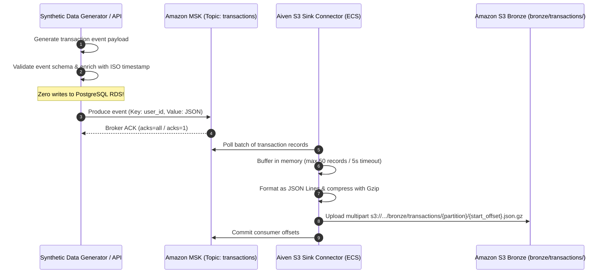
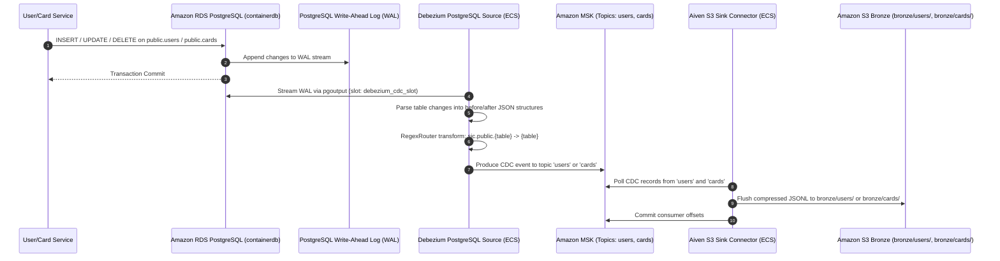
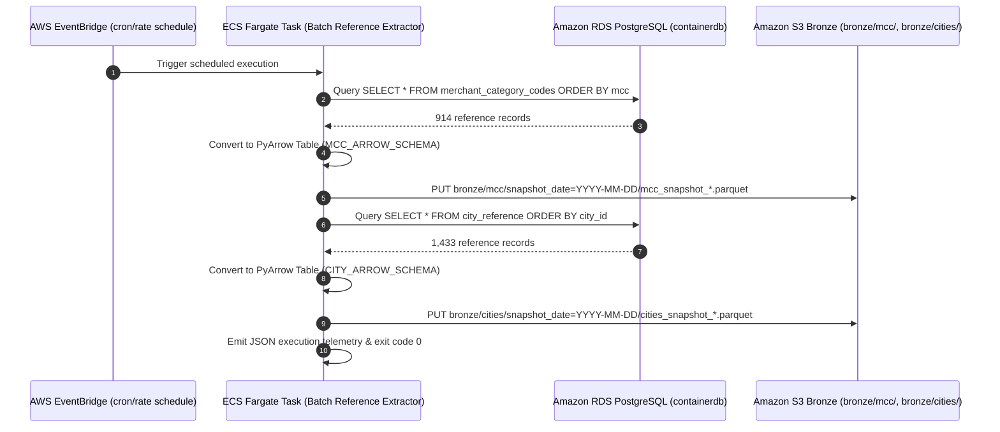

# Data Flow & Pipeline Specification
## SIC — Synthetic Financial Transaction Data Platform

**Document Version:** 1.0.0  
**Target Environment:** AWS `eu-west-3`  
**Classification:** Technical Data Pipeline Architecture  

---

## 1. Pipeline Overview

The SIC platform incorporates three distinct data flow pipelines into the Amazon S3 Bronze lakehouse layer:
1. **High-Throughput Streaming Pipeline:** Direct ingestion of synthetic transactions into Amazon MSK topic `transactions` and delivery into Amazon S3 Bronze.
2. **Change Data Capture (CDC) Pipeline:** Logical replication of operational entity state changes from Amazon RDS PostgreSQL (`users`, `cards`) into Amazon MSK and delivery into Amazon S3 Bronze.
3. **Scheduled Batch Ingestion Pipeline:** Periodic snapshot extraction of reference datasets (`merchant_category_codes`, `city_reference`) directly into Amazon S3 Bronze in columnar Parquet format.

---

## 2. Pipeline 1: Transaction Direct Streaming Flow



### 2.1. Payload Contract (Topic: `transactions`)
```json
{
  "schema_version": "1.0.0",
  "event_id": "f81d4fae-7dec-11d0-a765-00a0c91e6bf6",
  "event_type": "transaction.created",
  "timestamp": "2026-10-25T22:30:00.000Z",
  "producer": "sic.synthetic_streaming",
  "data": {
    "transaction_id": "tx-e2e-1792968099-001",
    "user_id": 888801,
    "card_id": 0,
    "amount": 27.25,
    "currency": "EUR",
    "merchant_name": "SIC Cloud Supermarket",
    "mcc": 5411,
    "transaction_type": "pos_terminal",
    "status": "APPROVED",
    "is_fraud": false,
    "zip": "75008"
  }
}
```

- **Partition Key:** `user_id` (guarantees strict in-order processing per user across the 3 partitions).
- **Compression:** Gzip in transit and S3 landing.
- **Delivery Guarantee:** At-least-once.

---

## 3. Pipeline 2: Entity Change Data Capture (CDC) Flow



### 3.1. CDC Message Contract (`users` and `cards`)
When Debezium captures an entity mutation, it publishes a structured change event:
```json
{
  "before": null,
  "after": {
    "user_id": 888801,
    "person": "LiveUser1",
    "current_age": 35,
    "retirement_age": 65,
    "birth_year": 1991,
    "birth_month": 5,
    "gender": "Female",
    "address": "100 Boulevard Haussmann",
    "apartment": "Apt 4B",
    "city": "Paris",
    "state": "IDF",
    "zipcode": 75008,
    "latitude": 48.8744,
    "longitude": 2.3328,
    "per_capita_income": "$48,000",
    "yearly_income": "$92,000",
    "total_debt": "$15,000",
    "fico_score": 760,
    "num_credit_cards": 1,
    "created_at": 1792968026000000
  },
  "source": {
    "version": "2.5.4.Final",
    "connector": "postgresql",
    "name": "sic",
    "ts_ms": 1792968026123,
    "db": "postgres",
    "schema": "public",
    "table": "users",
    "txId": 34105,
    "lsn": 6375620184
  },
  "op": "c",
  "ts_ms": 1792968026125
}
```

- **Operations Supported:** `c` (Create), `u` (Update), `d` (Delete), `r` (Snapshot Read).
- **Snapshot Behavior:** On initialization, Debezium performs a non-blocking initial snapshot of `public.users` (3,126+ rows) and `public.cards` (9,551+ rows), streaming historical records before switching to incremental WAL tailing.

---

## 4. Pipeline 3: Scheduled Batch Reference Ingestion Flow



### 4.1. Columnar Parquet Storage Contracts
- **Merchant Category Codes (`mcc`):**
  - Path: `bronze/mcc/snapshot_date=YYYY-MM-DD/mcc_snapshot_{YYYYMMDD_HHMMSS}.parquet`
  - Columns: `mcc` (String), `description` (String), `category` (String), `valid_payment_brands` (String), `required_abbreviation` (String), `extraction_timestamp` (ISO String), `source_system` (String).
  - Compression: Snappy.
- **City Reference (`cities`):**
  - Path: `bronze/cities/snapshot_date=YYYY-MM-DD/cities_snapshot_{YYYYMMDD_HHMMSS}.parquet`
  - Columns: `city_id` (Int64), `city_name` (String), `state_code` (String), `country_code` (String), `latitude` (Float64), `longitude` (Float64), `coordinate_source` (String), `coordinate_precision` (String), `extraction_timestamp` (ISO String), `source_system` (String).
  - Compression: Snappy.
