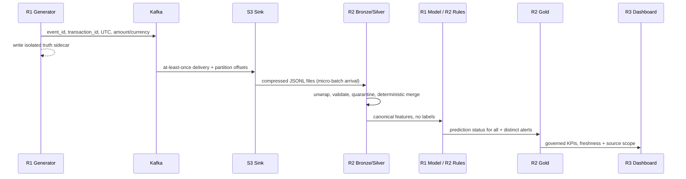

# Streaming event sequence

Direct Kafka online inference may have a lower latency path (R1 claimed), which is **not the same** as file-arrival micro-batch latency via S3. Neither end-to-end latency path is verified in this repo; benchmark separately with trace IDs, timestamps and actual logs.
