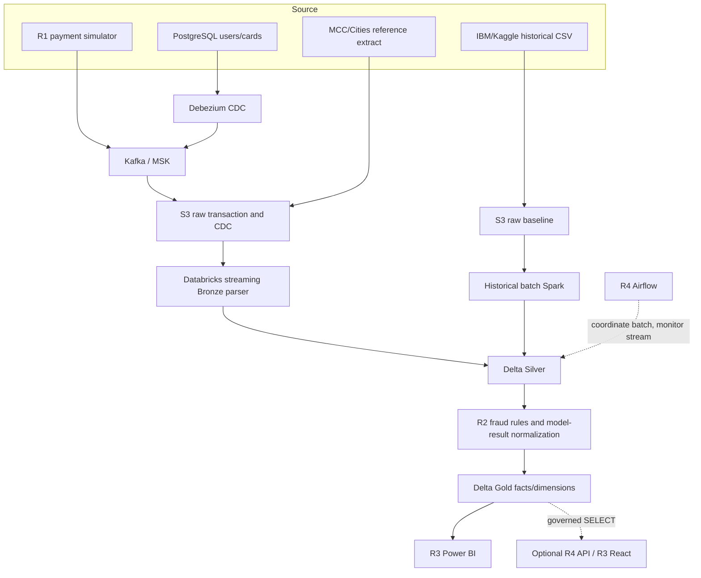

# High-level system architecture

**Verified vs designed:** The exact deployed R1 configuration is only team-reported, some S3 object prefixes were observed via read-only connected AWS inventory; actual R1 code unavailable here. The new local generator and SQLite data are *fixtures* and not replayable proof of MSK/Delta integration. Historical Gold publication is not verified. Airflow scheduling of perpetual streams must monitor health, not wait for process to finish.
