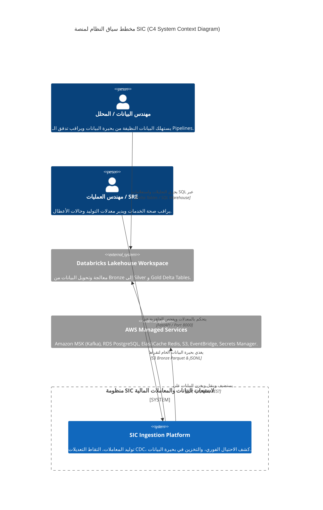
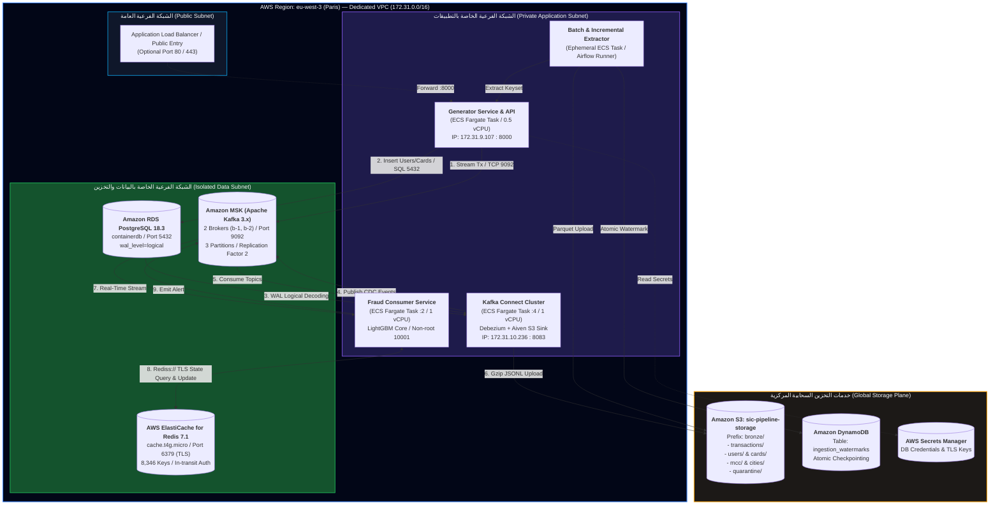
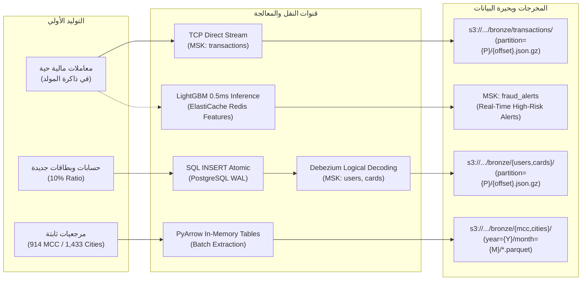
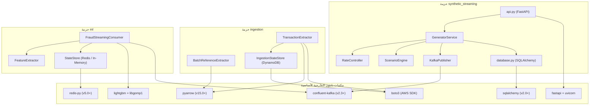
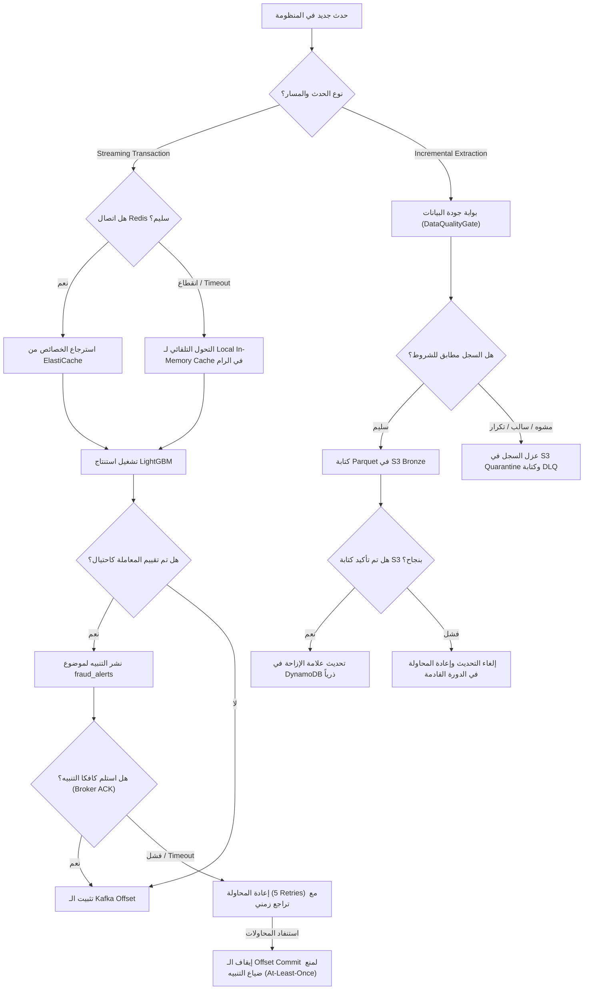

# المعمارية الكلية لمنظومة استيعاب البيانات (System Architecture)
## المعمارية السحابية الشاملة لمنصة SIC — مخططات C4 والشبكات وتدفق البيانات

---

> [!NOTE]
> **مسار الملف:** `docs/architecture/system-architecture.md`  
> **الهدف:** توثيق معمارية النظام الكلية وفق منهجية نماذج C4 (Context, Container, Component, Code)، مع تحديد حدود الشبكات، آليات الاتصال، مخازن البيانات، ومخططات تدفق ومعالجة الفشل.

---

## 1. سياق النظام والحدود الخارجية (System Context - C4 Level 1)

تتفاعل منصة **SIC** مع مستخدميها وأنظمتها الخارجية ضمن بيئة سحابية متكاملة على **Amazon Web Services (AWS)**:

---

## 2. معمارية الحاويات والخدمات (Containers Architecture - C4 Level 2)

يوضح المخطط التالي الحاويات والخدمات الأساسية والحدود الشبكية داخل شبكة الـ VPC:

---

## 3. مخطط تدفق البيانات الكامل (End-to-End Data Flow Diagram)

يوضح المخطط حركة كل صنف من البيانات عبر بروتوكولات النقل من الإنشاء وحتى الهبوط النهائي:

---

## 4. مخطط التبعيات البرمجية والتكامل (Component Dependencies Diagram)

يوضح المخطط كيف ترتبط الحزم البرمجية داخل `src/` ببعضها وبالمكتبات الخارجية:

---

## 5. مخطط معالجة الفشل والتعافي الذاتي (Failure Recovery Workflows)

تتبع المنصة استراتيجيات هندسية مرنة للتعامل مع أي عطل طارئ دون فقدان البيانات:

---

## 6. القرارات المعمارية الكبرى ومبرراتها (Architectural Decisions Summary)

1. **فصل المعاملات عن RDBMS (Zero-DB-Inserts):**
   * *المبرر:* منع اختناق قرص التخزين والتنافس على الـ Locks؛ استغلال سرعة كتابة كافكا التراكمية في الذاكرة (Append-Only Commit Log).
2. **استخدام `user_id` كمفتاح توزيع في كافكا (Partition Key):**
   * *المبرر:* ضمان وصول جميع معاملات نفس المستخدم لنفس الـ Partition بدقة زمنية متسلسلة (Strict FIFO)، مما يمنع تعارض حسابات النوافذ المتحركة (Sliding Windows) في كشف الاحتيال.
3. **نمط الـ Pod متعدد الحاويات لـ Kafka Connect على Fargate:**
   * *المبرر:* تجنب صيانة وتحديث Docker Images ضخمة مخصصة؛ استخدام Init Container لتحميل وتثبيت الـ Plugins في Volume مشترك عند الإقلاع.
4. **تخزين الـ Watermark في Amazon DynamoDB مع شروط ذرية:**
   * *المبرر:* ضمان عدم تراجع الـ Offset إلى الوراء عند تشغيل مهمتين متزامنتين، مما يضمن اتساق الاستخراج التزايدي بدون تكرار.
5. **درع الإزاحة (Offset Commit Guard) في مستهلك الاحتيال:**
   * *المبرر:* تقديم ضمانات تسليم صارمة (At-Least-Once) لتنبيهات الاحتيال، بحيث لو تعطل الكونتينر قبل إرسال التنبيه، تعاد قراءة المعاملة وتوليد التنبيه فور إعادة التشغيل.
