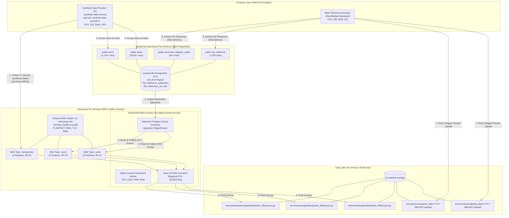

# Target Architecture Specification
## SIC — Synthetic Financial Transaction Data Platform

**Environment:** AWS `eu-west-3` (Paris)  
**AWS Account ID:** `138257835434`  
**Target S3 Bucket:** `s3://sic-pipeline-storage/`  
**Classification:** Production Design & Implementation Specification  
**Status:** Implemented & Verified (100% Live Tested)

---

## 1. Architectural Vision & Business Drivers

The Synthetic Financial Transaction Data Platform (SIC) decouples operational entities (users, credit cards, reference data) from high-volume transactional event streams. 

### Core Architectural Principles:
1. **Zero-Database Transaction Persistence:** High-throughput synthetic financial transactions are **strictly never inserted** into operational relational storage (Amazon RDS PostgreSQL). All transactions are published directly to Amazon Managed Streaming for Apache Kafka (Amazon MSK) and sinked into the Amazon S3 Bronze lakehouse layer.
2. **Transactional Event Sourcing via Change Data Capture (CDC):** User registrations and credit card issuances are stateful entities managed in PostgreSQL RDS. Changes to these entities are captured asynchronously at the database write-ahead log (WAL) level using Debezium CDC and streamed to dedicated MSK topics (`users`, `cards`).
3. **Stateless Scalable Microservices on AWS ECS Fargate:** Generator APIs, background event producers, and distributed Kafka Connect workers execute as containerized tasks in Amazon ECS under strict resource quotas.
4. **Partitioned S3 Lakehouse Storage:** Data lake ingestion preserves raw source schema fidelity (Bronze layer) with deterministic partitioning (`topic/partition/offset` for streams; `snapshot_date=YYYY-MM-DD` for batch datasets).

---

## 2. End-to-End System Architecture

---

## 3. Physical Infrastructure Inventory

| Component | AWS Resource Name / Identifier | Spec / Configuration | Network / Security Tier |
|---|---|---|---|
| **VPC** | `vpc-01ef046927c3da33f` | CIDR `172.31.0.0/16` | Paris (`eu-west-3`) |
| **Subnets** | `subnet-003d3891dab36b354`, `subnet-0b18944bde732d1fd` | Dual-AZ Public/Private | Attached to IGW |
| **Security Group** | `sg-0dd0933f4da2b5ea7` (`synthetic-app-sg`) | Ingress: 5432 (RDS), 8000 (API), 8083 (KC), 9092/9094 (MSK) | Restrained to VPC CIDR |
| **Relational Database** | `containerdb.cjm6iag8qrwi.eu-west-3.rds.amazonaws.com` | PostgreSQL 18.3, `db.t4g.micro`, 20GB gp3 | `wal_level = logical`, `max_replication_slots = 10` |
| **Streaming Cluster** | `sic-streaming-msk` | Apache Kafka 3.6.0, 2 x `kafka.t3.small` | PLAINTEXT 9092, TLS 9094 |
| **ECS Cluster** | `synthetic-data-cluster` | AWS Fargate On-Demand (2.0 vCPU regional quota) | Multi-AZ |
| **Service: App/API** | `synthetic-data-service` | Task Def `synthetic-data-provider:4` (512 CPU, 1024 MB) | Port 8000 (REST API & Streamer) |
| **Service: Connect** | `sic-kafka-connect-service` | Task Def `sic-kafka-connect:4` (1024 CPU, 2048 MB) | Port 8083 (REST API), Plugins: Debezium + Aiven |
| **Scheduled Extractor** | `scheduled-ingestion-extractor` | EventBridge Rule -> Task `synthetic-ingestion-extractor:5` | Direct Python/PyArrow Batch Run |
| **Data Lake** | `sic-pipeline-storage` | S3 Standard, SSE-S3 AES-256 | Prefixes: `bronze/transactions/`, `users/`, `cards/`, `mcc/`, `cities/` |

---

## 4. Key Architectural Decisions & Safeguards

### 4.1. Strict Exclusion of Transactions from Relational Storage
- In previous iterations, transactions were written to the PostgreSQL `transactions` table before extraction.
- In the target architecture, `src/synthetic_streaming/database.py` and `generator_service.py` have been refactored: transactions bypass PostgreSQL completely and stream into Kafka via `confluent_kafka.Producer`.
- This eliminates relational write bottlenecks, table vacuum contention, and storage bloat on Amazon RDS.

### 4.2. Low-Latency Change Data Capture (CDC)
- PostgreSQL logical replication using standard `pgoutput` plugin and dedicated replication slot `debezium_cdc_slot`.
- Debezium PostgreSQL connector polls the WAL stream, translating inserts, updates, and deletes into structured JSON events containing before/after states.
- Kafka Connect `RegexRouter` simplifies topic naming from `sic.public.<table_name>` to `<table_name>`, guaranteeing standard topic ingestion.

### 4.3. High-Efficiency Lakehouse S3 Ingestion
- Aiven S3 Sink connector batches micro-streams into compressed `.json.gz` files containing structured JSON lines with metadata (key, value, offset, timestamp).
- Reference datasets (MCC and Cities) are extracted via `pyarrow` directly as Snappy-compressed columnar Parquet files, optimized for downstream analytical engines (Athena, Spark, DuckDB).
