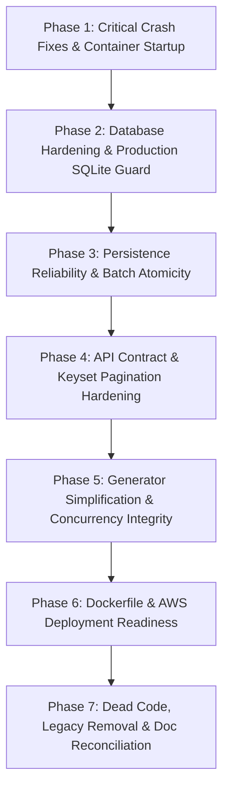
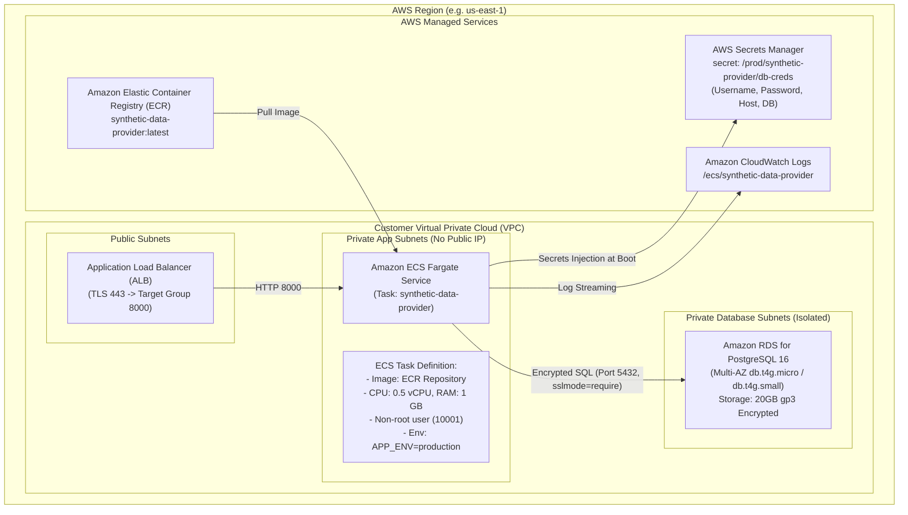

# Refactoring Plan: Synthetic Transaction Data Provider
**AWS-Ready Architecture & Production Hardening Roadmap**  
**Date:** October 25, 2026  
**Auditor Roles:** Senior Data Engineer, Python Backend Architect, DevOps Engineer, Code Quality Auditor  
**Workspace:** `/home/syd/Downloads/archive`  
**Status:** Plan Complete — Ready for Approval Gate

---

## 1. Executive Roadmap & Phasing Strategy

This refactoring plan provides an incremental, dependency-aware blueprint to transition the repository from its current state into the verified **Target Architecture**:
- Single minimal application container running the REST API and synthetic data provider.
- Separately managed PostgreSQL (Amazon RDS in production, Docker Compose in local development).
- Robust persistence, batch atomicity, and incremental watermark extraction (`since_id`).
- Zero legacy Kafka, distributed-worker, or Azure dependencies.
- Production-hardened security, secrets masking, and non-root execution.

The plan is strictly divided into **7 sequential phases**. Each task has explicit acceptance criteria, verification tests, risk ratings, and safety designations.

---

## 2. Detailed Task Breakdown

### Phase 1: Critical Correctness & Container Boot Fixes

#### Task 1.1: Fix Unconditional Kafka Import Crashing Container (FIND-CRIT-01)
- **Task ID:** `TASK-01`
- **Files Expected to Change:**
  - `src/synthetic_streaming/kafka_publisher.py`
  - `src/synthetic_streaming/generator_service.py`
  - `src/synthetic_streaming/api.py`
  - `scripts/run_generator.py`
- **Exact Implementation Objective:**
  Safely isolate or eliminate top-level `import confluent_kafka`. Wrap `confluent_kafka` in conditional try/except blocks so that when `confluent-kafka` is not installed (as in the minimal provider image), importing `kafka_publisher`, `generator_service`, or `api` succeeds transparently without error. Decouple `GeneratorService` so it does not require Kafka to start.
- **Acceptance Criteria:**
  - `docker run --rm test-build:latest python -c "import synthetic_streaming.api"` exits 0.
  - Core provider boots and serves without `confluent-kafka` installed in the environment.
- **Tests Required:**
  - `tests/unit/test_api.py`
  - New test verifying imports succeed when `confluent_kafka` is unavailable (`sys.modules["confluent_kafka"] = None`).
- **Dependencies:** None.
- **Risk Level:** Low.
- **Automation Safety:** **Safe to perform automatically.**

---

### Phase 2: Database Configuration & Production SQLite Guard

#### Task 2.1: Enforce PostgreSQL in Production and Guard Against SQLite Fallback (FIND-CRIT-02)
- **Task ID:** `TASK-02`
- **Files Expected to Change:**
  - `src/synthetic_streaming/config.py`
  - `src/synthetic_streaming/database.py`
  - `.env.example`
- **Exact Implementation Objective:**
  Add a strict Pydantic model validator to `GeneratorConfig`:
  1. If `app_env == "production"`, `database_url` must start with `postgresql://` or `postgresql+psycopg2://`. Any attempt to use `sqlite://` in production must raise a descriptive `ValueError` and halt initialization.
  2. If `app_env == "production"`, `database_url` cannot default to `sqlite:///./generator.db`.
  3. Validate database connection URL format, and ensure SSL parameters can be configured (`sslmode=require` or `sslmode=verify-full`).
  4. Ensure `AUTO_SEED` defaults to `False` in production, requiring explicit administrative invocation.
- **Acceptance Criteria:**
  - Starting the application with `APP_ENV=production` and default `DATABASE_URL` fails fast with an explanatory error.
  - Starting with `APP_ENV=production` and `DATABASE_URL=postgresql://...` succeeds.
  - Local development (`APP_ENV=development`) continues to permit SQLite for lightweight testing.
- **Tests Required:**
  - `tests/unit/test_config.py`: Add tests for production validation rejection and development allowances.
- **Dependencies:** `TASK-01`.
- **Risk Level:** Low.
- **Automation Safety:** **Safe to perform automatically.**

#### Task 2.2: Mask Database Passwords in Health Checks and Exception Handlers (FIND-MED-03)
- **Task ID:** `TASK-03`
- **Files Expected to Change:**
  - `src/synthetic_streaming/database.py`
  - `src/synthetic_streaming/api.py`
- **Exact Implementation Objective:**
  Ensure `check_db_health()` and route exception handlers sanitize connection exception messages before returning them in HTTP responses or logging them, preventing credential exposure during database outages.
- **Acceptance Criteria:**
  - Database health check failure returns generic error status or sanitized message without connection password.
- **Tests Required:**
  - `tests/unit/test_api.py`: Mock DB failure and assert password is not present in response JSON.
- **Dependencies:** `TASK-02`.
- **Risk Level:** Low.
- **Automation Safety:** **Safe to perform automatically.**

---

### Phase 3: Transaction Persistence Reliability & Batch Atomicity

#### Task 3.1: Atomic Batch Generation and Error Rollback (FIND-HIGH-01)
- **Task ID:** `TASK-04`
- **Files Expected to Change:**
  - `src/synthetic_streaming/database.py`
  - `src/synthetic_streaming/generator_service.py`
  - `src/synthetic_streaming/api.py`
- **Exact Implementation Objective:**
  1. Refactor `generate_batch()` in `GeneratorService` to execute within a single atomic SQLAlchemy transaction block (`with session.begin():`).
  2. Remove per-record `session.commit()` inside `persist_transaction()`. Use `session.flush()` during loop iterations to obtain generated IDs, and commit once at the end of the batch.
  3. If an exception occurs on any record, the entire batch must rollback automatically (`session.rollback()`), ensuring zero partial-batch data corruption.
  4. Add structured error response in `POST /api/v1/generator/generate` so database errors return a clean HTTP 500/503 with error details.
- **Acceptance Criteria:**
  - If a batch of 50 fails at record 25 (simulated failure), 0 records remain in the database (verified atomicity).
  - Successful batch commits all records in 1 transaction (1 commit vs 50 commits).
- **Tests Required:**
  - `tests/unit/test_transaction_api.py`: Add test verifying transactional rollback upon simulated mid-batch exception.
- **Dependencies:** `TASK-02`.
- **Risk Level:** Medium.
- **Automation Safety:** **Safe to perform automatically.**

---

### Phase 4: API Contract & Keyset Pagination Hardening

#### Task 4.1: Fix Keyset Pagination `max_id` Metadata (FIND-MED-02)
- **Task ID:** `TASK-05`
- **Files Expected to Change:**
  - `src/synthetic_streaming/api.py`
- **Exact Implementation Objective:**
  1. In `list_transactions()`, ensure that monotonic watermark extraction using `since_id` is coupled strictly with `order=asc`. If a caller supplies both `since_id` and `order=desc`, reject with HTTP 400 or enforce `order=asc`.
  2. Accurately document that `max_id` represents the highest integer sequence ID returned in the page, serving as the `since_id` cursor for the subsequent extraction poll.
- **Acceptance Criteria:**
  - Keyset pagination with `since_id` consistently advances watermarks monotonically.
  - Incompatible filter combinations return clear HTTP 400 Bad Request.
- **Tests Required:**
  - `tests/unit/test_transaction_api.py`: Verify pagination and watermark consistency under boundary conditions.
- **Dependencies:** `TASK-04`.
- **Risk Level:** Low.
- **Automation Safety:** **Safe to perform automatically.**

#### Task 4.2: Implement Graceful Application Lifespan Handler (FIND-MED-01)
- **Task ID:** `TASK-06`
- **Files Expected to Change:**
  - `src/synthetic_streaming/api.py`
  - `scripts/run_generator.py`
- **Exact Implementation Objective:**
  Add a FastAPI async `lifespan` context manager to `create_app()`. On application shutdown (SIGTERM/SIGINT), ensure any running `GeneratorService` background thread is gracefully stopped (`service.stop(timeout=5.0)`) and database connection pools are cleanly disposed (`engine.dispose()`).
- **Acceptance Criteria:**
  - Graceful shutdown stops generator thread cleanly without orphan threads or leaked connections.
- **Tests Required:**
  - `tests/unit/test_api.py`: Verify lifespan startup and shutdown hooks.
- **Dependencies:** `TASK-05`.
- **Risk Level:** Low.
- **Automation Safety:** **Safe to perform automatically.**

---

### Phase 5: Generator Simplification & Concurrency Integrity

#### Task 5.1: Initialize User ID High-Water Mark from Database (FIND-HIGH-03)
- **Task ID:** `TASK-07`
- **Files Expected to Change:**
  - `src/synthetic_streaming/users_generator.py`
  - `src/synthetic_streaming/generator_service.py`
  - `src/synthetic_streaming/baseline_loader.py`
- **Exact Implementation Objective:**
  1. Update `GeneratorService` initialization to query the database:
     `db_max_user_id = session.query(func.max(UserModel.user_id)).scalar()`
  2. Set `initial_high_water_mark` as `max(2000, (db_max_user_id or 0) + 1)`.
  3. Ensure that after container restart, new dynamically generated users resume from the highest persistent user ID, preventing primary key collisions and profile overwrites.
- **Acceptance Criteria:**
  - Seed 10 new users (IDs 2000–2009). Restart the generator service. Generate next user. Next user receives ID 2010.
- **Tests Required:**
  - `tests/unit/test_generators.py`: Add test for database-backed high-water mark initialization across restarts.
- **Dependencies:** `TASK-04`.
- **Risk Level:** Medium.
- **Automation Safety:** **Safe to perform automatically.**

#### Task 5.2: Eliminate Legacy Distributed Worker Proxy Layer (FIND-HIGH-02)
- **Task ID:** `TASK-08`
- **Files Expected to Change:**
  - `src/synthetic_streaming/api.py`
  - `src/synthetic_streaming/config.py`
  - `scripts/run_generator.py`
  - `src/synthetic_streaming/worker.py` (propose deprecation/removal)
- **Exact Implementation Objective:**
  1. Remove HTTP proxy branching (`if worker_url: ...`) from `api.py`. The API container directly manages its own generator service and database persistence.
  2. Standardize `scripts/run_generator.py` so default role is `api` (or unified).
  3. Deprecate `worker.py` and remove unused worker control endpoints.
- **Acceptance Criteria:**
  - All routes in `api.py` execute directly against local service and database without external HTTP calls.
  - Codebase is simplified by ~300 lines of proxy and duplicate schema definitions.
- **Tests Required:**
  - `tests/unit/test_api.py`
  - Remove obsolete `tests/unit/test_api_distributed.py` and `tests/unit/test_worker.py`.
- **Dependencies:** `TASK-06`.
- **Risk Level:** Low.
- **Automation Safety:** **Safe to perform automatically.**

---

### Phase 6: Dockerfile & AWS Deployment Readiness

#### Task 6.1: Harden Production Dockerfile (FIND-CRIT-03)
- **Task ID:** `TASK-09`
- **Files Expected to Change:**
  - `Dockerfile`
  - `.dockerignore`
  - `compose.yaml`
- **Exact Implementation Objective:**
  1. Fix working directory ownership in `Dockerfile`: `RUN chown -R appuser:appgroup /app`.
  2. Ensure `.dockerignore` explicitly excludes all large CSV files (`credit_card_transactions-ibm_v2.csv`), SQLite databases (`*.db`, `*.sqlite`), test caches, docs, and git artifacts.
  3. Streamline builder stage: install only core runtime dependencies.
  4. Ensure Docker container healthcheck queries `/health` with short timeouts.
  5. Delete legacy duplicate compose file `docker/docker-compose.yml`.
- **Acceptance Criteria:**
  - `docker build -t synthetic-data-provider:latest .` builds a minimal image (<180MB).
  - Container runs as non-root user `appuser` (UID 10001).
  - Container starts cleanly with `api` command and passes healthcheck.
- **Tests Required:**
  - Test container startup and health probe check via Docker CLI.
- **Dependencies:** `TASK-01`, `TASK-02`.
- **Risk Level:** Low.
- **Automation Safety:** **Safe to perform automatically.**

---

### Phase 7: Dead Code, Legacy Cleanup & Documentation

#### Task 7.1: Remove Legacy Infrastructure Artifacts (FIND-LOW-01, FIND-LOW-02, FIND-LOW-03)
- **Task ID:** `TASK-10`
- **Files Expected to Change:**
  - Delete `synthetic_transaction_streaming_docs/` (duplicate of `docs/`).
  - Delete `docker/docker-compose.yml` (duplicate of `compose.yaml`).
  - Delete `infra/main.bicep` and parameters (Azure Bicep obsolete for AWS target).
  - Delete `load_results_live_kafka.json` and `DATA_ENHANCEMENT_REPORT.docx` from root.
  - Add `*.db`, `*.sqlite`, `*.docx`, `load_results_*.json`, and `credit_card_transactions-ibm_v2.csv` to `.gitignore`.
- **Acceptance Criteria:**
  - Repository root is clean and free of untracked large binary/CSV files.
  - Zero duplicate documentation or compose files.
- **Tests Required:**
  - Run full test suite to verify no imports or tests break.
- **Dependencies:** `TASK-08`, `TASK-09`.
- **Risk Level:** Low.
- **Automation Safety:** **Safe to perform automatically.**

#### Task 7.2: Update Core Documentation & Architecture Specification
- **Task ID:** `TASK-11`
- **Files Expected to Change:**
  - `docs/ARCHITECTURE.md`
  - `docs/DATA_CONTRACTS.md`
  - `README.md`
- **Exact Implementation Objective:**
  Update architecture diagrams, API contract tables, and deployment instructions to reflect the cleaned, AWS-ready architecture. Document Amazon RDS PostgreSQL connectivity, IAM/Secrets Manager credentials, and the dual downstream consumption patterns (Source A REST API & Source B SQL).
- **Acceptance Criteria:**
  - Documentation accurately matches actual codebase without claiming non-existent Kafka or worker infrastructure.
- **Tests Required:**
  - Markdown syntax and link check.
- **Dependencies:** `TASK-10`.
- **Risk Level:** Low.
- **Automation Safety:** **Safe to perform automatically.**

---

## 3. AWS Deployment Architecture Specification

Below is the validated production deployment blueprint for AWS, strictly avoiding manual infrastructure creation until explicitly authorized:

### Security & Operational Configuration
1. **Network Isolation:** ECS tasks run in private VPC subnets with NAT Gateway for outbound traffic (if needed) and VPC Endpoints for ECR, Secrets Manager, and CloudWatch.
2. **Database Credentials:** Injected dynamically into the container via AWS Secrets Manager reference in the ECS Task Definition (`DATABASE_URL=postgresql://{{resolve:secretsmanager:...}}`).
3. **Downstream Pipeline Access:** Downstream pipeline connects to Amazon RDS via a dedicated read-only IAM/database role (`pipeline_reader`), separate from the provider application's read/write role (`provider_app`).
4. **Health & Auto-Recovery:** The ALB Target Group performs health checks against `/health` every 15 seconds. If a task fails, Fargate replaces it automatically.

---

## 4. Verification and Testing Matrix

| Requirement | Test Method | Target Result |
|---|---|---|
| **Container Boots Cleanly** | `docker run --rm <image> api --help` | Exits 0, no `ModuleNotFoundError` |
| **Non-Root Execution** | `docker run --rm <image> id` | `uid=10001(appuser)` |
| **Production SQLite Guard** | `APP_ENV=production .venv/bin/pytest tests/unit/test_config.py` | Raises `ValueError` if SQLite used |
| **Batch Persistence Atomicity** | `pytest tests/unit/test_transaction_api.py -k test_batch_atomicity` | 0 rows committed on mid-batch failure |
| **Idempotent Seeding** | `init_db.py` executed twice against PostgreSQL | Row counts identical on second run |
| **Watermark Monotonicity** | `pytest tests/unit/test_transaction_api.py -k test_pagination` | `since_id` extracts monotonic sequence |
| **PostgreSQL Compatibility** | Run test suite with `TEST_DATABASE_URL=postgresql://...` | All unit and contract tests pass |
| **Zero Orphaned Imports** | `grep -rn "confluent_kafka" src/` | Clean (no unhandled top-level imports) |
