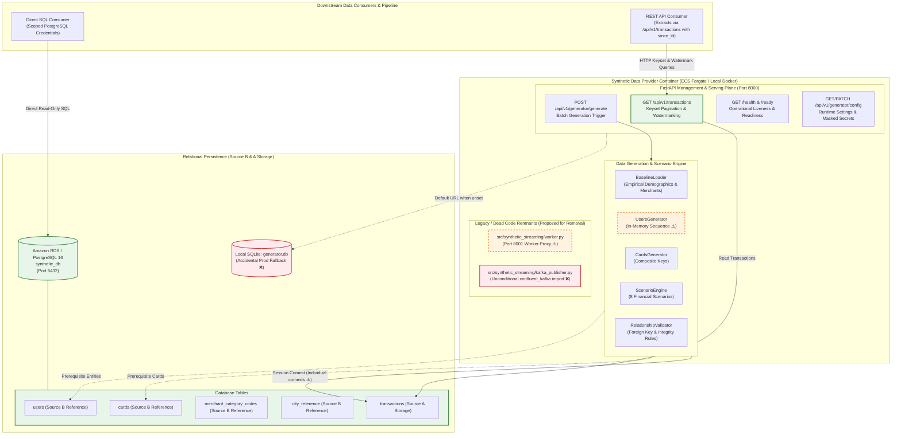

# Repository Audit: Synthetic Transaction Data Provider
**AWS-Ready Architecture & Code Quality Audit Report**  
**Date:** October 25, 2026  
**Auditor Roles:** Senior Data Engineer, Python Backend Architect, DevOps Engineer, Code Quality Auditor  
**Workspace:** `/home/syd/Downloads/archive`  
**Status:** Audit Complete — Read-Only Phase (Pending Approval Gate)

---

## 1. Executive Summary

A comprehensive, evidence-based code and architectural audit of the **Synthetic Transaction Data Provider** repository was conducted. Every claim in the documentation and test suite was verified against the actual source code, package configurations, Docker runtime, database access paths, and container behavior.

### Key Audit Highlights

1. **Production Docker Container Boot Failure (Critical):**
   The production image built from `Dockerfile` immediately crashes with `ModuleNotFoundError: No module named 'confluent_kafka'` when started. Although `confluent-kafka` is correctly designated as an optional dependency in `pyproject.toml`, `src/synthetic_streaming/kafka_publisher.py` imports it at top-level unconditionally. Because `api.py` imports `generator_service.py`, which imports `kafka_publisher.py`, the core API service cannot even boot inside a clean container.
2. **Container File Permissions & SQLite Fallback Failure (Critical):**
   In `Dockerfile`, the container runs as unprivileged user `appuser` (UID `10001`), but the working directory `/app` is owned by `root:root` with permissions `drwxr-xr-x`. If `DATABASE_URL` is omitted, the application defaults to `sqlite:///./generator.db` in `/app`, which immediately fails with `PermissionError: [Errno 13] Permission denied: '/app/generator.db'`. Furthermore, there is no guard preventing silent fallback to SQLite in production (`APP_ENV=production`).
3. **Broken Distributed Worker Architecture & Remnants (High):**
   The codebase contains an orphaned distributed worker architecture (`src/synthetic_streaming/worker.py` and proxy branches throughout `src/synthetic_streaming/api.py`) designed for continuous streaming to Kafka. In `compose.yaml`, no worker container exists. Crucially, `POST /api/v1/generator/generate` is not implemented for the worker proxy (raising HTTP 501), rendering batch generation broken if configured with a worker.
4. **Batch Persistence Lacks Transaction Atomicity (High):**
   `persist_transaction()` commits each transaction individually inside the generation loop (`session.commit()`). If record 25 of a 50-record batch fails, records 1–24 remain committed, no rollback occurs, and an unhandled 500 error is returned to the client, creating a false impression of total batch failure while leaking partial writes.
5. **In-Memory ID Generator Collisions Across Restarts & Replicas (Medium/High):**
   `UsersGenerator` initializes its sequential user ID counter from in-memory state rather than querying `SELECT MAX(user_id) FROM users`. Upon container restart or when running multiple API replicas, new user IDs reset to `2000`, causing key collisions or silent reusing of existing user records.
6. **Missing Application Shutdown Handlers (Medium):**
   FastAPI does not configure a lifespan or shutdown hook to stop the background generator thread. When Uvicorn receives `SIGTERM` in container runtimes, the thread is abruptly killed mid-transaction.
7. **Repository Hygiene & Artifact Bloat (Medium):**
   The repository contains a **2.35 GB** raw transaction CSV file (`credit_card_transactions-ibm_v2.csv`) that is untracked by `.gitignore`, an active SQLite database (`generator.db`) in the root, an obsolete binary report (`DATA_ENHANCEMENT_REPORT.docx`), duplicate Docker Compose files, Azure Bicep infrastructure templates (when targeting AWS), and an entire duplicated documentation directory (`synthetic_transaction_streaming_docs/`).

---

## 2. Target Architecture vs. Actual Architecture

### Architectural Comparison

| Dimension | Target Architecture (Source of Truth) | Actual Implementation (Observed) | Status / Gap |
|---|---|---|---|
| **Application Image** | Single container containing only the synthetic data provider application. | Single multi-stage Dockerfile exists, but image crashes on boot due to top-level Kafka dependency. | ❌ Broken runtime |
| **Database Architecture** | Separately managed PostgreSQL (Amazon RDS in production, container in local Compose). | Local Compose uses PostgreSQL 16; application defaults to `generator.db` SQLite; production allows SQLite fallback. | ⚠️ Defect |
| **Downstream Infrastructure** | Zero local Kafka, Spark, MinIO, Iceberg, Trino, dbt, Prometheus, or Grafana. | Core application still imports Kafka publisher; distributed worker code and mock publisher still present. | ⚠️ Partial removal |
| **Reference Data (Source B)** | Directly queried via SQL (`users`, `cards`, `mcc`, `city_reference`). | Supported and functional in database schema, but CSVs are not seeded predictably in production. | ⚠️ Configuration gap |
| **Transaction API (Source A)** | REST API with stable response schema, keyset pagination, and watermarking (`since_id`). | Implemented and functional, but keyset pagination `max_id` metadata behaves inconsistently when `order=desc`. | ⚠️ Edge-case bug |
| **Generator Control** | Explicit batch generation and safe operational controls; thread-safe shutdown. | Batch generation lacks atomicity; shutdown signal unhandled in API mode; remote worker proxy code dead/broken. | ⚠️ Defect |
| **Cloud Deployment Target** | AWS (Amazon ECS Fargate, ECR, RDS PostgreSQL, Secrets Manager). | Infra directory contains Azure Container Apps Bicep templates (`main.bicep`); zero AWS deployment configs. | ❌ Misaligned cloud |

---

### Architecture Diagram (Actual vs. Intended)



---

## 3. Findings Registry

| Finding ID | Severity | Category | File Path & Symbol / Lines | Summary of Defect |
|---|---|---|---|---|
| **FIND-CRIT-01** | **Critical** | Docker & Runtime | `src/synthetic_streaming/kafka_publisher.py:11` | Top-level unconditional `import confluent_kafka` crashes Docker container on boot. |
| **FIND-CRIT-02** | **Critical** | Configuration & Security | `src/synthetic_streaming/config.py:112-115` | Default `DATABASE_URL` silently falls back to local SQLite in production. |
| **FIND-CRIT-03** | **Critical** | Docker & Deployment | `Dockerfile:45-58` | Working directory `/app` owned by `root:root`; non-root `appuser` cannot write SQLite file. |
| **FIND-HIGH-01** | **High** | Database & Persistence | `src/synthetic_streaming/database.py:688` & `generator_service.py:294` | Batch generation commits per record without rollback; partial failures return false HTTP 500. |
| **FIND-HIGH-02** | **High** | Architecture & Legacy | `src/synthetic_streaming/worker.py:1-144` & `api.py:377-393` | Obsolete worker proxy returns HTTP 501 on batch generate; conflicting architecture. |
| **FIND-HIGH-03** | **High** | Generator Correctness | `src/synthetic_streaming/users_generator.py:54-65` | In-memory user ID counter restarts at 2000 on restart; causes duplicate ID conflicts. |
| **FIND-MED-01** | **Medium** | Generator Lifecycle | `src/synthetic_streaming/api.py:111-118` & `scripts/run_generator.py:97-110` | No FastAPI lifespan/shutdown handler; background generator thread killed mid-stream on SIGTERM. |
| **FIND-MED-02** | **Medium** | API Contract | `src/synthetic_streaming/api.py:315` | `max_id` metadata returns inaccurate watermark when query is sorted `order=desc`. |
| **FIND-MED-03** | **Medium** | Database & SSL | `src/synthetic_streaming/database.py:267-272` | `create_db_engine` does not enforce or configure SSL for RDS PostgreSQL connections. |
| **FIND-MED-04** | **Medium** | Configuration & Seeding | `src/synthetic_streaming/config.py:118` & `compose.yaml:52-55` | `AUTO_SEED=true` runs on every boot; logs missing CSV warnings when container lacks mounts. |
| **FIND-LOW-01** | **Low** | Repo Hygiene | Project Root | Accidental tracking of 2.35 GB CSV, active `generator.db`, and `.docx` report. |
| **FIND-LOW-02** | **Low** | Configuration | `docker/docker-compose.yml` vs `compose.yaml` | Duplicate, conflicting Compose files with mismatched volume and service definitions. |
| **FIND-LOW-03** | **Low** | Cloud Deployment | `infra/main.bicep` | Azure Container Apps templates retained while target platform is AWS ECS/RDS. |
| **FIND-LOW-04** | **Low** | Generator Correctness | `src/synthetic_streaming/baseline_loader.py:258-271` | Baseline sampling uses global `random` instead of seeded instance; seed repeatability bypassed. |

---

## 4. Deep Dive Evidence for Findings

### FIND-CRIT-01: Unconditional Kafka Import Breaks Production Container
- **Severity:** Critical
- **File:** `src/synthetic_streaming/kafka_publisher.py` (Line 11)
- **Observed Behavior:**
  Running `docker run --rm test-build:latest api --help` fails immediately with:
  ```text
  Traceback (most recent call last):
    File "/app/scripts/run_generator.py", line 17, in <module>
      from synthetic_streaming.api import create_app
    File "/app/src/synthetic_streaming/api.py", line 27, in <module>
      from synthetic_streaming.generator_service import GeneratorService
    File "/app/src/synthetic_streaming/generator_service.py", line 31, in <module>
      from synthetic_streaming.kafka_publisher import (
    File "/app/src/synthetic_streaming/kafka_publisher.py", line 11, in <module>
      import confluent_kafka
  ModuleNotFoundError: No module named 'confluent_kafka'
  ```
- **Evidence:**
  `pyproject.toml` puts `confluent-kafka` in `[project.optional-dependencies] kafka`. When Dockerfile builds with `pip install .`, optional dependencies are not installed. But `kafka_publisher.py` imports `confluent_kafka` globally at line 11 without a `try/except ImportError`. Because `api.py` imports `generator_service.py`, the whole REST API is unbootable.
- **Impact:** Zero container portability. Image built per standard instructions cannot run.
- **Fix:** Remove top-level `import confluent_kafka` or decouple the REST API and generator service completely from streaming publisher modules.

---

### FIND-CRIT-02 & FIND-CRIT-03: Silent Production SQLite Fallback & Container Permission Denied
- **Severity:** Critical
- **Files:** `src/synthetic_streaming/config.py` (Lines 112–115), `Dockerfile` (Lines 45–58)
- **Observed Behavior:**
  1. In `config.py`:
     ```python
     database_url: str = Field(
         default_factory=lambda: os.environ.get("DATABASE_URL", "sqlite:///./generator.db"),
         description="Relational database connection string (PostgreSQL or SQLite)"
     )
     ```
     If `APP_ENV=production` and `DATABASE_URL` is omitted, `config.py` silently falls back to SQLite.
  2. Inside the container, `/app` is owned by `root:root` with mode `755`:
     ```text
     $ docker run --rm test-build:latest ls -ld /app
     drwxr-xr-x 1 root root 4096 Oct 25 13:02 /app
     $ docker run --rm test-build:latest python -c "open('/app/generator.db', 'w')"
     PermissionError: [Errno 13] Permission denied: '/app/generator.db'
     ```
- **Impact:** In production, if `DATABASE_URL` is missing, the service fails to start or creates unpersisted ephemeral SQLite files. If run in container with default config, it crashes with `PermissionError`.
- **Fix:** Add a validator in `GeneratorConfig`: if `app_env == "production"`, `DATABASE_URL` must be provided and must start with `postgresql://` or `postgresql+psycopg2://`. SQLite must be strictly rejected in production. In Dockerfile, ensure `/app` is owned by `appuser` if local file writes are ever permitted.

---

### FIND-HIGH-01: Batch Generation Lacks Transactional Atomicity
- **Severity:** High
- **Files:** `src/synthetic_streaming/database.py` (Lines 687–689), `src/synthetic_streaming/generator_service.py` (Lines 286–301)
- **Observed Behavior:**
  In `persist_transaction`:
  ```python
  session.add(tx_record)
  session.commit()
  return tx_record
  ```
  In `generate_batch`:
  ```python
  for _ in range(count):
      tx_envelope, prereq_envelopes = self.tx_gen.generate_next_transaction(run_id=effective_run_id)
      rec = persist_transaction(session, tx_envelope, prereq_envelopes)
      records.append(rec)
  ```
- **Impact:**
  1. Extreme write amplification: generating 1,000 transactions performs 1,000 separate DB commits and fsyncs rather than a single batch transaction.
  2. Incomplete error recovery: if transaction 500 fails, records 1–499 are permanently committed, but `api.py` catches nothing and returns HTTP 500. The downstream client assumes the batch failed and retries, creating duplicate transactions.
- **Fix:** Wrap batch persistence in an atomic transaction: commit once after all items in the batch are generated and validated. If any error occurs, invoke `session.rollback()`.

---

### FIND-HIGH-02: Obsolete Worker Proxy Architecture & Broken Batch Proxy
- **Severity:** High
- **Files:** `src/synthetic_streaming/worker.py` (Lines 1–144), `src/synthetic_streaming/api.py` (Lines 377–394)
- **Observed Behavior:**
  `worker.py` runs a secondary Uvicorn server on port 8001. `api.py` contains extensive branching:
  `if worker_url: ... elif service: ...`
  However, in `api.py`:
  ```python
  @app.post("/api/v1/generator/generate", ...)
  def generate_batch_transactions(req: GenerateBatchRequest, ...):
      if service is not None:
          ...
      raise HTTPException(
          status_code=status.HTTP_501_NOT_IMPLEMENTED,
          detail="Active generator service not bound to API instance.",
      )
  ```
  If `WORKER_CONTROL_URL` is set, `service` is None, and batch generation returns HTTP 501!
- **Impact:** Split architecture creates confusing configuration, duplicate code paths, and broken endpoints.
- **Fix:** Per Target Architecture Section 1, consolidate provider responsibilities into the single provider application. Remove the separate worker HTTP daemon and proxy layer.

---

### FIND-HIGH-03: User ID Counter Collisions Across Restarts
- **Severity:** High
- **Files:** `src/synthetic_streaming/users_generator.py` (Lines 54–65), `src/synthetic_streaming/generator_service.py` (Line 108)
- **Observed Behavior:**
  `initial_hwm` is computed purely from `baseline.high_water_mark + (config.worker_id * 1_000_000)`. Because `baseline.high_water_mark` only reflects static CSV users (2000), upon restart the generator re-starts at user ID 2000.
  In `database.py` line 554, `persist_transaction` queries `session.query(UserModel).filter_by(user_id=user_id).first()`. If found, it skips user insertion.
- **Impact:** When generating transactions with new user ratios after an application restart, the generator re-generates cards and transactions for already existing users, causing user profile mismatch and invalid card/user associations.
- **Fix:** When connecting to the database, initialize `initial_high_water_mark` as `max(2000, session.query(func.max(UserModel.user_id)).scalar() or 2000) + 1`.

---

### FIND-MED-01: Missing Application Lifecycle and Shutdown Signal Management
- **Severity:** Medium
- **Files:** `src/synthetic_streaming/api.py` (Lines 111–118), `scripts/run_generator.py` (Lines 97–110)
- **Observed Behavior:**
  `create_app()` does not define a FastAPI `lifespan` handler. When running `scripts/run_generator.py api`, `uvicorn.run()` catches SIGTERM and shuts down its server, but `service.stop()` is never called.
- **Impact:** If continuous generation was started via `/api/v1/generator/start`, stopping the container terminates the background thread abruptly without flushing active transactions or closing database connections cleanly.
- **Fix:** Implement an async `lifespan` context manager in FastAPI that cleanly invokes `service.stop(timeout=5.0)` during application shutdown.

---

### FIND-MED-02: Watermark Inaccuracy in Descending Keyset Queries
- **Severity:** Medium
- **File:** `src/synthetic_streaming/api.py` (Line 315)
- **Observed Behavior:**
  Line 315 calculates:
  `max_id = max([r.id for r in page_records]) if page_records else since_id`
  If a consumer extracts records in descending order (`order=desc`), `max_id` returns the largest ID in the page, but pagination is advancing downwards. If the downstream pipeline persists `max_id` as its extraction watermark for `since_id`, subsequent queries with `since_id > max_id` will extract zero rows or skip newly inserted transactions.
- **Impact:** Incremental extraction pipelines using `order=desc` will fail or skip records.
- **Fix:** Enforce `order=asc` whenever `since_id` is supplied, or document that `since_id` watermarking strictly requires ascending monotonic queries.

---

### FIND-MED-03: Lack of Enforced SSL for PostgreSQL Connections
- **Severity:** Medium
- **File:** `src/synthetic_streaming/database.py` (Lines 254–273)
- **Observed Behavior:**
  `create_db_engine` creates the PostgreSQL engine without validating `sslmode`.
- **Impact:** If `DATABASE_URL` for Amazon RDS is supplied without `?sslmode=require`, credentials and financial records traverse the cloud network unencrypted.
- **Fix:** Enforce SSL configuration validation in production.

---

### FIND-MED-04: Startup Seeding Confusion in Production Containers
- **Severity:** Medium
- **Files:** `src/synthetic_streaming/config.py` (Line 118), `compose.yaml` (Lines 48–55)
- **Observed Behavior:**
  `AUTO_SEED` defaults to `True`. In local Docker Compose, CSV files are mounted into `/data`. But in production (AWS ECS/Fargate), `.dockerignore` excludes `*.csv`. On boot, `init_db` logs repeated warnings (`Users file not found at sd254_users.csv`).
- **Impact:** Production containers attempt unnecessary file scans on startup and pollute logs.
- **Fix:** Set `AUTO_SEED` default to `False` in production. Provide an explicit, idempotent CLI command (`scripts/init_db.py`) for database provisioning.

---

### FIND-LOW-01 through FIND-LOW-04: Repo Hygiene & Dead Infrastructure Artifacts
- **FIND-LOW-01:** `credit_card_transactions-ibm_v2.csv` (2.35 GB) is stored in the workspace without `.gitignore` rules. `generator.db` (1.8 MB active SQLite file) and `load_results_live_kafka.json` are committed/present.
- **FIND-LOW-02:** `docker/docker-compose.yml` is an incomplete duplicate of `compose.yaml`.
- **FIND-LOW-03:** `infra/main.bicep` defines Azure Container Apps, Event Hubs, and Log Analytics, which contradicts the AWS target architecture.
- **FIND-LOW-04:** `baseline_loader.py` lines 258, 266, 271 use global `random.choice` instead of a seeded PRNG, bypassing reproducible seed configuration.

---

## 5. Audit Questions: Detailed Answers

### A. Architecture and Responsibilities
1. **Application image contents:** The image built by `Dockerfile` contains application code and dependencies, but crashes on boot because `confluent-kafka` is imported without being installed.
2. **PostgreSQL separation:** Local Compose runs PostgreSQL 16 as an independent service on port 5432. However, the application config allows silent fallback to SQLite in production.
3. **Removed infrastructure dependencies:** The core provider no longer requires Spark, MinIO, Iceberg, dbt, Prometheus, or Grafana. However, Kafka and worker proxy modules are still embedded in the source tree.
4. **Duplicate Compose files:** Yes. `docker/docker-compose.yml` and root `compose.yaml` conflict. Root `compose.yaml` is the correct multi-service file.
5. **Separation of concerns:** API, persistence, and baseline loading are modularized, but `GeneratorService` conflates continuous Kafka streaming with database batch generation.
6. **Unnecessary components:** `src/synthetic_streaming/worker.py`, `src/synthetic_streaming/kafka_publisher.py`, `infra/main.bicep`, and `synthetic_transaction_streaming_docs/` are unnecessary.
7. **Worker process simplification:** Dedicated worker processes on port 8001 are legacy artifacts. A single application container running FastAPI and the generator engine satisfies all requirements.

### B. Generator Correctness
1. **Preservation of scenarios:** All 8 financial scenarios (`normal_spend`, `high_value`, `unusual_location`, `fraud_labelled`, `declined_error`, `refund_return`, `repeated_attempt`, `late_event`) are preserved and verified by unit tests.
2. **Consistency of users and cards:** Relational integrity between users, cards, and transactions is enforced in memory by `RelationshipValidator`.
3. **Transaction ID stability:** Transaction IDs (`tx-<uuid>`) and event IDs (`uuid4`) are unique and stable.
4. **Persistence before exposure:** In `api.py`, transactions are persisted before the API response is returned.
5. **Partial batch failure:** A partial batch currently fails leaving prior records committed, while returning a false HTTP 500 error to the client.
6. **Failure recovery:** Database failure during background streaming leaves the in-memory generator in an inconsistent state with respect to new user/card entities.
7. **Thread safety & shutdown:** Generator controls use a `threading.Lock`, but shutdown signal handling is missing in FastAPI API mode.
8. **Worker duplication:** Running multiple API container replicas without central coordination causes duplicate user ID sequences (starting at 2000).
9. **Conflicting logical events:** UUIDs prevent transaction ID collisions, but user entity IDs can collide if multiple uncoordinated generators write to the same DB.
10. **Configuration defaults:** Defaults are functional for local dev, but dangerous for production (allowing SQLite fallback).

### C. Database Correctness and Reliability
- **Keys and Constraints:** Primary keys and composite keys (`users.user_id`, `cards.(user_id, card_index)`) are correctly structured.
- **Data Types:** Financial amounts correctly use `Numeric(12, 2)` (PostgreSQL) and `Decimal` (Python).
- **Session Lifecycle:** `SessionLocal` is used across routes, but `persist_transaction` commits per item without rollback on error.
- **Connection Pooling:** SQLAlchemy `pool_pre_ping=True`, `pool_size=10`, `max_overflow=20` are configured.
- **Idempotency of Seeding:** `seed_reference_data` checks existing row counts before inserting, ensuring idempotency.
- **Empty Tables:** If tables are empty, queries return empty lists gracefully.
- **Schema Migrations:** `run_migrations()` provides non-destructive schema upgrades for new columns (`transaction_entry_method`, coordinates).

### D. API Contract and Extraction Behavior
- **Response Schemas:** Schemas are strictly validated via Pydantic response models.
- **Pagination & Ordering:** Keyset pagination via `cursor` and `id > :cursor` provides $O(\log N)$ performance.
- **Incremental Extraction:** Monotonic sequence extraction via `since_id` functions properly.
- **Response Format:** Returns both normalized relational columns and raw event payloads in `payload`.
- **Limits & Error Handling:** Limits are bounded (1 to 1000). Invalid cursors return HTTP 400.

### E. Configuration and Security
- **Database URL Validation:** Lacks production enforcement against SQLite.
- **Credential Leakage:** Credentials are masked in `to_safe_dict()`, but raw SQLAlchemy connection exceptions could leak strings if unhandled.
- **Non-Root Execution:** Container executes as UID 10001, but permissions on `/app` prevent file writes.
- **Downstream Credentials:** Downstream consumers should use a dedicated read-only PostgreSQL role rather than the application user.

### F. Docker and Deployment Readiness
- **Build Status:** Dockerfile builds cleanly, but container fails at runtime due to `confluent_kafka`.
- **Unnecessary Files:** Root contains 2.35 GB CSV file that should be excluded from Git and Docker contexts.
- **Signal Handling:** Entrypoint routes signals, but Uvicorn lacks graceful hook into `GeneratorService`.

### G. Dead Code and Dependency Audit
- **Dead Modules:** `src/synthetic_streaming/worker.py`, `src/synthetic_streaming/kafka_publisher.py`.
- **Dead Dependencies:** `confluent-kafka` (optional, but broken), `python-docx` (unlisted dependency in script).
- **Duplicate Docs:** `synthetic_transaction_streaming_docs/` is a duplicate of `docs/`.
- **Obsolete Templates:** `infra/main.bicep` is Azure-specific.

---

## 6. Conclusion and Transition to Phase Two

The read-only audit confirms that while the core business logic (scenarios, taxonomies, database models, and REST endpoints) is well-designed, critical runtime and architectural blockers exist:
1. Docker container boot crash (`confluent_kafka`).
2. Production SQLite fallback risk and container permission errors.
3. Batch persistence non-atomicity.
4. Legacy worker proxy dead code.

The accompanying documents provide the detailed remediation roadmap:
- `docs/audit/REFACTORING_PLAN.md`: Step-by-step phased execution plan with acceptance criteria.
- `docs/audit/REMOVAL_CANDIDATES.md`: Full inventory of obsolete files, dependencies, and modules proposed for safe removal.
