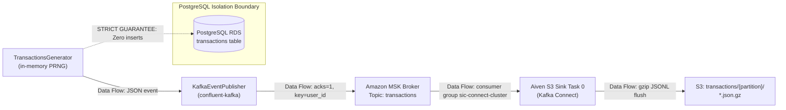
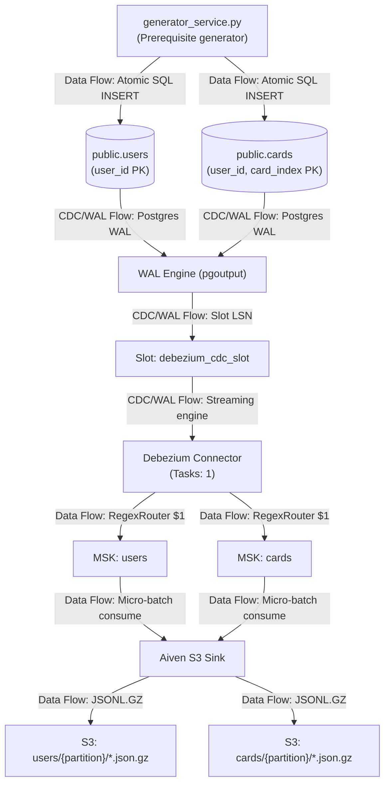
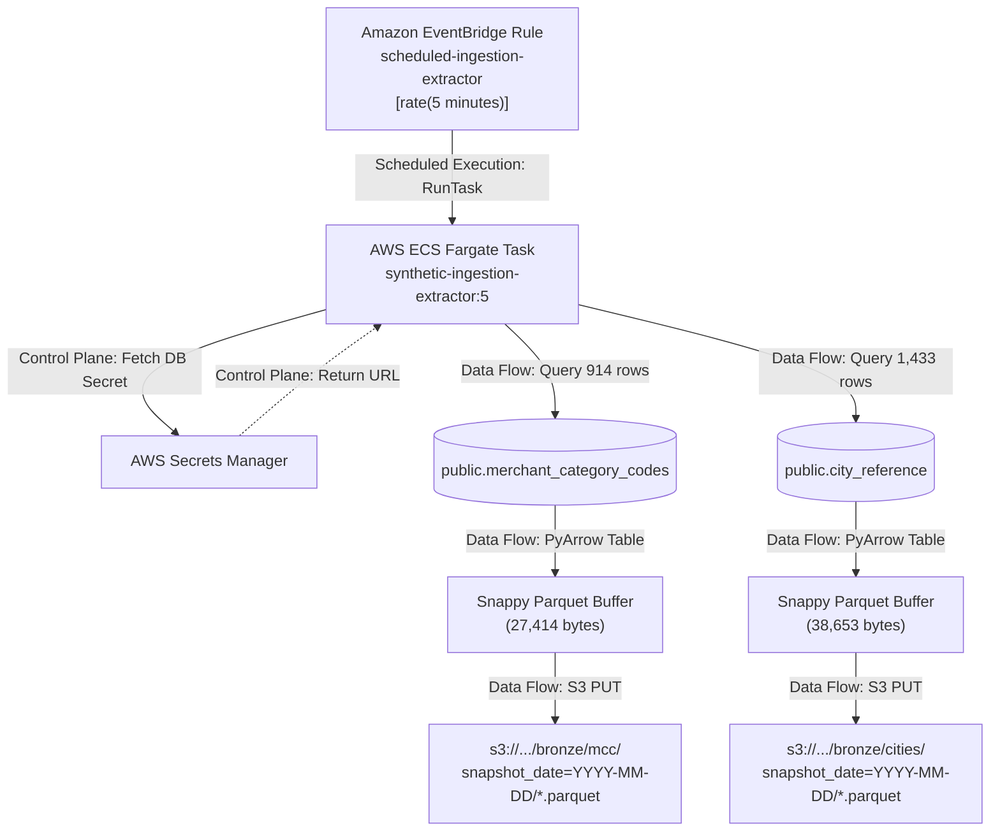
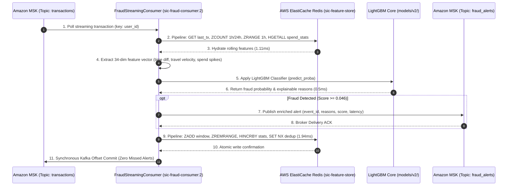

# Verified Architecture & Data Flow Diagrams
## Synthetic Financial Data Ingestion Pipeline (SIC Platform)

**Audit Date:** October 26, 2026  
**AWS Account ID:** `138257835434` | **Region:** `eu-west-3`  
**Classification:** Reconstructed Architecture & Lineage Diagrams

---

## 1. Complete End-to-End Actual Architecture

```mermaid
flowchart TD
    subgraph DataGen["Data Generation & API (ECS Fargate)"]
        API["FastAPI App / Health Probe\n(Port 8000)"]
        GenLoop["generator_service.py\n(_generation_loop)"]
        Pub["KafkaEventPublisher\n(confluent-kafka)"]
    end

    subgraph RelationalDB["Relational Storage (Amazon RDS)"]
        RDS[("PostgreSQL 18.3: containerdb\nTables: users, cards, mcc, cities\nNO TRANSACTIONS COMMITTED")]
        WAL["Write-Ahead Log (WAL)\npgoutput plugin"]
        Slot["Slot: debezium_cdc_slot\nPub: debezium_publication"]
    end

    subgraph StreamingBrokers["Streaming Platform (Amazon MSK)"]
        MSK1["Topic: transactions\n(3 Partitions, RF 2)"]
        MSK2["Topic: users\n(3 Partitions, RF 2)"]
        MSK3["Topic: cards\n(3 Partitions, RF 2)"]
    end

    subgraph ConnectCluster["Kafka Connect Distributed (ECS Fargate)"]
        Deb["Debezium PostgreSQL Connector\n(Task 0)"]
        Router["RegexRouter SMT\n(.*.public.* -> $1)"]
        Sink["Aiven S3 Sink Connector\n(Task 0)"]
    end

    subgraph BatchSystem["Batch Ingestion (EventBridge + ECS)"]
        EB["EventBridge Rule:\nscheduled-ingestion-extractor\n[rate(5 minutes)]"]
        BatchTask["ECS Task: synthetic-ingestion-extractor:5\n(BatchReferenceExtractor)"]
    end

    subgraph FraudInference["Real-Time Fraud Detection (ECS Fargate)"]
        FC["FraudStreamingConsumer\n(Task: sic-fraud-consumer:2)\nManual Offset Commit Guard"]
        Model["LightGBM Classifier Core\n(models/v2/ 450 Trees, <1ms)"]
        MSKAlert["Topic: fraud_alerts\n(2 Partitions, RF 2)"]
    end

    subgraph FeatureStore["Online Feature Store (AWS ElastiCache Redis)"]
        RedisNode[("sic-feature-store (Redis 7.1)\ncache.t4g.micro • In-Transit TLS & Encryption\n8,346 Keys: profile:*, tx_window:*, spend_stats:*")]
    end

    subgraph S3Storage["Amazon S3 Lakehouse Bucket: sic-pipeline-storage"]
        S3RootTx["transactions/{p}/*.json.gz\n[PATH DEFECT: at bucket root]"]
        S3RootUsers["users/{p}/*.json.gz\n[PATH DEFECT: at bucket root]"]
        S3RootCards["cards/{p}/*.json.gz\n[PATH DEFECT: at bucket root]"]
        S3MCC["bronze/mcc/snapshot_date=YYYY-MM-DD/\n*.parquet"]
        S3Cities["bronze/cities/snapshot_date=YYYY-MM-DD/\n*.parquet"]
    end

    subgraph Management["Observability & Secrets"]
        SM["AWS Secrets Manager\nsynthetic-data-provider/database"]
        CW["Amazon CloudWatch Logs\n/ecs/..."]
    end

    %% Data Flows
    GenLoop -->|1. Data Flow: tx_envelope| Pub
    Pub -->|2. Data Flow: Kafka produce| MSK1
    GenLoop -->|3. Data Flow: SQL INSERT users/cards| RDS
    RDS -->|4. CDC/WAL Flow: Commit LSN| WAL
    WAL -->|5. CDC/WAL Flow: Logical replication| Slot
    Slot -->|6. CDC/WAL Flow: pgoutput stream| Deb
    Deb -->|7. Data Flow: Entity change event| Router
    Router -->|8. Data Flow: Remapped topic event| MSK2
    Router -->|8. Data Flow: Remapped topic event| MSK3
    MSK1 -->|9. Data Flow: Micro-batch poll| Sink
    MSK2 -->|9. Data Flow: Micro-batch poll| Sink
    MSK3 -->|9. Data Flow: Micro-batch poll| Sink
    Sink -->|10. Data Flow: Flush Gzip JSONL| S3RootTx
    Sink -->|10. Data Flow: Flush Gzip JSONL| S3RootUsers
    Sink -->|10. Data Flow: Flush Gzip JSONL| S3RootCards

    %% Batch Flow
    EB -->|11. Scheduled Execution: Trigger RunTask| BatchTask
    BatchTask -->|12. Data Flow: SQL query mcc/cities| RDS
    BatchTask -->|13. Data Flow: Snappy Parquet PUT| S3MCC
    BatchTask -->|13. Data Flow: Snappy Parquet PUT| S3Cities

    %% Real-Time ML Fraud Flow
    MSK1 -->|14. Streaming Consume (Parallel)| FC
    FC <-->|Atomic 1h/24h Sliding Window & Profile Hydration (1.9ms)| RedisNode
    FC -->|34-dim Feature Vector| Model
    Model -->|Scoring Decision & Risk Reasons (0.5ms)| FC
    FC -->|15. Publish Enriched Alert & Commit Offset| MSKAlert

    %% Control Plane & Monitoring
    API -.->|Control Plane: Read secret| SM
    BatchTask -.->|Control Plane: Read secret| SM
    API -.->|Monitoring & Logging: logs| CW
    Sink -.->|Monitoring & Logging: logs| CW
    BatchTask -.->|Monitoring & Logging: logs| CW
    FC -.->|Monitoring & Logging: logs| CW
```

---

## 2. Diagram 1: Transaction Direct Streaming Flow



---

## 3. Diagram 2: Users & Cards CDC Pipeline Flow



---

## 4. Diagram 3: MCC & Cities Batch Ingestion Flow



---

## 5. Diagram 4: Deployment & Network Relationships

```mermaid
graph TD
    subgraph VPC_172_31["AWS VPC: 172.31.0.0/16"]
        subgraph Subnet_AZ1["Subnet eu-west-3a (subnet-003d3891dab36b354)"]
            Broker1["MSK Broker 1\n(b-1...:9092, 9094)"]
            TaskAPI["ECS Task: synthetic-data-provider:4\n(Port 8000)"]
            TaskExt["ECS Task: synthetic-ingestion-extractor:5\n(Batch Extractor)"]
        end

        subgraph Subnet_AZ2["Subnet eu-west-3b (subnet-0b18944bde732d1fd)"]
            Broker2["MSK Broker 2\n(b-2...:9092, 9094)"]
            TaskConnect["ECS Task: sic-kafka-connect:6\n(Port 8083)"]
            RDS[("PostgreSQL RDS: containerdb\n(Port 5432 - Non-Public)")]
        end

        subgraph Subnet_AZ3["Subnet eu-west-3c (subnet-03fa02b6eabf60d25)"]
            RedisCluster[("ElastiCache Redis: sic-feature-store\n(Port 6379 - TLS Enabled)")]
            TaskConsumer["ECS Task: sic-fraud-consumer:2\n(Real-Time ML Scorer)"]
        end
    end

    subgraph Security_Groups["Security Group Boundary"]
        AppSG["synthetic-app-sg (sg-0dd0933f4da2b5ea7)"]
        DBSG["default (sg-0041172e0d9b6c810)"]
        MSKSG["sg-0ddf4e9366885421b"]
        RedisSG["sic-redis-sg (sg-045ac4d82b2de70c6)"]
    end

    AppSG -->|Port 5432 (Postgres Ingress)| DBSG
    AppSG -->|Port 9092/9094 (MSK Ingress)| MSKSG
    AppSG -->|Port 6379 (Redis TLS Ingress)| RedisSG
```

---

## 6. Diagram 5: Real-Time Fraud Detection & ElastiCache Redis Feature Store Pipeline



