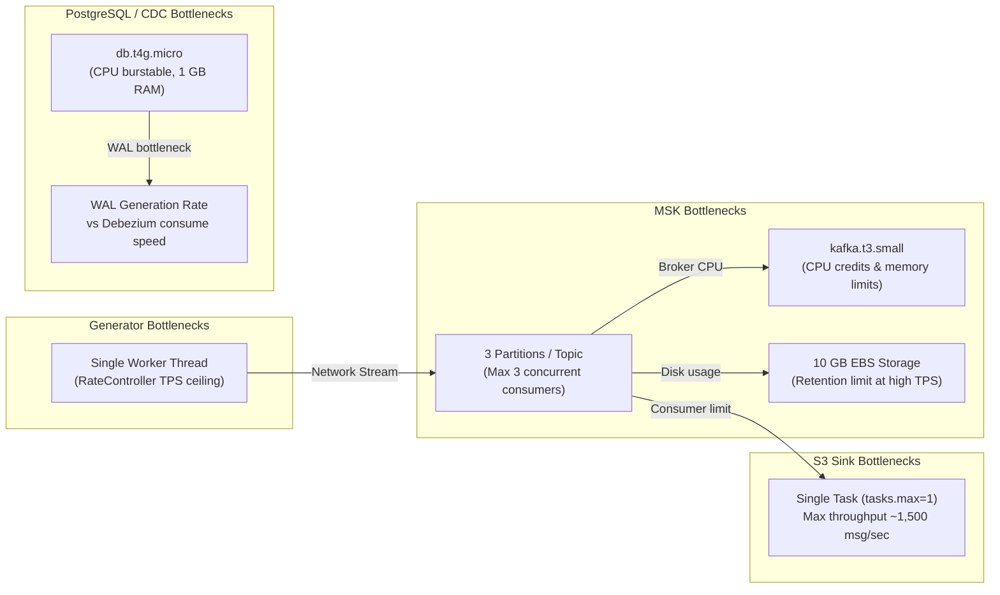

# Cost Drivers & Scalability Assessment
## Synthetic Financial Data Ingestion Pipeline (SIC Platform)

**Audit Date:** October 26, 2026  
**AWS Account ID:** `138257835434` | **Region:** `eu-west-3`  
**Classification:** Infrastructure Economics & System Scalability Analysis

---

## 1. Configured Resource Footprint & Cost Drivers

Direct inspection of AWS configurations in `eu-west-3` establishes the following active infrastructure footprint. *(Note: AWS Cost Explorer / Billing API is read-restricted; unit pricing reflects standard AWS Paris `eu-west-3` pricing as of 2026).*

| Infrastructure Component | Configured Specifications | Quantity / Units | Primary Cost Mechanism | Estimated Baseline Cost (USD/Month) |
|---|---|---|---|---|
| **Amazon MSK Cluster** (`sic-streaming-msk`) | `kafka.t3.small` (2 vCPU, 2 GiB RAM) EBS: 10 GiB gp3 per broker | 2 Broker Nodes | Broker hourly charge (~$0.052/hr * 2 * 730 hrs) Storage: 20 GB gp3 (~$0.11/GB-mo) | ~$76.00 / month |
| **Amazon RDS PostgreSQL** (`containerdb`) | `db.t4g.micro` (2 vCPU, 1 GiB RAM) Storage: 20 GiB gp3 | 1 Single-AZ Instance | Instance hourly (~$0.019/hr * 730 hrs) Storage: 20 GB gp3 (~$0.125/GB-mo) | ~$16.50 / month |
| **AWS ECS Fargate: Kafka Connect** (`sic-kafka-connect-service`) | 1024 CPU (1.0 vCPU) 2048 MB RAM (2.0 GB) | 1 Continuous Task (24/7) | Fargate vCPU (~$0.04048/hr) Fargate Memory (~$0.004445/GB-hr) | ~$36.00 / month |
| **AWS ECS Fargate: Synthetic Generator** (`synthetic-data-service`) | 512 CPU (0.5 vCPU) 1024 MB RAM (1.0 GB) | 1 Continuous Task (24/7) | Fargate vCPU & Memory | ~$18.00 / month |
| **AWS ECS Fargate: Batch Extractor** (`synthetic-ingestion-extractor:5`) | 256 CPU (0.25 vCPU) 512 MB RAM (0.5 GB) Duration: ~10 seconds/run | **Current:** 288 runs/day **Target:** 1 run/day | Per-second Fargate billing. **Current:** 8,640 runs/month ≈ $8.60/mo **Target:** 30 runs/month ≈ $0.05/mo | Current: ~$8.60 / month Target: ~$0.05 / month |
| **Amazon S3 Storage & API Calls** (`sic-pipeline-storage`) | Standard Storage PUT / LIST requests | Current: ~20 MB storage PUTs: 288*2 batch + S3 sink | S3 Standard (~$0.024/GB-mo) PUT requests ($0.005 per 1,000 requests) | ~$1.50 / month |
| **AWS Secrets Manager** (`synthetic-data-provider/database`) | 1 Secret | 1 Secret | Secret base fee ($0.40/secret/mo) API calls ($0.05 per 10,000 calls) | ~$0.50 / month |
| **AWS ElastiCache Redis** (`sic-feature-store`) | `cache.t4g.micro` (0.5 GB RAM, Graviton2) Redis 7.1, In-Transit TLS & At-Rest Encryption | 1 Node (Single-AZ) | Hourly cache node charge (~$0.016/hr * 730 hrs) Pro-rated per second | ~$11.68 / month |
| **AWS ECS Fargate: Fraud Consumer** (`sic-fraud-consumer:2`) | 512 CPU (0.5 vCPU) 1024 MB RAM (1.0 GB) | 1 Continuous Task (24/7) | Fargate vCPU & Memory | ~$18.00 / month |
| **Amazon CloudWatch Logs** | Retention: 7 days | ~4 Log Groups | Ingestion ($0.57/GB) | ~$2.50 / month |
| **Total Estimated Run-Rate** | — | — | — | **~$188.78 / month** |

### Key Cost Optimization Opportunities:
1. **EventBridge Batch Cadence Optimization:** Switching EventBridge schedule from `rate(5 minutes)` to daily (`cron(0 2 * * ? *)`) cuts Fargate extractor executions from 8,640 runs/month to 30 runs/month, eliminating ~17,200 redundant S3 PUT API calls.
2. **S3 Lifecycle Transitions:** Implementing lifecycle transitions to Standard-IA (30 days) and Glacier Flexible Retrieval (90 days) ensures storage costs remain flat as data volume grows.

---

## 2. Scalability Architecture & Bottleneck Analysis

### Detailed Bottleneck Evaluations:

### 1. Generator Throughput & Concurrency
- `generator_service.py` executes in a single worker thread (`_worker_thread = threading.Thread(target=self._generation_loop)`).
- Pacing is controlled by `RateController(target_tps=10.0)`.
- **Scaling Limit:** A single Python thread running serialization and synchronous prerequisite entity DB commits can achieve at most ~150–250 TPS before GIL and network I/O contention saturate the 0.5 vCPU container. To scale beyond 1,000 TPS, horizontal scaling across multiple ECS tasks with distinct `worker_id` shard partitions is required.

### 2. Kafka Partitions & Consumer Parallelism
- Topics `transactions`, `users`, and `cards` are configured with **3 partitions**.
- In Apache Kafka, the maximum number of active consumers in a single consumer group is strictly bounded by the partition count.
- **Scaling Limit:** The Aiven S3 Sink connector cannot scale beyond 3 worker tasks (`tasks.max: 3`). Any additional sink tasks would remain idle. If stream throughput exceeds ~5,000 msg/sec, topic partitions must be expanded from 3 to 6 or 12.

### 3. Broker Sizing & Disk Capacity
- MSK cluster uses 2x `kafka.t3.small` brokers with **10 GB EBS gp3 storage** per broker.
- `t3.small` instances use CPU burst credits. Under sustained high-throughput loads (>5 MB/sec), CPU credits will exhaust, throttling Kafka broker I/O.
- At 50 TPS with 1 KB average message size:
  - Throughput = 50 KB/sec = 4.32 GB / day.
  - With 7-day retention (`604800000 ms`), 30.24 GB of log segments would accumulate, **overflowing the 20 GB aggregate cluster storage** and putting MSK brokers into read-only disk lock.
  - **Scaling Rule:** With 10 GB EBS per broker, sustainable throughput at 7-day retention cannot exceed **15 TPS**. For higher TPS, EBS storage must be expanded to 50–100 GB per broker.

### 4. PostgreSQL RDS & Debezium Write Load
- Database instance is `db.t4g.micro` with 1 GiB RAM.
- Generates write load only for prerequisite Users and Cards. Transactions bypass PostgreSQL.
- **Scaling Limit:** `db.t4g.micro` handles ~50–100 inserts/sec comfortably. If user generation rates exceed 100 users/sec, CPU and buffer pool thrashing will degrade WAL generation and increase Debezium replication slot lag.

### 5. S3 File Sizes & Small-File Accumulation
- Current Aiven S3 Sink configuration flushes every 50 records or 5,000 ms (`file.max.records: 50`, `flush.timeout.ms: 5000`).
- This results in compressed `.json.gz` files of only 500 bytes to 5 KB.
- Running continuously produces ~17,280 small files per topic per day.
- **Lakehouse Impact:** Query engines like AWS Athena, AWS Glue, and Apache Spark experience massive file-listing overhead when scanning millions of tiny files.
- **Scaling Recommendation:** Increase `file.max.records` to `10000` and `flush.timeout.ms` to `60000` (60 seconds) in production, yielding part files of ~1–5 MB. Deploy periodic AWS Glue or Spark compaction jobs to merge raw micro-batch files into optimized 128 MB Parquet files in Silver.
