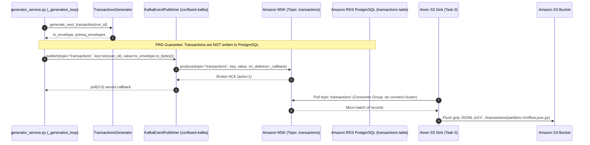
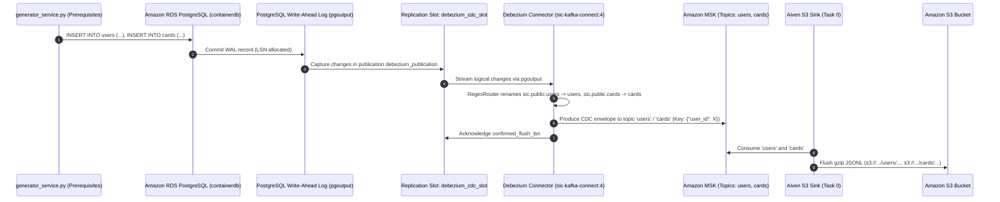
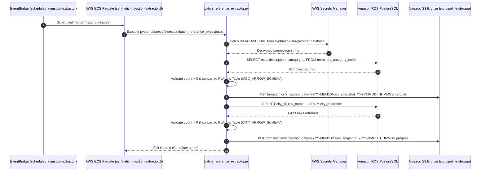
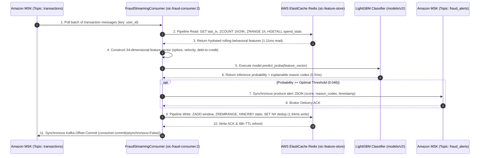

# End-to-End Data Flows Audit Report
## Synthetic Financial Data Ingestion Pipeline (SIC Platform)

**Audit Date:** October 26, 2026  
**AWS Account ID:** `138257835434` | **Region:** `eu-west-3`  
**Classification:** Deep-Dive Technical Flow Audit

---

## Flow A: Transactions — Direct Streaming Pipeline



### Technical Trace & Investigation Findings:

1. **Generation & Stable Identifiers:**
   - Transactions are generated in `src/synthetic_streaming/transactions_generator.py:120-210`.
   - Each transaction receives a unique `event_id` (UUIDv4) and a synthetic `transaction_id` (e.g. `tx-e2e-1792968099-001`). Stable determinism is controlled via PRNG seed `(random_seed + worker_id)`.
2. **Publishing Component:**
   - Handled by `KafkaEventPublisher` in `src/synthetic_streaming/kafka_publisher.py:73-212`, wrapping `confluent-kafka.Producer`.
3. **Bootstrap Configuration & Authentication:**
   - Configured via environment variable `KAFKA_BOOTSTRAP_SERVERS` (`b-1.sicstreamingmsk.4io9um.c2.kafka.eu-west-3.amazonaws.com:9092,b-2...:9092`).
   - Authentication is `PLAINTEXT` (unauthenticated VPC-internal). Port 9092 is restricted to `sg-0dd0933f4da2b5ea7`. TLS port 9094 is available on MSK brokers but not currently used by the producer.
4. **Partitioning, Key & Serialization:**
   - Topic: `transactions` (3 partitions, Replication Factor 2).
   - Message Key: `str(user_id).encode("utf-8")`. Guarantees all transactions for a given user land in the same partition, preserving temporal event ordering per user.
   - Serialization: Versioned JSON event envelope (`schema_version="1.0.0"`, `event_type="transaction.created"`).
5. **Producer Settings (Acks, Idempotence, Buffering):**
   - In `kafka_publisher.py:88-100`: `acks="1"`, `enable.idempotence=False` (defaults in config), `max.in.flight=5`, `retries=3`, `queue.buffering.max.messages=100000`, `linger.ms=5`.
6. **Error Surfacing & Silent Drop Evaluation:**
   - In `generator_service.py:265-273`, `publish()` is called **without** an `on_delivery` callback.
   - When librdkafka fails asynchronously to deliver a message (e.g. after internal retries expire), `_delivery_callback` in `kafka_publisher.py:155-170` increments `_total_failed` and logs an error throttled to 5 seconds.
   - **Silent Drop Vulnerability:** The application has no in-memory retry queue or persistent dead-letter queue (DLQ) for failed delivery callbacks. If a broker rejects an enqueued message, it is permanently lost from the stream.
7. **PostgreSQL 0-Insert Guarantee Verification:**
   - In `database.py:711-738`, `persist_transaction()` instantiates `TransactionModel` in memory but explicitly omits `session.add(tx_record)`.
   - In `scripts/run_e2e_live_validation.py`, 55 transactions were published; live query `SELECT count(*) FROM transactions` confirmed row count was exactly `32,353` before and after (`0` new rows written).
   - **Limitation:** The table `transactions` still exists in PostgreSQL with 32,353 pre-loaded baseline rows. `api.py:262` (`GET /api/v1/transactions`) queries this table, meaning consumers of the REST API see only stale baseline transactions, not the live stream.

---

## Flow B: Users and Cards — PostgreSQL CDC Pipeline



### Technical Trace & Investigation Findings:

1. **Entity Generation & Relational Persistence:**
   - Generated in `UsersGenerator` and `CardsGenerator` (`src/synthetic_streaming/generators.py`).
   - Persisted via `persist_prerequisite_entities()` in `database.py:615-633` within an atomic SQLAlchemy transaction `with session.begin():`.
2. **PostgreSQL Relational Schemas & Constraints:**
   - `users`: Primary Key `user_id` (`BIGINT`), non-null constraints on `city`, `state`, `person`, `zipcode`.
   - `cards`: Composite Primary Key `(user_id, card_index)`, Foreign Key `CONSTRAINT fk_cards_user_id FOREIGN KEY (user_id) REFERENCES users(user_id) ON DELETE CASCADE`.
3. **Logical Replication Prerequisites & Publication:**
   - RDS Parameter Group: `synthetic-pg18-cdc` has `rds.logical_replication=1` and `wal_level=logical`.
   - Publication: `debezium_publication` explicitly covers `public.users` and `public.cards`.
   - Replication Slot: `debezium_cdc_slot` using plugin `pgoutput`.
4. **Debezium Routing & Envelope Format:**
   - RegexRouter: transforms `(?:.*\.public\.)?(.*)` to `$1`, remapping internal topic `sic.public.users` to `users` and `sic.public.cards` to `cards`.
   - Message Key: JSON object `{"user_id": 888803}` for users, preserving entity identity across partitions.
   - Message Value: Full Debezium envelope containing `op` (`c` for create, `u` for update, `d` for delete), `before`, `after`, `source` (LSN, txId, timestamp), and `ts_ms`.
5. **Replication Slot Lag & Disk Growth Risk:**
   - PostgreSQL retains WAL logs until `confirmed_flush_lsn` is advanced by Debezium.
   - If the `sic-kafka-connect-service` task crashes or is stopped for extended periods, WAL segments will accumulate on the 20 GB RDS storage volume, eventually causing database write lockups. No CloudWatch alarm is currently configured for `FreeStorageSpace` or slot lag.
6. **Recovery & Schema Evolution:**
   - When restarted, Debezium resumes from the last committed LSN in `debezium_cdc_slot` without missing events.
   - If columns are added to `users` or `cards` in PostgreSQL, Debezium dynamically incorporates the new columns into subsequent CDC payloads.

---

## Flow C: MCC and Cities — Scheduled Batch Extraction



### Technical Trace & Investigation Findings:

1. **Source Tables & Queries:**
   - Table `merchant_category_codes`: `SELECT mcc, description, category, valid_payment_brands, required_abbreviation FROM merchant_category_codes ORDER BY mcc ASC;` (914 records).
   - Table `city_reference`: `SELECT city_id, city_name, state_code, country_code, latitude, longitude, coordinate_source, coordinate_precision FROM city_reference ORDER BY city_id ASC;` (1,433 records).
2. **Columnar Data Typing & Schemas:**
   - Enforces strict PyArrow schemas (`MCC_ARROW_SCHEMA` and `CITY_ARROW_SCHEMA`). Nullable string and float columns are explicitly typed.
   - Parquet output is compressed using **Snappy**. File sizes verified: MCC ~27.4 KB, Cities ~38.6 KB.
3. **Partitioning & Idempotency:**
   - S3 Prefix: `bronze/{dataset}/snapshot_date=YYYY-MM-DD/`.
   - File Naming: `{dataset}_snapshot_{timestamp}.parquet`.
   - Idempotency Behavior: Runs do **not** overwrite previous files; each run appends a newly timestamped file in the day's partition directory.
4. **Critical Schedule & Cadence Defect:**
   - EventBridge rule `scheduled-ingestion-extractor` is configured with `rate(5 minutes)`.
   - **Operational Consequence:** Because reference datasets are static, running every 5 minutes produces 288 duplicate Parquet files per dataset per day (~17,280 files per month). This causes severe small-file sprawl on S3 Bronze, inflates Athena/Glue query planning latency, and incurs unnecessary Fargate task execution fees ($0.01 per run * 288 * 30 ≈ $86/month for static data).
   - **Remediation Required:** Change EventBridge schedule from `rate(5 minutes)` to daily: `cron(0 2 * * ? *)`.

---

## Flow D: S3 Bronze — Final Lakehouse Storage Layout

### S3 Prefix & Format Audit Matrix:

| Domain | Source Topic / Table | Intended Target Prefix | Actual S3 Prefix Observed | Format & Compression | Observed Objects & Sizes | Status |
|---|---|---|---|---|---|---|
| **Transactions** | MSK `transactions` | `bronze/transactions/` | `transactions/{partition}/` | JSONL (gzip) | 10+ objects (~0.5–2.3 KB each) | **PATH DEFECT** |
| **Users (CDC)** | MSK `users` | `bronze/users/` | `users/{partition}/` | JSONL (gzip) | 20+ objects (~2.1–5.9 KB each) | **PATH DEFECT** |
| **Cards (CDC)** | MSK `cards` | `bronze/cards/` | `cards/{partition}/` | JSONL (gzip) | 30+ objects (~3.5–3.6 KB each) | **PATH DEFECT** |
| **MCC (Batch)** | RDS `merchant_category_codes` | `bronze/mcc/` | `bronze/mcc/snapshot_date=2026-10-25/` | Parquet (Snappy) | Multiple files (27,414 bytes each) | **VERIFIED** |
| **Cities (Batch)**| RDS `city_reference` | `bronze/cities/` | `bronze/cities/snapshot_date=2026-10-25/` | Parquet (Snappy) | Multiple files (38,653 bytes each) | **VERIFIED** |
| **Legacy Batch**| Older `extractor.py` | `bronze/transactions/` | `bronze/transactions/year=2026/...` | Parquet (Snappy) | 11 legacy objects | **ARCHIVED** |

### Root Cause Analysis of the Path Defect:
In `scripts/fix_s3_sink_sts.py:24-25`:
```python
"file.name.prefix": "bronze/",
"file.name.template": "{{topic}}/{{partition}}/{{start_offset:padding=true}}.json.gz",
```
Under Aiven S3 Sink connector semantics, defining `file.name.template` completely overrides the default key generation unless `{{file_name_prefix}}` is included in the template string.
Consequently, the connector uploaded files to:
`s3://sic-pipeline-storage/{{topic}}/{{partition}}/{{start_offset}}.json.gz`
bypassing the `bronze/` folder entirely.

**Required Remediation:** Update `file.name.template` in `aiven-s3-sink` configuration to:
`"file.name.template": "bronze/{{topic}}/partition={{partition}}/{{start_offset:padding=true}}.json.gz"`

---

## Flow E: Real-Time ML Fraud Inference & Online Feature Store Pipeline (Path 4)



### Technical Trace & Investigation Findings:

1. **Decoupled Low-Latency Architecture:**
   - Real-time fraud scoring runs entirely independently from S3 sink persistence and PostgreSQL database operations.
   - Streaming transactions are consumed directly from MSK topic `transactions` (partition key: `user_id`).
2. **Shared Online Feature Store:**
   - Managed single-node **AWS ElastiCache for Redis** 7.1 (`cache.t4g.micro`) located in `subnet-03fa02b6eabf60d25`.
   - Security: Restricted via `sg-045ac4d82b2de70c6` (port 6379 only from `sg-0dd0933f4da2b5ea7`), In-Transit TLS (`rediss://`), and KMS At-Rest encryption.
   - Keyspace capacity: **8,346 live keys** (`profile:user:*`, `profile:card:*`, `tx_window:*`, `last_tx:*`, `spend_stats:*`, `dedup:*`).
   - Latency: Read latency **1.11ms**, Write latency **1.94ms**.
3. **Resilient Local Fallback:**
   - If Redis becomes unreachable, `StateStore` automatically falls back to in-memory Python dictionaries with explicit `WARNING` logs in CloudWatch.
4. **Synchronous Commit Guard:**
   - `enable.auto.commit=false` prevents advancing Kafka partition offsets until the fraud alert is confirmed delivered to `fraud_alerts`. Eliminates dropped alerts during crash recovery.

