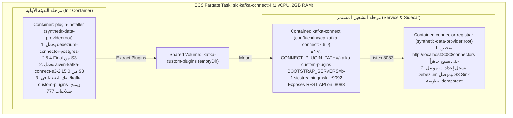

# منظومة التقاط التعديلات اللحظية (Debezium PostgreSQL CDC)
## الدليل التشريحي لتقنية Change Data Capture، سجلات الـ WAL، وموصلات Kafka Connect

---

> [!NOTE]
> **مسار الملف:** `docs/data-sources/debezium-cdc.md`  
> **الملفات المصدرية المرتبطة:**  
> - [`docker/kafka-connect/register_connectors.sh`](file:///home/syd/Downloads/archive/docker/kafka-connect/register_connectors.sh)
> - [`docker/kafka-connect/Dockerfile`](file:///home/syd/Downloads/archive/docker/kafka-connect/Dockerfile)
> - [`docs/services/kafka-connect-debezium.md`](file:///home/syd/Downloads/archive/docs/services/kafka-connect-debezium.md)

---

## 1. ما هو الـ CDC ولماذا نحتاجه؟ (CDC From First Principles)

### 1.1 المشكلة الهندسية: لماذا لا نعتمد على الاستعلام الدوري (Polling)؟
في الأنظمة التقليدية، عندما يحتاج فريق البيانات إلى مزامنة التعديلات التي تحدث في قاعدة البيانات (مثل إضافة عميل جديد أو تعديل حد ائتماني)، يلجأ البعض لعمل Query دوري:
```sql
SELECT * FROM users WHERE updated_at > :last_sync_timestamp;
```
هذا الأسلوب يعاني من مشاكل مدمرة في بيئات الإنتاج:
1. **إجهاد المعالج والقرص (Resource Overhead):** تنفيذ هذا الاستعلام كل دقيقة أو ثانية يستهلك موارد الخادم حتى لو لم تتغير أي بيانات.
2. **فقدان عمليات الحذف (Missed Hard Deletes):** إذا تم حذف صف من الجدول، لن يعثر عليه الاستعلام لأنه لم يعد موجوداً في الجدول أصلاً!
3. **فقدان التعديلات المتعددة (Missed Intermediate States):** إذا تم تعديل رصيد العميل 3 مرات في ثانية واحدة، فالاستعلام الدوري سيلتقط فقط القيمة الأخيرة ويفقد تاريخ التعديلات الوسيطة.

### 1.2 الحل المعماري: تقنية الـ Change Data Capture (CDC)
في محرك PostgreSQL، كل عملية (`INSERT` أو `UPDATE` أو `DELETE` أو `COMMIT`) تُكتب أولاً في سجل متسلسل متين على القرص يسمى **سجل الكتابة المسبقة (Write-Ahead Log - WAL)** قبل تعديل صفحات البيانات الفعلية لضمان عدم فقدان أي معاملة عند انقطاع الكهرباء.  
تقنية **CDC عبر Debezium** لا تستعلم الجداول نهائياً! بل تتصل بـ PostgreSQL كـ Replication Client وتقرأ سجلات الـ WAL مباشرة فور كتابتها، وتحول كل سطر يتم تعديله إلى حدث غني (Event Stream) يُرسل لحظياً لـ Apache Kafka.

```mermaid
flowchart LR
    A["تطبيق المولد\n(Generator Service)"] -->|SQL INSERT| B[("PostgreSQL 18\n(containerdb)")]
    B -->|تأكيد المعاملة في القرص| C["Write-Ahead Log\n(WAL Stream)"]
    C -->|Logical Decoding\n(pgoutput plugin)| D["Replication Slot\n(debezium_cdc_slot)"]
    D -->|Continuous Streaming| E["Debezium Connector\n(Kafka Connect)"]
    E -->|SMT Reroute| F["Amazon MSK\n(topics: users, cards)"]
```

---

## 2. الإعدادات السحابية في PostgreSQL (RDS Logical Replication)

لتمكين Debezium من قراءة الـ WAL، تم تعديل بارامترات خادم PostgreSQL 18 على Amazon RDS عبر الـ Parameter Group المخصص `synthetic-pg18-cdc`:

### 2.1 البارامترات الأساسية
* `rds.logical_replication = 1`: تفعيل ميزة التكرار المنطقي على مستوى الخادم السحابي.
* `wal_level = logical`: يوجه محرك Postgres لتضمين تفاصيل البيانات السابقة والجديدة لكل صف معدل في الـ WAL (وليس مجرد كتل البايتات الثنائية).
* `max_replication_slots = 10`: الحد الأقصى للمنافذ المسموح بحجزها للاستماع للـ WAL.
* `max_wal_senders = 10`: عدد خيوط المعالجة المخصصة لبث التعديلات للعملاء.

### 2.2 الـ Publication والـ Replication Slot
في لغة PostgreSQL:
1. **الـ Publication (`debezium_publication`):** بمثابة فلتر أو قناة اشتراك تحدد الجداول المسموح ببث تعديلاتها:
   ```sql
   CREATE PUBLICATION debezium_publication FOR TABLE public.users, public.cards;
   ```
2. **الـ Replication Slot (`debezium_cdc_slot`):** علامة مائية (Watermark / Cursor) يحتفظ بها خادم PostgreSQL لحساب موصل Debezium. فائدته الجوهرية: **يمنع محرك PostgreSQL من مسح سجلات الـ WAL من القرص حتى يتأكد أن Debezium قد قرأها وأكد استلامها!**

---

## 3. معمارية الحاويات على AWS ECS Fargate (Multi-Container Pod Pattern)

نظراً لأن منصة SIC تعمل على بيئة Serverless Fargate دون إدارة خوادم EC2، تم تطبيق نمط معماري متقدم لتشغيل موصلات Kafka Connect دون بناء صورة مخصصة وضخمة:



---

## 4. إعدادات موصل Debezium ومسار توجيه المواضيع (Configuration & SMT)

يتم تسجيل موصل Debezium عبر الـ REST API من خلال سكريبت [`register_connectors.sh`](file:///home/syd/Downloads/archive/docker/kafka-connect/register_connectors.sh):

```json
{
  "connector.class": "io.debezium.connector.postgresql.PostgresConnector",
  "tasks.max": "1",
  "plugin.name": "pgoutput",
  "database.hostname": "containerdb.cjm6iag8qrwi.eu-west-3.rds.amazonaws.com",
  "database.port": "5432",
  "database.user": "postgres",
  "database.password": "${DB_PASSWORD}",
  "database.dbname": "postgres",
  "database.server.name": "sic",
  "topic.prefix": "sic",
  "table.include.list": "public.users,public.cards",
  "publication.name": "debezium_publication",
  "slot.name": "debezium_cdc_slot",
  "snapshot.mode": "initial",
  "tombstones.on.delete": "false",
  "decimal.handling.mode": "double",
  "time.precision.mode": "connect",
  "transforms": "reroute",
  "transforms.reroute.type": "io.debezium.transforms.ByLogicalTableRouter",
  "transforms.reroute.topic.regex": ".*\\.public\\.(.*)",
  "transforms.reroute.topic.replacement": "$1"
}
```

### 4.1 شرح التحويل المنطقي (Single Message Transform - SMT):
افتراضياً، يقوم Debezium بتسمية مواضيع كافكا بالشكل: `<topic.prefix>.<schema>.<table>` (أي: `sic.public.users`).  
باستخدام أداة التحويل `ByLogicalTableRouter` مع التعبير النمطي `.*\.public\.(.*)` والبديل `$1`، يتم توجيه الرسائل مباشرة إلى المواضيع النظيفة:
* `sic.public.users` $\rightarrow$ موضوع **`users`**.
* `sic.public.cards` $\rightarrow$ موضوع **`cards`**.

---

## 5. تشريح رسالة الـ CDC (Before / After Payload Structure)

كل حدث تعديل ينشره Debezium في كافكا يحمل بنية غنية توثق التاريخ الكامل للتعديل:

```json
{
  "schema": { "...": "Debezium Schema Definition" },
  "payload": {
    "before": null,
    "after": {
      "user_id": 1042,
      "person": "John Doe",
      "current_age": 42,
      "city": "Springfield",
      "state": "IL",
      "latitude": 39.7817,
      "longitude": -89.6501,
      "fico_score": 720
    },
    "source": {
      "version": "2.5.4.Final",
      "connector": "postgresql",
      "name": "sic",
      "ts_ms": 1761765600123,
      "db": "postgres",
      "schema": "public",
      "table": "users",
      "txId": 584920,
      "lsn": 249018240
    },
    "op": "c",
    "ts_ms": 1761765600456
  }
}
```
* **حقل `op` (Operation Type):**
  * `"c"`: Create (`INSERT`) — يكون حقل `before` فارغاً و `after` يحتوي الصف الجديد.
  * `"u"`: Update (`UPDATE`) — يحتوي `before` على البيانات السابقة و `after` على البيانات الجديدة.
  * `"d"`: Delete (`DELETE`) — يحتوي `before` على بيانات الصف المحذوف و `after` يكون null.
  * `"r"`: Read (Initial Snapshot) — لقطة البداية عند تشغيل الموصل لأول مرة.

---

## 6. المخاطر التشغيلية وإدارة الـ Replication Slot (Operational Risks & Lag)

> [!WARNING]
> **خطر امتلاء قرص RDS (Disk Full Risk):**  
> إذا توقفت خدمة Kafka Connect أو تعطلت حاوية Debezium لأيام بينما المولد مستمر في إضافة مستخدمين جدد، سيقوم خادم PostgreSQL بحجز كافة ملفات الـ WAL على القرص ولن يحذفها لحين قراءتها من الـ Slot `debezium_cdc_slot`. هذا قد يؤدي إلى استهلاك 100% من مساحة قرص RDS وتوقف قاعدة البيانات بالكامل!

### كيفية فحص وتدارك الـ Slot Lag:
```sql
-- فحص حجم البيانات العالقة بالـ Replication Slot
SELECT 
    slot_name, 
    active, 
    pg_size_pretty(pg_wal_lsn_diff(pg_current_wal_lsn(), restart_lsn)) AS replication_backlog
FROM pg_replication_slots 
WHERE slot_name = 'debezium_cdc_slot';
```
* إذا كان `active = false` والـ backlog يتزايد بالميجابايت، يجب فحص سجلات حاوية Kafka Connect فوراً أو إعادة تشغيلها، أو إسقاط الـ Slot يدوياً في حالات الطوارئ القصوى (`SELECT pg_drop_replication_slot('debezium_cdc_slot');`).
