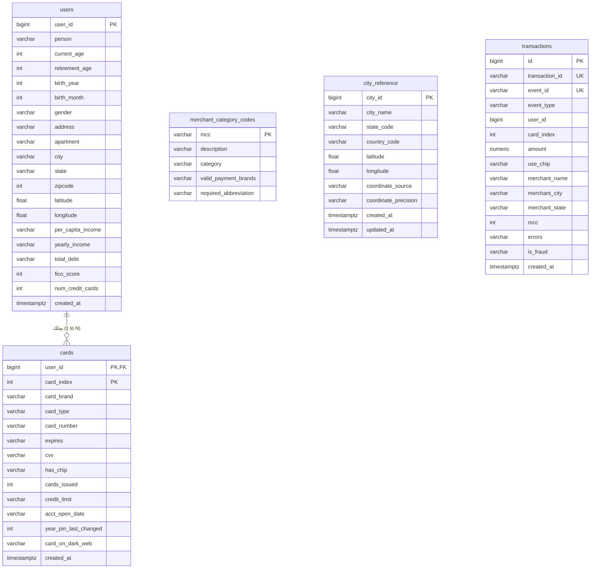

# نموذج بيانات قاعدة بيانات PostgreSQL (PostgreSQL Data Model)
## الدليل التوثيقي الشامل للجداول، العلاقات، الفهارس، ومخططات الـ ER

---

> [!NOTE]
> **مسار الملف:** `docs/data-sources/postgresql-data-model.md`  
> **الملفات المصدرية المرتبطة:**  
> - [`src/synthetic_streaming/database.py`](file:///home/syd/Downloads/archive/src/synthetic_streaming/database.py)
> - [`sql/schema.sql`](file:///home/syd/Downloads/archive/sql/schema.sql)  
> **قاعدة البيانات:** PostgreSQL 18.3 على Amazon RDS (`containerdb`)

---

## 1. نظرة عامة ودور قاعدة البيانات التشغيلية

في منصة SIC، تمثل قاعدة بيانات PostgreSQL 18 مصدر الحقيقة للكيانات العلائقية (Relational Entities) والبيانات المرجعية الثابتة (Reference Dimensions).  
تتألف قاعدة البيانات من 5 جداول رئيسية:



---

## 2. تفصيل الجداول الخمسة وحقولها البرمجية

### 2.1 جدول المستخدمين: `public.users`
* **المسؤولية:** حفظ السجل الديموغرافي والمالي لعملاء المنظومة.
* **طريقة التعبئة (Population):** يتم تحميل المستخدمين الأوائل من `data/sd254_users.csv`، ويقوم [`UsersGenerator`](file:///home/syd/Downloads/archive/src/synthetic_streaming/users_generator.py) بتوليد مستخدمين جدد ديناميكياً أثناء تشغيل المنصة.
* **المستهلكون:** يُلتقط بواسطة **Debezium CDC** ويبث إلى كافكا ثم S3، ويُستخدم في تهيئة بروفايلات متجر الخصائص اللحظي في Redis.

| اسم العمود | نوع البيانات | القيود | الوصف والدلالة البنكية |
| :--- | :--- | :--- | :--- |
| `user_id` | `BigInteger` | **Primary Key**, Indexed | معرف العميل الفريد المتسلسل (User ID) |
| `person` | `String(255)` | NOT NULL | اسم العميل التخليقي الكامل |
| `current_age` | `Integer` | NOT NULL | عمر العميل الحالي (18 إلى 100 سنة) |
| `retirement_age` | `Integer` | NOT NULL | سن التقاعد المتوقع |
| `birth_year` / `birth_month` | `Integer` | NOT NULL | سنة وشهر الميلاد |
| `gender` | `String(32)` | NOT NULL | الجنس (`Female` / `Male`) |
| `address` / `apartment` | `String(255)` | Nullable | العنوان السكني ورقم الشقة |
| `city` / `state` | `String(128/32)` | NOT NULL, Indexed | مدينة وولاية إقامة العميل |
| `zipcode` | `Integer` | NOT NULL, Indexed | الرمز البريدي المكون من 5 أرقام |
| `latitude` / `longitude` | `Float` | NOT NULL | الإحداثيات الجغرافية لمنزل العميل (Home GPS) |
| `yearly_income` | `String(64)` | NOT NULL | الدخل السنوي للعميل (e.g. `$55,000`) |
| `total_debt` | `String(64)` | NOT NULL | إجمالي الديون القائمة (e.g. `$25,000`) |
| `fico_score` | `Integer` | NOT NULL | درجة الجدارة الائتمانية (FICO: 300 إلى 850) |
| `num_credit_cards` | `Integer` | NOT NULL | إجمالي البطاقات المصدرة للعميل |
| `created_at` | `DateTime(TZ)` | NOT NULL | توقيت إنشاء الحساب بالـ UTC |

---

### 2.2 جدول بطاقات الدفع: `public.cards`
* **المسؤولية:** توثيق حسابات البطاقات الصادرة لكل عميل.
* **المفتاح الأساسي المركب (Composite PK):** `(user_id, card_index)` لضمان مطابقة بنية المعاملات المالية التاريخية لشركة IBM.
* **العلاقة:** مربوط بجدول `users` عبر Foreign Key مع خاصية الحذف المتتالي `ON DELETE CASCADE`.

| اسم العمود | نوع البيانات | القيود | الوصف والدلالة البنكية |
| :--- | :--- | :--- | :--- |
| `user_id` | `BigInteger` | **PK**, **FK** | رقم العميل المالك للبطاقة |
| `card_index` | `Integer` | **PK** | مؤشر البطاقة لدى العميل (0، 1، 2..) |
| `card_brand` | `String(64)` | NOT NULL | علامة البطاقة (Visa, Mastercard, Amex, Discover) |
| `card_type` | `String(64)` | NOT NULL | نوع البطاقة (Debit, Credit, Prepaid) |
| `card_number` | `String(64)` | NOT NULL | رقم البطاقة المقنع أو التخليقي (Synthetic PAN) |
| `expires` | `String(16)` | NOT NULL | تاريخ الانتهاء بصيغة `MM/YYYY` |
| `cvv` | `String(8)` | NOT NULL | كود الحماية المكون من 3 أو 4 أرقام |
| `has_chip` | `String(8)` | NOT NULL | هل تحتوي البطاقة على شريحة ذكية (`YES` / `NO`) |
| `credit_limit` | `String(32)` | NOT NULL | الحد الائتماني للبطاقة (e.g. `$5,000`) |
| `year_pin_last_changed` | `Integer` | NOT NULL | سنة آخر تعديل للرقم السري (ميزة سلوكية هامة) |
| `card_on_dark_web` | `String(8)` | NOT NULL | هل سُربت البطاقة على الدارك ويب (`Yes` / `No`) |
| `created_at` | `DateTime(TZ)` | NOT NULL | توقيت إنشاء البطاقة |

---

### 2.3 جدول أكواد تصنيف المتاجر: `public.merchant_category_codes`
* **المسؤولية:** جدول مرجعي ثابت يضم **914 كود تصنيف تجاري (MCC)** معتمد عالمياً.
* **الاستخدام:** يُستخرج يومياً في المسار الثالث كملف Snappy Parquet لتغذية استعلامات الـ JOIN في بحيرة البيانات، ويستخدم في حساب مخاطر التاجر (`mcc_risk_score`).

| اسم العمود | نوع البيانات | القيود | الوصف |
| :--- | :--- | :--- | :--- |
| `mcc` | `String(8)` | **Primary Key** | كود تصنيف التاجر المكون من 4 أرقام (e.g. `5411` للبقالة) |
| `description` | `String(255)` | NOT NULL | الوصف التجاري (Grocery Stores, Supermarkets) |
| `category` | `String(128)` | NOT NULL, Indexed | التصنيف العام (Retail, Travel, Dining, Services) |
| `valid_payment_brands` | `String(64)` | Nullable | شبكات الدفع المقبولة |
| `required_abbreviation`| `String(64)` | Nullable | الاختصار المعتمد |

---

### 2.4 جدول إحداثيات المدن: `public.city_reference`
* **المسؤولية:** مرجع جغرافي يضم **1,433 مدينة** في الولايات المتحدة الأمريكية مع إحداثياتها الجغرافية الدقيقة.
* **الفهرس الفريد:** مفهرس بـ `idx_city_ref_lookup` على `(city_name, state_code)` لتسريع عمليات المطابقة الجغرافية للمولد وحساب مسافات الـ Haversine.

| اسم العمود | نوع البيانات | القيود | الوصف |
| :--- | :--- | :--- | :--- |
| `city_id` | `BigInteger` | **Primary Key**, Auto | المعرف الرقمي المتسلسل للمدينة |
| `city_name` | `String(128)` | NOT NULL | اسم المدينة |
| `state_code` | `String(32)` | NOT NULL | كود الولاية (e.g. `IL`, `CA`, `NY`) |
| `latitude` / `longitude` | `Float` | NOT NULL | خط العرض وخط الطول الدقيقين لمركز المدينة |
| `coordinate_source` | `String(128)` | NOT NULL | مصدر الإحداثيات الجغرافية (USGS / Census) |
| `coordinate_precision`| `String(64)` | NOT NULL | دقة الإحداثيات (e.g. `city_center`) |

---

### 2.5 جدول المعاملات التاريخي: `public.transactions` (Legacy Store)
* **المسؤولية:** حفظ المعاملات التاريخية الأولية ومعاملات الـ REST API التي يطلب المستخدم توليدها يدوياً عبر `POST /api/v1/generator/generate`.
* **ملاحظة معمارية حاسمة:** كما وضحنا في ميثاق الـ Zero-DB-Inserts، **المعاملات اللحظية الحية المتدفقة لا تدخل هذا الجدول نهائياً**، بل تتجه مباشرة لكافكا لتفادي إجهاد قاعدة البيانات.

---

## 3. نصوص DDL لإنشاء الفهارس وضمان الأداء (Indexes & Performance)

تم إنشاء الفهارس التالية في ملف [`sql/schema.sql`](file:///home/syd/Downloads/archive/sql/schema.sql) لتأمين سرعة القراءة لخدمة Debezium ومسارات الـ Extraction:

```sql
-- تسريع البحث عن كروت العميل الواحد
CREATE INDEX IF NOT EXISTS idx_cards_user_index ON public.cards (user_id, card_index);

-- تسريع مطابقة مدن التجار
CREATE UNIQUE INDEX IF NOT EXISTS idx_city_ref_lookup ON public.city_reference (city_name, state_code);

-- تسريع الاستعلام التزايدي في Airflow باستخدام علامات الإزاحة
CREATE INDEX IF NOT EXISTS idx_transactions_since_id ON public.transactions (id ASC);
CREATE INDEX IF NOT EXISTS idx_transactions_created_at ON public.transactions (created_at);
```
