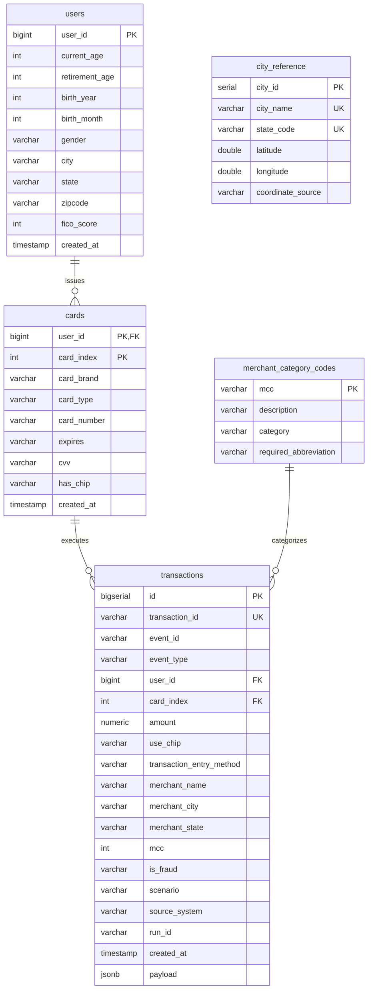

# Relational Database Architecture & SQL Schema Specification

**Engine Target:** PostgreSQL 16+ (Amazon RDS)  
**Database Name:** `synthetic_db` / `postgres`  
**Schema Name:** `public`  
**Role:** Operational OLTP Source System (Source B) & Persistent Transaction Log (Source A)

---

## 1. Architectural Scope & Boundary Definition

The relational database acts strictly as the **Source System Data Provider**:
- **OLTP Primary Store**: Enforces referential integrity, unique constraints, foreign keys, and serial monotonically increasing identity sequence IDs (`id BIGSERIAL`).
- **Separation of Concerns**: It is **not** an analytical lakehouse destination. Downstream analytical workloads, Star Schemas, and Iceberg/Delta transformations belong in the downstream Data Engineering lakehouse tier, populated via the S3 Bronze ingestion layer.

---

## 2. Entity Relationship & Schema Details

---

## 3. Table Definitions & Constraints Matrix

### 3.1. Reference Entities (Source B)
1. **`users`**:
   - **Primary Key**: `user_id BIGINT` (Natural index: 0..1999 for baseline demographic users; >=2000 for dynamic new users).
   - **Check Constraints**: `current_age BETWEEN 0 AND 120`, `fico_score BETWEEN 300 AND 850`.
   - **Indexes**: `(city, state)`, `(zipcode)`.

2. **`cards`**:
   - **Composite Primary Key**: `(user_id, card_index)`.
   - **Foreign Key**: `user_id REFERENCES users(user_id) ON DELETE CASCADE`.
   - **Index**: `(card_brand, card_type)`.

3. **`merchant_category_codes`**:
   - **Primary Key**: `mcc VARCHAR(8)` (preserving 4-digit leading zeros).
   - **Index**: `(category)`.

4. **`city_reference`**:
   - **Primary Key**: `city_id SERIAL`.
   - **Unique Constraint**: `(city_name, state_code)` ensuring zero coordinate duplication.
   - **Precision**: Centroid coordinates (`latitude`, `longitude`) with `coordinate_precision` documentation.

### 3.2. Operational Transaction Store (Source A Storage)
5. **`transactions`**:
   - **Primary Key**: `id BIGSERIAL` (Monotonic integer auto-increment identity; forms the infallible pipeline watermark).
   - **Unique Constraint**: `transaction_id VARCHAR(64) UNIQUE`.
   - **Foreign Key**: `(user_id, card_index) REFERENCES cards(user_id, card_index)`.
   - **Indexes**:
     - `idx_transactions_created_at_id`: `(created_at ASC, id ASC)` for timestamp range filtering.
     - `idx_transactions_user_card`: `(user_id, card_index)` for customer historical query lookups.
     - `idx_transactions_scenario_fraud`: `(scenario, is_fraud)` for behavioral analytics.
     - `idx_transactions_entry_method`: `(transaction_entry_method)` for payment rail profiling.

6. **`ingestion_watermarks_audit`**:
   - **Primary Key**: `run_id VARCHAR(128)`.
   - Records every execution of the downstream ingestion worker (`watermark_before`, `watermark_after`, `records_fetched`, `records_written`, `records_quarantined`, `s3_object_key`, `duration_seconds`).

---

## 4. Idempotency & Duplicate Load Strategy

1. **Reference Seeding**:
   - Managed via `session.bulk_save_objects()` and idempotent existence checks.
   - On container startup, if `SELECT count(*) FROM users` returns > 0, re-insertion is cleanly skipped without error.
2. **Batch Persistence Atomicity**:
   - In `GeneratorService`, batches persist inside a single database transaction block (`with session.begin():`).
   - If an error occurs on record $k$ of $N$, the entire batch rolls back automatically (`session.rollback()`). Zero partial batches are committed.
3. **Downstream Ingestion Idempotency**:
   - Keyset extraction (`WHERE id > :since_id ORDER BY id ASC LIMIT :limit`) ensures records are monotonically ordered.
   - Downstream S3 Parquet naming is deterministic: `transactions_batch_{first_id}_{last_id}.parquet`. Re-running the batch overwrites the exact S3 key with identical bytes, guaranteeing idempotent at-least-once ingestion without duplication.
