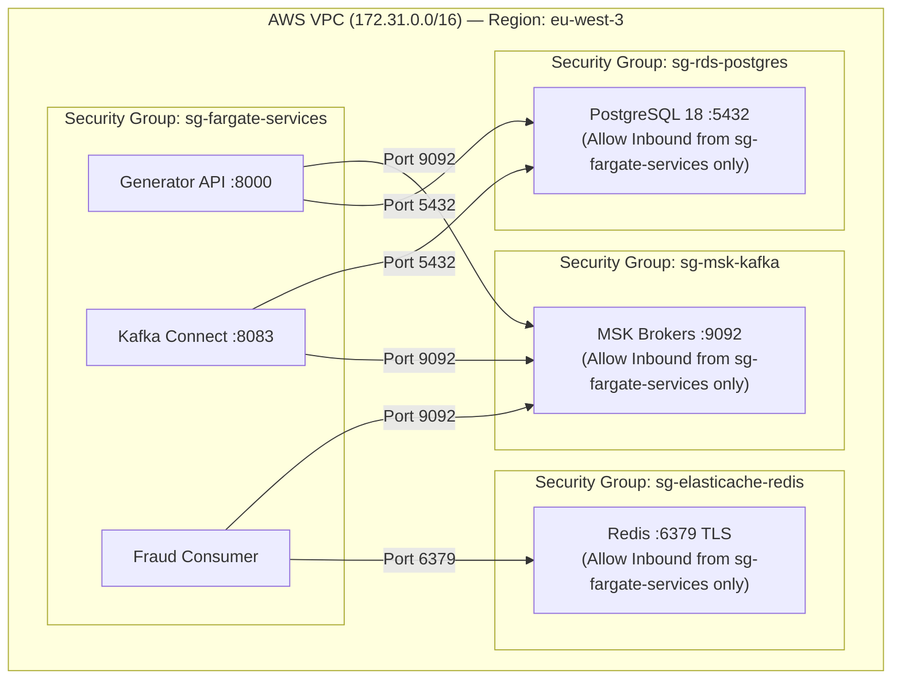

# البنية التحتية والنشر السحابي على AWS (AWS Cloud Deployment)
## الدليل التشغيلي لموارد السحابة، الشبكات، مجموعات الأمان، ومهام ECS Fargate

---

> [!NOTE]
> **مسار الملف:** `docs/deployment/aws-deployment.md`  
> **المنطقة السحابية:** `eu-west-3` (AWS Europe - Paris)  
> **البيئة المستهدفة:** Production-Grade Serverless Data Platform

---

## 1. حصر الموارد السحابية المستخدمة (Cloud Resource Inventory)

تم فحص تكوينات البنية التحتية والسكريبتات، وإليك جدول الموارد السحابية المعتمدة:

```text
┌───────────────────────────┬─────────────────────────────────┬─────────────────────────────────────────────────┐
│ الخدمة السحابية (Service) │ اسم المورد / المعرف             │ التكوين والمواصفات التشغيلية                    │
├───────────────────────────┼─────────────────────────────────┼─────────────────────────────────────────────────┤
│ AWS ECS Fargate Cluster   │ synthetic-data-cluster          │ عنقود الحاويات السحابية Serverless              │
│ ECS Service (Generator)   │ synthetic-data-service          │ تشغيل API والمولد (0.5 vCPU, 1GB RAM)           │
│ ECS Service (Kafka Connect│ sic-kafka-connect-service       │ تشغيل Debezium و S3 Sink (Task :4, 1 vCPU, 2GB) │
│ ECS Service (Fraud Model) │ sic-fraud-consumer              │ تشغيل مستهلك الاحتيال وموديل LightGBM (Task :2) │
│ Amazon RDS PostgreSQL     │ containerdb.cjm6iag8qrwi...     │ PostgreSQL 18.3 / Parameter Group: pg18-cdc     │
│ Amazon MSK Cluster        │ sic-streaming-msk               │ كافكا مدار مع 2 Brokers / PLAINTEXT Port 9092   │
│ AWS ElastiCache Redis     │ (redis endpoint: 6379)          │ Redis 7.1 / cache.t4g.micro / In-transit TLS    │
│ Amazon S3 Bucket          │ sic-pipeline-storage            │ باكت بحيرة البيانات المركزي (Bronze Lakehouse)  │
│ Amazon DynamoDB Table     │ ingestion_watermarks            │ جدول علامات الإزاحة التزايدية الذري             │
│ Amazon EventBridge        │ sic-batch-reference-daily       │ مشغل الجدولة اليومي cron(0 2 * * ? *)           │
│ AWS Secrets Manager       │ synthetic-data-provider/database│ تخزين بيانات اتصال RDS وتشفير الأسرار          │
└───────────────────────────┴─────────────────────────────────┴─────────────────────────────────────────────────┘
```

---

## 2. معمارية الشبكات ومجموعات الأمان (VPC & Security Groups)

تعمل المنظومة داخل **VPC مخصصة (172.31.0.0/16)** مقسمة إلى 3 شبكات فرعية:



* **مبدأ العزل الأمني:** قواعد البيانات (RDS و Redis) ووسطاء كافكا لا يملكون أي Public IP ولا يمكن الوصول إليهم من خارج الـ VPC؛ كافة الاتصالات تتم عبر عناوين IP الخاصة (Private IPs).

---

## 3. تسلسل النشر والاعتماديات (Deployment Order Sequence)

عند نشر المنظومة في بيئة سحابية جديدة، يجب الالتزام بالتسلسل الهندسي التالي لتفادي أخطاء الاعتماديات:

```text
المرحلة 1: البنية التحتية الأساسية (Foundational Plane)
  1. إنشاء الـ VPC، الـ Subnets، ومجموعات الأمان (Security Groups).
  2. إنشاء Amazon S3 Bucket وتفعيل التشفير وحظر الوصول العام.
  3. إنشاء جدول Amazon DynamoDB `ingestion_watermarks`.
  4. تخزين كلمات المرور في AWS Secrets Manager.

المرحلة 2: مخازن البيانات والمراسلات (State & Streaming Plane)
  5. إنشاء قاعدة بيانات RDS PostgreSQL وتعيين الـ Parameter Group `wal_level = logical`.
  6. تشغيل استعلامات SQL لإنشاء الجداول والـ Publication: `sql/init_schema.sql`.
  7. إنشاء عنقود Amazon MSK وضبط المواضيع الخمسة وعوامل التكرار.
  8. إنشاء عنقود ElastiCache for Redis وتفعيل التشفير بالـ TLS.

المرحلة 3: التطبيقات والحاويات (Compute Plane)
  9. دفع صور الحاويات المحدثة إلى Amazon ECR.
  10. إطلاق خدمة Kafka Connect (`sic-kafka-connect-service`) وتشغيل سكريبت تسجيل الموصلات.
  11. إطلاق خدمة مستهلك الاحتيال (`sic-fraud-consumer`).
  12. إطلاق خدمة المولد والـ API (`synthetic-data-service`).

المرحلة 4: الجدولة والتكامل (Orchestration & Lakehouse)
  13. تفعيل قواعد EventBridge Scheduler ومزامنة Airflow DAGs.
  14. ربط مهام Databricks ببحيرة البيانات عبر AWS IAM Role المعتمد.
```

---

## 4. خطة التراجع عند الطوارئ (Rollback Procedures)

* **تحديث الموديل الرياضي:** إذا أظهر الإصدار الجديد من الموديل ارتفاعاً غير مقبول في الإيجابيات الكاذبة، يتم التراجع فوراً بتعديل الـ Task Definition في ECS Fargate وإرجاع مسار الموديل إلى الإصدار السابق (`models/v1/fraud_lgbm_model.joblib`) دون توقف كافكا.
* **إعادة بناء موصلات كافكا كونكت:** إذا حدث خطأ في إعدادات Debezium أو S3 Sink، لا حاجة لإعادة نشر الحاوية بالكامل؛ بل يتم استدعاء سكريبتات التصحيح الفوري:
  ```bash
  python scripts/fix_debezium_config.py
  python scripts/fix_s3_sink_sts.py
  ```
