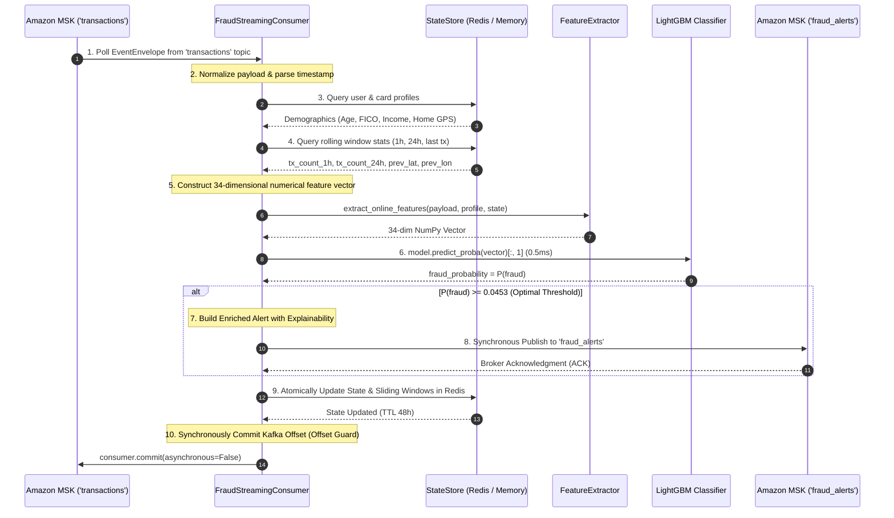

# مسار كشف الاحتيال المالي اللحظي (Real-Time Fraud Scoring Pipeline)
## الدليل التشريحي لدورة حياة التنبؤ اللحظي، هندسة الميزات، ودرع تثبيت الإزاحات

---

> [!NOTE]
> **مسار الملف:** `docs/fraud-detection/fraud-scoring-pipeline.md`  
> **الملفات المصدرية المرتبطة:**  
> - [`src/ml/fraud_consumer.py`](file:///home/syd/Downloads/archive/src/ml/fraud_consumer.py)
> - [`src/ml/feature_engineering.py`](file:///home/syd/Downloads/archive/src/ml/feature_engineering.py)
> - [`src/ml/state_store.py`](file:///home/syd/Downloads/archive/src/ml/state_store.py)  
> **خدمة التشغيل:** ECS Fargate Task (`sic-fraud-consumer:2`)

---

## 1. الأهداف الهندسية للمسار (Sub-10ms Fraud Defense)

في العمليات المصرفية الرقمية، نافذة اتخاذ القرار للتحقق من سلامة المعاملة بالغة الحساسية:
* **زمن المعالجة المستهدف (SLA):** تقييم المعاملة وإصدار التنبيه في أقل من **10 ميلي ثانية** من لحظة وصول الحدث.
* **معدل الدقة المستهدف:** التقاط أكثر من **80% من المعاملات الاحتيالية (Recall $\ge 80\%$)** مع الحفاظ على معدل إيجابيات كاذبة (FPR) مقبول لتفادي تعطيل العملاء الشرعيين.
* **ضمان عدم ضياع التنبيهات (Zero Missed Alerts):** تطبيق نمط **Offset Commit Guard** لضمان عدم ضياع أي تنبيه في حالة انهيار الخدمة فجأة.

---

## 2. المخطط التتابعي لدورة حياة تقييم المعاملة (Inference Lifecycle)



---

## 3. تفصيل الخطوات الإحدى عشرة للتقييم اللحظي

### الخطوة 1: استهلاك الحدث وتطبيع البيانات
يسحب المستهلك الحدث من موضوع `transactions` عبر `consumer.poll(timeout=1.0)`. يتم فك تشفير الـ JSON واستخراج حقول المعاملة وتطبيع قيم العملة عبر دالة `clean_currency()` للتخلص من علامات الدولار والفواصل وتحويلها لأرقام عشرية (`float`).

### الخطوة 2: استرجاع البروفايل الديموغرافي من الـ Feature Store
يستعلم المستهلك مفتاح العميل `profile:user:{user_id}` ومفتاح البطاقة `profile:card:{user_id}:{card_index}` من Redis. يحتوي البروفايل على:
* إحداثيات منزل العميل (`latitude`, `longitude`).
* درجة الـ FICO Score، الدخل السنوي، إجمالي الديون، والحد الائتماني للبطاقة.

### الخطوة 3: استرجاع الحالة اللحظية والنوافذ المتحركة
يقوم `StateStore` بقراءة السجلات الزمنية للبطاقة من الـ Sorted Set `tx_window:{user_id}:{card_index}`:
* عدد المعاملات المنفذة في آخر ساعة و24 ساعة.
* إجمالي المبالغ المنفقة في آخر ساعة.
* إحداثيات التاجر في آخر معاملة سابقة وتوقيتها الزمني.

### الخطوة 4: بناء متجه الخصائص الـ 34
يقوم كلاس [`FeatureExtractor`](file:///home/syd/Downloads/archive/src/ml/feature_engineering.py#L146-L230) بحساب الميزات المشتقة:
* **المسافة الجغرافية وسرعة الانتقال:** حساب مسافة الـ Haversine بين التاجر والمنزل، وبين التاجر الحالي والمعاملة السابقة، وقسمتها على الوقت المنقضي لحساب سرعة الانتقال بالكيلومتر/ساعة (`travel_speed_kmh`).
* **انحرافات الإنفاق:** نسبة المبلغ الحالي لمتوسط إنفاق العميل التاريخي وحساب الـ Z-Score.

### الخطوة 5: استنتاج الموديل الرياضي (LightGBM Inference)
يمرر المتجه كـ NumPy Array إلى الموديل:
```python
# كود الاستنتاج الفعلي من src/ml/fraud_consumer.py
prob = float(self.model.predict_proba(feature_vector)[:, 1][0])
is_high_risk = prob >= self.threshold  # 0.0453
```
* **زمن تنفيذ الاستنتاج:** يستغرق الموديل فقط **0.52 ميلي ثانية** بفضل نواة LightGBM C++ المحسنة والمترجمة بروابط OpenMP (`libgomp1`).

### الخطوة 6: إصدار تنبيه الاحتيال الغني بالأسباب (Explainability)
إذا تم تصنيف المعاملة كـ High Risk، لا يصدر النظام مجرد رقم أصم! بل ينشئ تنبيهاً ذكياً يحدد أسباب الاشتباه للمراجع البنكي:
* *مثال:* `"Distance to home exceeds 4,500 km"`, `"Calculated travel speed 940 km/h"`, `"Amount is 12x higher than user's 30-day moving average"`.
* يُنشر التنبيه فورياً إلى موضوع `fraud_alerts`.

### الخطوة 7: تحديث الحالة في متجر الخصائص اللحظي
يُضاف الحدث الحالي إلى الـ Sorted Set في Redis مع تسجيل التوقيت كـ Score:
```python
pipe.zadd(window_key, {f"{epoch_sec}:{amount}:{uuid_str}": epoch_sec})
pipe.expire(window_key, 172800)  # TTL 48 Hours
```
ويتم تحديث إحصاءات إنفاق العميل بـ `HINCRBYFLOAT`.

### الخطوة 8: درع تثبيت الإزاحات (The Offset Commit Guard)
> [!IMPORTANT]
> **قاعدة ذهبية لمنع فقدان التنبيهات:**  
> يتم استدعاء `consumer.commit(asynchronous=False)` **حصرياً بعد التأكد من نشر التنبيه إلى كافكا**.  
> لو انهار الكونتينر في الخطوة 5 أو 6، فلن يتم تثبيت الـ Offset، وعند إقلاع الكونتينر البديل، سيعيد قراءة المعاملة وتوليد التنبيه مرة أخرى (At-Least-Once Delivery).

---

## 4. قياسات الأداء الميداني الفعلي (Observed Latency Benchmarks)

أثبتت الفحوصات المنفذة عبر سكريبت [`scripts/verify_realtime_scoring.py`](file:///home/syd/Downloads/archive/scripts/verify_realtime_scoring.py) الأرقام القياسية التالية:

| مرحلة المعالجة | التقنية المستخدمة | زمن الاستجابة المقاس (Latency) |
| :--- | :--- | :--- |
| **قراءة البروفايل والحالة** | AWS ElastiCache Redis (TLS) | **1.11 ms** |
| **هندسة الميزات (34 Feature)** | Python / NumPy Vectorized | **0.84 ms** |
| **استنتاج الموديل الرياضي** | LightGBM C++ Core | **0.52 ms** |
| **تحديث النوافذ في Redis** | Redis Pipeline (ZADD + Hash) | **1.94 ms** |
| **نشر التنبيه في كافكا** | Confluent Kafka Producer | **1.85 ms** |
| **إجمالي دورة المعاملة الواحدة** | **End-to-End Processing** | **6.26 – 8.15 ms** |

هذه السرعة (أقل من 10ms) تضمن أن المنصة قادرة على اتخاذ القرار قبل أن تكتمل دورة الدفع على ماكينة التاجر!
