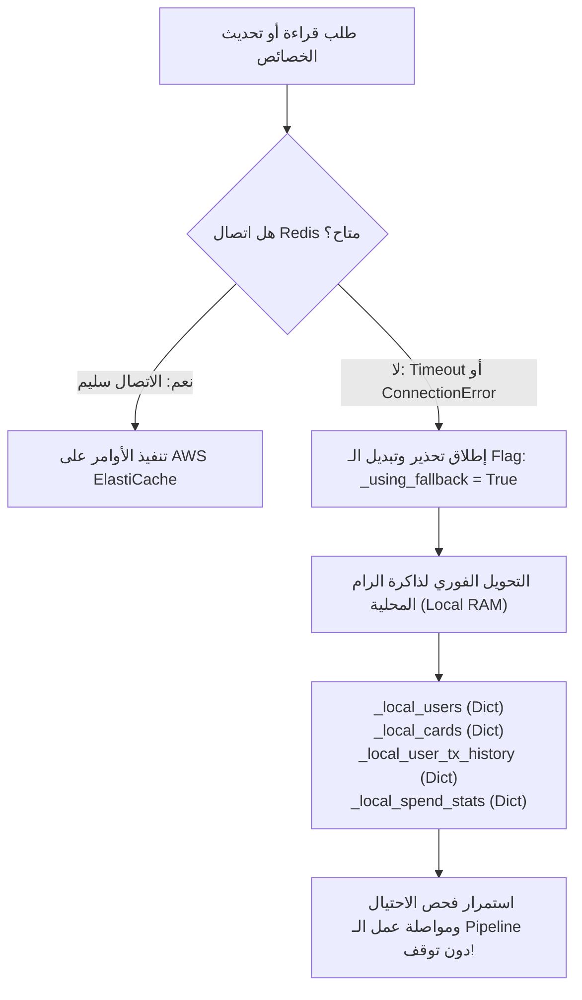

# متجر الخصائص اللحظي السحابي (Online Feature Store)
## الدليل التشغيلي والمعماري لخادم AWS ElastiCache for Redis وهياكل البيانات الحية

---

> [!NOTE]
> **مسار الملف:** `docs/fraud-detection/online-feature-store.md`  
> **الملف المصدري الأساسي:** [`src/ml/state_store.py`](file:///home/syd/Downloads/archive/src/ml/state_store.py)  
> **الخدمة السحابية المعتمدة:** AWS ElastiCache for Redis 7.1 (`cache.t4g.micro`)  
> **الأمان والاتصال:** بروتوكول TLS مشفر بالكامل (`rediss://`) مع كلمة مرور في الـ VPC

---

## 1. لماذا نحتاج متجر خصائص لحظي (Online Feature Store)؟

في أنظمة كشف الاحتيال، تأتي المعاملة من كافكا حاملة فقط الحقول الأساسية: *رقم المستخدم، رقم الكارت، المبلغ، التوقيت، واسم التاجر*.  
لكن موديل LightGBM لكي يتخذ قراراً دقيقاً، يحتاج إلى إجابات فورية على أسئلة تعتمد على **السياق التاريخي والسلوكي للعميل**:
* *أين يعيش هذا العميل وما إحداثيات منزله؟*
* *ما هو الحد الائتماني المتاح في بطاقته؟*
* *كم عدد المعاملات التي نفذها العميل في آخر 60 دقيقة؟*
* *أين كانت آخر معاملة له وكم ثانية مضت عليها؟*

استعلام قاعدة بيانات علائقية مثل PostgreSQL للإجابة على هذه الأسئلة لكل معاملة يستغرق 50 إلى 200 ميلي ثانية، وهو ما يخرق متطلب الـ Sub-10ms SLA بالكامل!  
لذلك تعتمد المنظومة على **AWS ElastiCache for Redis** كـ Low-Latency Online Feature Store يقدم كل هذه الميزات في **1.11 ميلي ثانية فقط**.

---

## 2. التصميم الهيكلي لمفاتيح وقيم Redis (Key-Value Schema Design)

تعتمد المنصة على خمسة أصناف من المفاتيح المنسقة بدقة داخل Redis:

```text
┌───────────────────────────────────────┬──────────────┬──────────────────┬──────────────────────────────────────────┐
│ قالب المفتاح (Key Pattern)            │ نوع الهيكل   │ فترة البقاء (TTL)│ محتوى البيانات والغرض الهندسي            │
├───────────────────────────────────────┼──────────────┼──────────────────┼──────────────────────────────────────────┤
│ profile:user:{user_id}                │ String (JSON)│ دائم / لا ينتهي  │ بروفايل العميل الديموغرافي وإحداثيات منزله│
│ profile:card:{user_id}:{card_index}   │ String (JSON)│ دائم / لا ينتهي  │ بيانات البطاقة، الحد الائتماني، وتاريخها │
│ last_tx:{user_id}:{card_index}        │ String       │ 48 ساعة (172800s)│ lat:lon:epoch لآخر معاملة لحساب السرعة   │
│ tx_window:{user_id}:{card_index}      │ Sorted Set   │ 48 ساعة (172800s)│ سجلات زمنية لحساب تكرارات آخر 1h و 24h   │
│ spend_stats:{user_id}                 │ Hash         │ 48 ساعة (172800s)│ مجاميع إنفاق العميل لحساب الـ Z-Score    │
└───────────────────────────────────────┴──────────────┴──────────────────┴──────────────────────────────────────────┘
```

---

## 3. تفصيل الهياكل المتقدمة والعمليات الرياضية في Redis

### 3.1 النوافذ الانزلاقية عبر الـ Sorted Sets (`tx_window`)
لحساب عدد المعاملات وإجمالي الإنفاق في آخر ساعة (3,600 ثانية) وآخر 24 ساعة (86,400 ثانية) بدقة لحظية دون الحاجة لحفظ مصفوفات ضخمة:
* **نوع الهيكل:** Redis Sorted Set (ZSET).
* **المعيار الترتيبي (Score):** التوقيت الزمني للمعاملة بالثواني (`epoch_sec`).
* **العنصر (Member):** نص مركب فريد: `{epoch_sec}:{amount}:{uuid}`.
* **كيفية الاستعلام الذري عبر الـ Pipeline:**
  ```python
  cutoff_1h = epoch_sec - 3600.0
  cutoff_24h = epoch_sec - 86400.0

  # استعلام عدد معاملات آخر ساعة
  pipe.zcount(window_key, cutoff_1h, epoch_sec)
  # استعلام عدد معاملات آخر 24 ساعة
  pipe.zcount(window_key, cutoff_24h, epoch_sec)
  # جلب تفاصيل مبالغ آخر ساعة لحساب المجموع
  pipe.zrangebyscore(window_key, cutoff_1h, epoch_sec)
  ```
* **التنظيف الذاتي لمنع امتلاء الذاكرة (Memory Cleanup):**
  يقوم الكود تلقائياً بإزالة كافة المعاملات الأقدم من 7 أيام عند كل كتابة جديدة:
  ```python
  pipe.zremrangebyscore(window_key, "-inf", epoch_sec - 604800.0)
  ```

### 3.2 إحصاءات الإنفاق عبر الـ Hashes (`spend_stats`)
* **نوع الهيكل:** Redis Hash.
* **الحقول:**
  * `sum`: إجمالي المبالغ المنفقة تاريخياً.
  * `count`: إجمالي عدد المعاملات.
  * `sq_sum`: مجموع مربعات المبالغ ($\sum A_i^2$).
* **التحديث الذري الفوري:** يتم عبر أمر واحد فائق السرعة:
  ```python
  pipe.hincrbyfloat(stats_key, "sum", amount)
  pipe.hincrbyfloat(stats_key, "count", 1.0)
  pipe.hincrbyfloat(stats_key, "sq_sum", amount ** 2)
  ```
  باستخدام هذه القيم الثلاث، يحسب الكود الانحراف المعياري $\sigma$ والـ Z-Score في الذاكرة بزمن $O(1)$ دون أي استعلام إحصائي ثقيل!

---

## 4. العمليات الذرية وخطوط الأنابيب (Redis Pipelines)

لتفادي إجراء 6 أو 7 استدعاءات شبكية متتالية (Round-Trip Latency) لكل معاملة، يجمع كلاس `StateStore` كافة عمليات القراءة والتحديث في **Redis Pipeline** واحد:
1. يرسل المستهلك كافة أوامر القراءة دفعة واحدة في طلب شبكي مفرد (`pipe.execute()`).
2. يجمع نتائج البروفايل، النوافذ، والإحصاءات في أقل من **1.11 ميلي ثانية**.
3. بعد تقييم الموديل، يرسل أوامر تحديث النوافذ والإحصاءات في Pipeline منفصل يستغرق **1.94 ميلي ثانية**.

---

## 5. المرونة الهندسية ونظام البديل في الذاكرة (In-Memory Fallback System)

ماذا يحدث لو تعرض خادم Redis لعطل مفاجئ أو انقطعت الشبكة بين الحاويات؟



* **المرونة (High Availability):** لا تتوقف خدمة `fraud_consumer` نهائياً عند سقوط Redis! بل تتحول إلى قواميس الذاكرة المحلية (`_local_users`, `_local_cards`, `_local_user_tx_history`).
* **الحدود الهندسية للبديل المحلي:**
  * البديل في الذاكرة محلي لكل حاوية ولا يشارك الحالة بين الحاويات المتعددة.
  * عند إعادة تشغيل الحاوية، يفقد الـ In-Memory Cache تاريخه المؤقت ويعود للاتصال بـ Redis فور استقراره.

---

## 6. إجراءات الأمان والتشفير (Operational Security)

1. **التشفير أثناء النقل (In-Transit Encryption):** تفرض المنصة استخدام بروتوكول TLS الإلزامي عبر بادئة `rediss://`؛ كافة البيانات المتبادلة بين ECS Fargate و ElastiCache مشفرة بشهادات أمان معتمدة.
2. **العزل الشبكي الصارم:** يعيش عنقود Redis في Private Isolated Subnet داخل شبكة الـ VPC، ولا يملك أي عنوان IP عام (No Public IP).
3. **مجموعات الأمان (Security Groups):** ترفض Security Group الخاصة بـ Redis أي اتصال على المنفذ `6379` إلا إذا كان قادماً حصرياً من Security Group الخاصة بحاوية `sic-fraud-consumer`.
