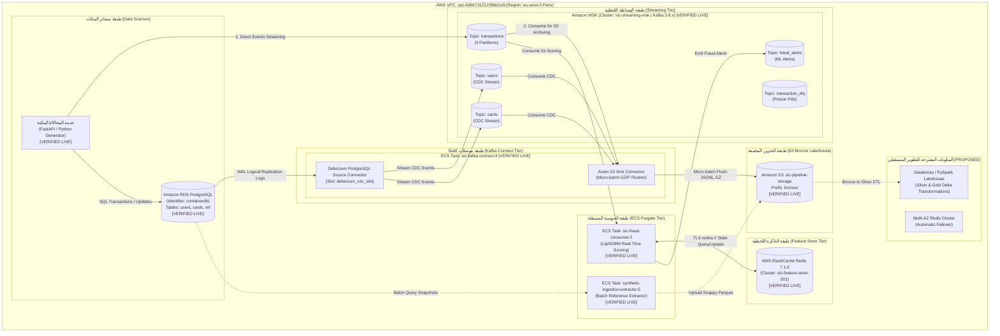
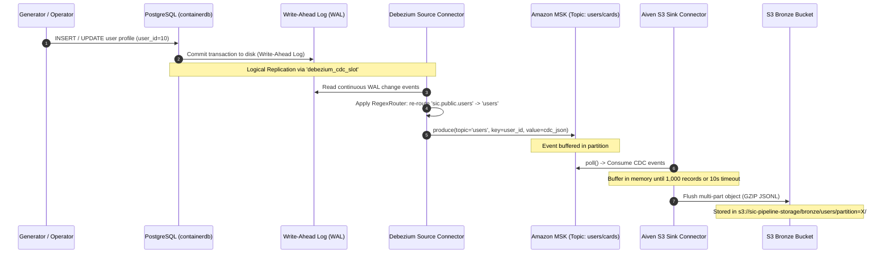
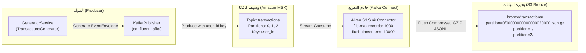
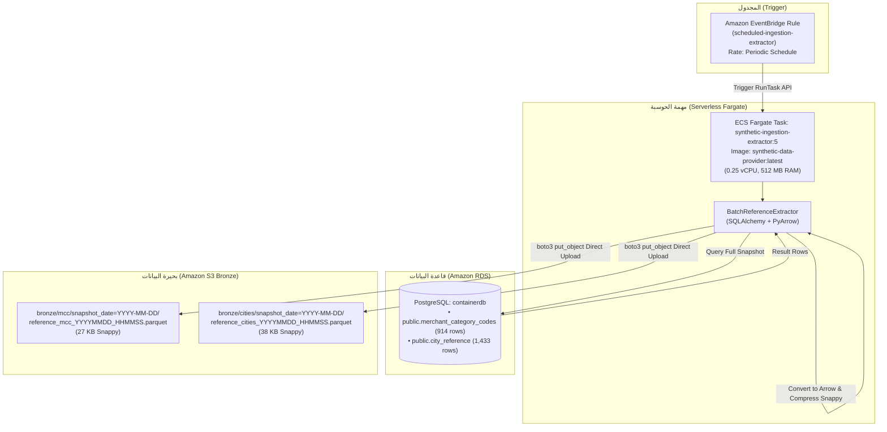
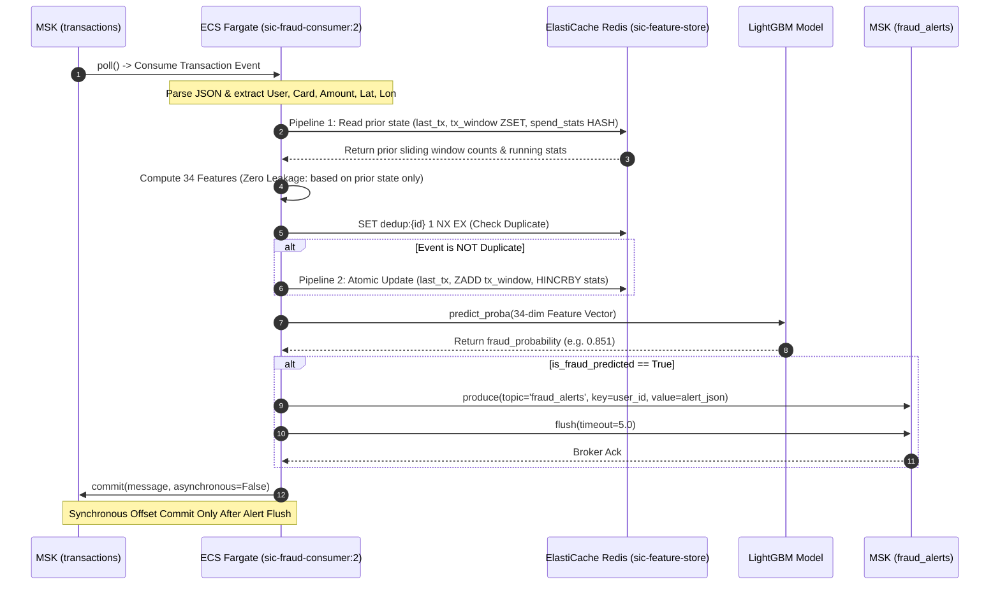
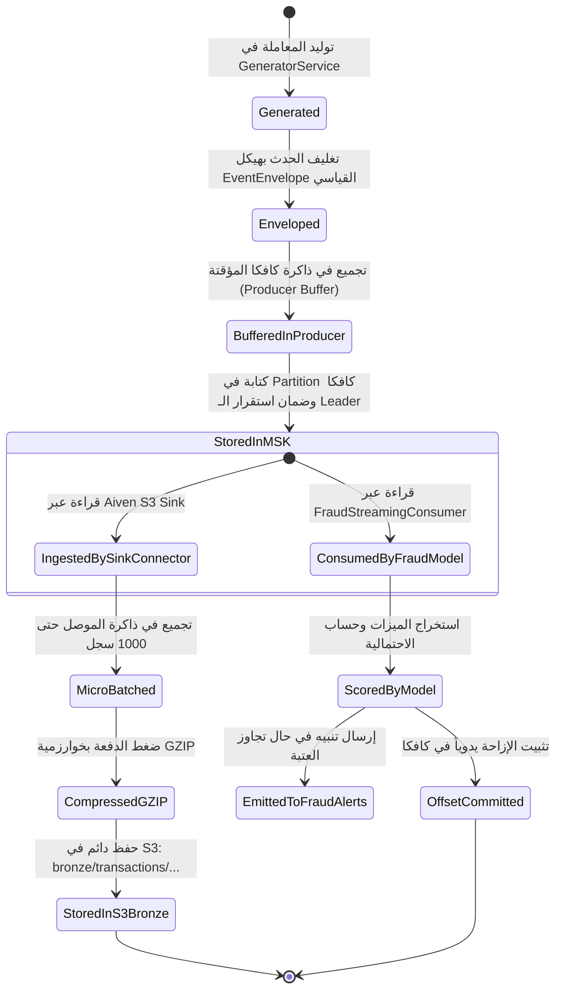

# المعمارية ورسومات تدفق البيانات: Data Ingestion Pipeline
## دليل المخططات والرسومات المعمارية التفصيلية

---

## 1. المعمارية الشاملة للمنظومة (Complete System Architecture)

يوضح هذا المخطط المعمارية الكلية للنظام، وكيف تتكامل مسارات الاستيعاب المتعددة مع طبقات التخزين والمعالجة اللحظية داخل شبكة AWS الافتراضية الموحدة (**VPC: `vpc-0d66731212396d1e9`**).

---

## 2. المسار الأول: تدفق الـ CDC عبر Debezium (PostgreSQL -> MSK -> S3)

يوضح هذا المخطط مسار التقاط التغييرات اللحظية من قاعدة بيانات PostgreSQL إلى بحيرة البيانات عبر **Debezium**:

### الشرح الهندسي للمسار:
1. أي تعديل في جدول المستخدمين أو الكروت بيسجله البوستجريس فوراً في الـ **Write-Ahead Log (WAL)**.
2. موصل **Debezium** بيسحب التغييرات من الـ Replication Slot بدون ما يعمل كويري مباشر يرهق المعالج.
3. الموصل بيستخدم **RegexRouter (SMT)** عشان يحذف الـ Schema Prefix ويحول اسم القناة لـ `users` أو `cards` مباشرة.
4. موصل **Aiven S3 Sink** بيقرا الرسائل من MSK، يجمعها في Micro-batch، ويضغطها بـ Gzip ويكتبها في S3.

---

## 3. المسار الثاني: التدفق المباشر للمعاملات (Transactions Direct Streaming)

يوضح المخطط كيفية انتقال أحداث المعاملات عالية الكثافة من محرك التوليد إلى التخزين النهائي في S3:

### الشرح الهندسي للمسار:
1. المعاملات بتتبعت فور توليدها باستخدام مكتبة `confluent-kafka` بمفتاح رسالة يمثل `user_id`.
2. توجيه الرسائل بمفتاح يضمن بقاء جميع معاملات العميل في نفس الـ Partition وبالترتيب الزمني الدقيق.
3. موصل S3 يفرغ البيانات عند تراكم 1,000 سجل أو مرور 10 ثوانٍ، مما يحمي النظام من مشكلة الملفات الصغيرة (Small Files Problem).

---

## 4. المسار الثالث: الاستخراج الدفعي للبيانات المرجعية (Batch Reference Extractor)

يوضح المخطط معمارية سحب لقطات الجداول المرجعية الثابتة دون المرور عبر كافكا لترشيد التكاليف:

### الشرح الهندسي للمسار:
1. الجداول الثابتة (أكواد التصنيف 914 كود والمدن 1,433 مدينة) لا تحتاج إلى Streaming لحظي عبر كافكا.
2. خدمة **EventBridge** تشغل Fargate Task صغيرة جداً (0.25 vCPU) تسحب البيانات دفعة واحدة (Batch).
3. الكود يحول البيانات في الذاكرة إلى **Apache Parquet** مضغوط بـ **Snappy** ويرفعها مباشرة إلى S3 مقسمة بالتاريخ اليومي (`snapshot_date=YYYY-MM-DD/`).

---

## 5. مسار المعالجة الفورية وكشف الاحتيال (Real-Time Fraud Serving Path)

يوضح المخطط كيفية استهلاك الحركات لحظياً وتقييمها بالذكاء الاصطناعي مع حفظ الحالة في **Redis Feature Store**:

---

## 6. دورة حياة رسالة البيانات من المصدر إلى التخزين (Message Lifecycle)

