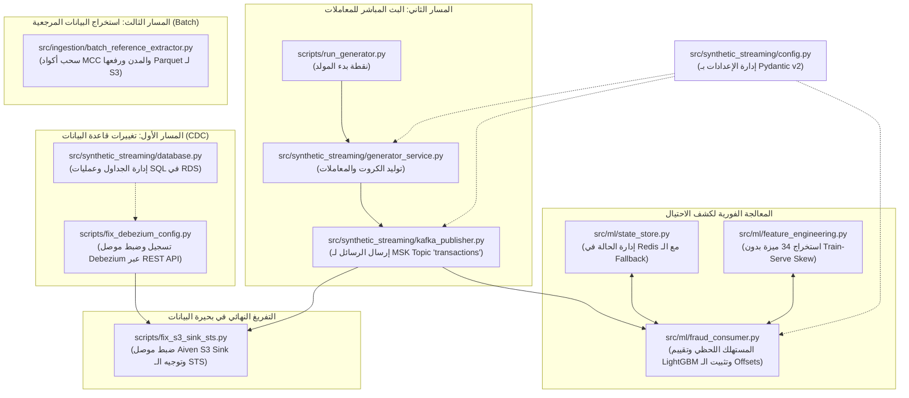

# شرح الكود والملفات البرمجية: Data Ingestion Pipeline
## تفكيك الكود البرمجي ومسار التنفيذ الفعلي خطوة بخطوة

---

## 1. مخطط تسلسل التنفيذ البرمجي (Execution Entrypoints Flow)

يوضح المخطط التالي الملفات التي يبدأ منها تشغيل المنظومة، وتدفق البيانات المنطقي بين الوحدات البرمجية المختلفة:



---

## 2. تفكيك ملفات محرك التوليد والبث (Streaming Core Files)

### 2.1. إعدادات المنظومة: `src/synthetic_streaming/config.py`
- **الوظيفة:** إدارة إعدادات المشروع بشكل مركزي ومكتوب بالأنواع الصارمة باستخدام **Pydantic Settings (v2)**.
- **أهم الفئات (Classes):**
  - `KafkaConfig`: يحمل عناوين الوسطاء (`bootstrap_servers`)، وأسماء الـ Topics (`transactions`, `users`, `cards`, `dlq_topic`, `fraud_alerts_topic`).
  - `MLFraudConfig`: يحمل رابط اتصال Redis (`redis_url`)، مسار ملف الموديل (`model_path`)، وعتبة الاحتيال (`fraud_threshold: 0.20`).
  - `GeneratorConfig`: الكلاس الرئيسي الحاوي لجميع التكوينات الفرعية.
- **المنطق البرمجي والسر الهندسي:**
  يدعم الـ Parsing التلقائي للمتغيرات البيئية ذات المقاطع الثنائية المفصولة بشرطتين سفليتين (`__`). مثلاً:
  `SYNTH_KAFKA__BOOTSTRAP_SERVERS` يتم توجيهه تلقائياً إلى `config.kafka.bootstrap_servers`.

---

### 2.2. خدمة التوليد: `src/synthetic_streaming/generator_service.py`
- **الوظيفة:** تنظيم توليد المعاملات عبر نموذج الحالات وسيناريوهات الصرف البنكي.
- **أهم الدوال (Functions):**
  - `_generate_loop()`: حلقة التوليد المستمرة، تستدعي محرك السيناريوهات وتحسب توقيت المعاملة وموقعها ومبلغها.
  - `step()`: توليد معاملة مفردة وتغليفها في كائن `EventEnvelope`.
- **المدخلات والمخرجات:**
  - *المدخلات:* كائنات الـ Baseline المحملة للمستخدمين والكروت.
  - *المخرجات:* قاموس بيانات المعاملة مغلفاً بمعرف فريد `event_id` (UUIDv4) وتوقيت زمني ISO 8601.

---

### 2.3. ناشر كافكا: `src/synthetic_streaming/kafka_publisher.py`
- **الوظيفة:** إدارة الاتصال بـ Amazon MSK وضخ الرسائل بكفاءة عالية باستخدام مكتبة `confluent_kafka`.
- **أهم الدوال (Functions):**
  - `publish_transaction(envelope: EventEnvelope) -> bool`:
    ```python
    payload_bytes = envelope.model_dump_json().encode("utf-8")
    user_key = str(envelope.payload.get("User", 0)).encode("utf-8")
    self.producer.produce(
        topic=self.config.transactions_topic,
        key=user_key,
        value=payload_bytes,
        on_delivery=self._delivery_report
    )
    self.producer.poll(0)
    ```
- **التبرير الهندسي لاختيار الكود:**
  - **مفتاح الرسالة (`user_key`):** تم اختيار رقم المستخدم كـ Message Key لضمان توجيه جميع حركات العميل إلى نفس الـ Partition، مما يحافظ على الترتيب الزمني الصارم للمعاملات.
  - **`poll(0)`:** يمنع انسداد الـ Memory Buffer ويسمح بتشغيل دوال الإشعار بالتسليم (`_delivery_report`) بشكل غير متزامن.

---

## 3. تفكيك ملفات مسارات الاستيعاب والـ Connectors

### 3.1. موصل الـ CDC وتعديل التوجيه: `scripts/fix_debezium_config.py`
- **الوظيفة:** تسجيل وإعادة ضبط موصل Debezium لربط PostgreSQL RDS بـ Amazon MSK عبر الـ REST API لمجمع Kafka Connect على بورت 8083.
- **أهم الإعدادات الهندسية:**
  - `"slot.name": "debezium_cdc_slot"`: فتح قناة تكرار منطقي مخصصة داخل محرك PostgreSQL 18.3.
  - `"transforms": "reroute"`:
    ```json
    "transforms.reroute.type": "org.apache.kafka.connect.transforms.RegexRouter",
    "transforms.reroute.regex": "(?:.*\\.public\\.)?(.*)",
    "transforms.reroute.replacement": "$1"
    ```
- **التبرير الهندسي:** موصل Debezium افتراضياً يرسل الرسائل إلى اسم قناة يبدأ بـ `<prefix>.<schema>.<table>` (مثل `sic.public.users`). استخدام الـ RegexRouter يحذف هذه البادئة ويعيد توجيه الرسائل مباشرة إلى القناة الموحدة `users`، مما يسهل استهلاكها لاحقاً.

---

### 3.2. موصل بحيرة البيانات S3 وحل الـ STS: `scripts/fix_s3_sink_sts.py`
- **الوظيفة:** تكوين وتحديث موصل **Aiven S3 Sink Connector** لترحيل رسائل قنوات `transactions` و `users` و `cards` إلى S3 Bronze.
- **أهم الإعدادات الهندسية:**
  ```json
  {
    "connector.class": "io.aiven.kafka.connect.s3.AivenKafkaConnectS3SinkConnector",
    "topics": "transactions,users,cards",
    "aws.s3.bucket.name": "sic-pipeline-storage",
    "aws.s3.region": "eu-west-3",
    "aws.sts.config.endpoint": "https://sts.eu-west-3.amazonaws.com",
    "format.output.type": "jsonl",
    "file.compression.type": "gzip",
    "file.name.template": "bronze/{{topic}}/partition={{partition}}/{{start_offset:padding=true}}.json.gz",
    "file.max.records": "1000",
    "flush.timeout.ms": "10000"
  }
  ```
- **الإصلاح الحرج (Critical Fix):**
  الموصل كان يرمي خطأ `AWSSecurityTokenServiceException: Credential should be scoped to a valid region (SignatureDoesNotMatch)` لأن موصلات كافكا تعتمد افتراضياً على العنوان العالمي `sts.amazonaws.com`. إضافة `"aws.sts.config.endpoint": "https://sts.eu-west-3.amazonaws.com"` حلت مشكلة توثيق الـ SigV4 فورياً.

---

### 3.3. سحب البيانات المرجعية: `src/ingestion/batch_reference_extractor.py`
- **الوظيفة:** سحب كامل لبيانات الجداول المرجعية (`merchant_category_codes` و `city_reference`) من PostgreSQL وتحويلها إلى ملفات Parquet في S3.
- **أهم الفئات والدوال:**
  - `BatchReferenceExtractor.extract_table(table_name: str)`:
    تقرأ السجلات عبر كويري SQLAlchemy، ثم تنشئ مخطط بيانات صريح باستخدام مكتبة `pyarrow` (`pa.schema`), وتضغط البيانات بخوارزمية Snappy:
    ```python
    arrow_table = pa.Table.from_pydict(column_data, schema=schema)
    pq_buffer = io.BytesIO()
    pq.write_table(arrow_table, pq_buffer, compression="snappy")
    s3_client.put_object(
        Bucket=target_bucket,
        Key=f"bronze/{table_name}/snapshot_date={today}/{file_name}",
        Body=pq_buffer.getvalue()
    )
    ```
- **التبرير الهندسي:** استخدام `io.BytesIO()` يسمح بإنشاء الملف في الذاكرة ورفعه مباشرة بدون استهلاك أقراص تخزين حاوية Fargate المؤقتة.

---

## 4. تفكيك ملفات المعالجة اللحظية لكشف الاحتيال

### 4.1. مخزن الحالة: `src/ml/state_store.py`
- **الوظيفة:** إدارة النوافذ المنزلقة (Sliding Windows) في Redis 7 وحساب الإحصائيات التراكمية مع توفير مسار طوارئ محلي (In-Memory Fallback).
- **أهم الدوال (Functions):**
  - `get_and_update_state(...)`:
    1. تنفذ **Pipeline قراءة أولاً**: تجلب آخر إحداثيات GPS (`last_tx`)، وعدد الحركات في آخر ساعة و24 ساعة (`ZCOUNT tx_window`)، ومجاميع الصرف السابقة (`HGETALL spend_stats`).
    2. تفحص عدم التكرار الذري عبر `SET dedup:{event_id} 1 NX EX 172800`.
    3. تنفذ **Pipeline كتابة ثانياً**: تضيف المعاملة الحالية لـ `tx_window`، وتنظف الحركات الأقدم من 24 ساعة بـ `ZREMRANGEBYSCORE`، وتزيد مجاميع الصرف بـ `HINCRBYFLOAT`.

---

### 4.2. مستهلك الاحتيال: `src/ml/fraud_consumer.py`
- **الوظيفة:** استهلاك المعاملات من MSK، استدعاء الموديل، نشر التنبيهات، وتثبيت الـ Offsets يدوياً.
- **أهم الدوال (Functions):**
  - `consume_and_process_single_message(...)`:
    تضمن تسليم التنبيه لـ MSK وعمل `producer.flush(timeout=5.0)` بنجاح تام *قبل* تنفيذ أمر تثبيت الإزاحة:
    ```python
    # Commit synchronously only after alert broker acknowledgment
    consumer.commit(message=msg, asynchronous=False)
    ```
