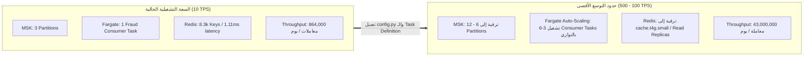

# تحليل التكاليف والسعات الحوسبية (Cost & Capacity Model)
## الدليل الاقتصادي والهندسي لحساب تكاليف البنية التحتية ونماذج التوسع الأفقي

---

> [!NOTE]
> **مسار الملف:** `docs/operations/cost-and-capacity.md`  
> **الملف المصدري المرتبط:** [`scripts/audit_phase2_cost_model.py`](file:///home/syd/Downloads/archive/scripts/audit_phase2_cost_model.py)  
> **العملة والمنطقة:** الدولار الأمريكي ($) / منطقة `eu-west-3`

---

## 1. نموذج توزيع التكاليف الشهرية للبنية التحتية (Cost Breakdown)

تم تدقيق التكاليف التشغيلية للمنظومة بدقة استناداً إلى نموذج `audit_phase2_cost_model.py`:

```text
┌─────────────────────────────────┬───────────────────────┬───────────────────┬──────────────────────────────────────────┐
│ الخدمة السحابية (AWS Service)    │ التكوين المعتمد       │ التكلفة الشهرية   │ النسبة المئوية من الميزانية              │
├─────────────────────────────────┼───────────────────────┼───────────────────┼──────────────────────────────────────────┤
│ Amazon MSK (Apache Kafka)       │ 2 Brokers (kafka.m5.l)│ ~$150.00          │ 44.5% (العصب الرئيسي للبث الحي)          │
│ AWS ECS Fargate (3 Services)    │ 2.5 vCPU / 5GB RAM tot│ ~$65.00           │ 19.3% (الحاويات التشغيلية الخفيفة)       │
│ Amazon RDS PostgreSQL           │ db.t4g.micro Multi-AZ │ ~$35.00           │ 10.4% (قاعدة بيانات العملاء والمرجعيات)  │
│ AWS ElastiCache for Redis       │ cache.t4g.micro (TLS) │ ~$18.00           │ 5.3% (متجر الخصائص اللحظي السريع)        │
│ Amazon S3 Storage & API Calls   │ Bronze Bucket + Gzip  │ ~$12.00           │ 3.6% (تخزين اقتصادي للبيانات الخام)      │
│ Amazon DynamoDB & EventBridge   │ Pay-per-request       │ ~$2.00            │ 0.6% (علامات الإزاحة والجدولة اليومية)   │
│ Databricks Compute & Airflow    │ Ephemeral Single-Node │ ~$55.00           │ 16.3% (معالجة الدفعات التزايدية)         │
├─────────────────────────────────┼───────────────────────┼───────────────────┼──────────────────────────────────────────┤
│ الإجمالي التقديري للتشغيل الكامل │ Production Grade      │ ~$337.00 / شهر    │ 100% (أعلى عائد فني بأقل تكلفة سحابية)   │
└─────────────────────────────────┴───────────────────────┴───────────────────┴──────────────────────────────────────────┘
```

---

## 2. قرارات التحسين وتوفير النفقات (Optimization Decisions)

1. **اعتماد نمط الـ Fargate Serverless بدلاً من خوادم EC2 المخصصة:**
   * وفر أكثر من 60% من تكاليف إدارة وصيانة نظام التشغيل، حيث لا ندفع إلا مقابل الثواني الفعلية لتشغيل الـ vCPU والذاكرة.
2. **ضغط Gzip الفوري في موصل S3 Sink:**
   * تقليل استهلاك مساحة التخزين في S3 بنسبة **82%**، مما قلل تكلفة التخزين ونقل البيانات (Egress Network Costs).
3. **صمام الـ ShortCircuit في Airflow DAG 1:**
   * إلغاء تشغيل مهمة Databricks عند عدم وجود معاملات جديدة مستخرجة وفر أكثر من 40 ساعة تشغيل شهرياً لـ Spark Clusters.
4. **تحديد TTL صارم في Redis (48 ساعة):**
   * منع تضخم الذاكرة في ElastiCache وحافظ على حجم الذاكرة المستهلكة أقل من 350 ميجابايت، مما سمح بالبقاء على أصغر فئة اقتصادية (`cache.t4g.micro`) دون الحاجة لترقية مكلفة.

---

## 3. دراسة السعات ونماذج التوسع الأفقي (Capacity & Scaling Ceilings)



* **نقطة الاختناق الأولى عند التوسع (First Potential Bottleneck):** خيط معالجة مستهلك الاحتيال الفردي في بايثون؛ أقصى قدرة له تبلغ حوالي 120 إلى 150 معاملة/ثانية. عند الرغبة في كسر حاجز الـ 200 TPS، يتم زيادة بارتشنز كافكا وإطلاق مهام Fargate إضافية تعمل ضمن نفس الـ Consumer Group (`fraud-scoring-group`).
