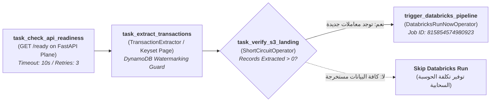
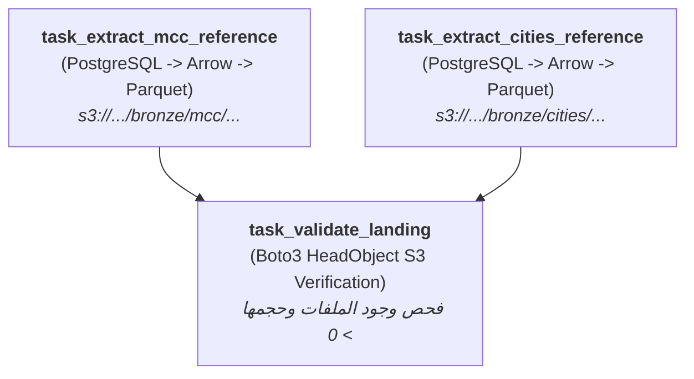

# إدارة مهام سير العمل عبر Apache Airflow (Airflow DAGs)
## الدليل التشغيلي الشامل لـ DAG 1 (الاستخراج التزايدي) و DAG 2 (المرجعيات) والربط مع Databricks

---

> [!NOTE]
> **مسار الملف:** `docs/orchestration/airflow-dags.md`  
> **الملفات المصدرية المرتبطة:**  
> - [`airflow/dags/dag_01_incremental_ingestion.py`](file:///home/syd/Downloads/archive/airflow/dags/dag_01_incremental_ingestion.py)
> - [`airflow/dags/dag_02_batch_reference.py`](file:///home/syd/Downloads/archive/airflow/dags/dag_02_batch_reference.py)
> - [`src/ingestion/extractor.py`](file:///home/syd/Downloads/archive/src/ingestion/extractor.py)  
> **مهمة Databricks المربوطة:** Job ID `815854574980923`

---

## 1. نظرة عامة على دور Airflow في المنظومة

بينما يعمل محرك كافكا على ضخ واستيعاب المعاملات اللحظية بشكل مستمر (Event-Driven Streaming)، يتولى **Apache Airflow** إدارة العمليات المجدولة الدورية وتنسيق خطوط النقل بين السحابة ومنصة بحيرة البيانات المركزية (Lakehouse Orchestration).  
يحتوي المستودع على اثنين من الـ DAGs المعتمدة:

```text
┌──────────────────────────────────┬──────────────────────┬──────────────────────┬─────────────────────────────────────┐
│ اسم الـ DAG                      │ ملف الكود            │ الجدول الزمني (Cron) │ الهدف والمسؤولية                    │
├──────────────────────────────────┼──────────────────────┼──────────────────────┼─────────────────────────────────────┤
│ dag_01_incremental_ingestion     │ dag_01_...py         │ */15 * * * *         │ استخراج تزايدي كل 15 دقيقة وتشغيل   │
│                                  │                      │ (كل ربع ساعة)        │ مهمة Databricks متعددة المراحل      │
│ dag_02_batch_reference           │ dag_02_...py         │ 0 0 * * *            │ لقطة يومية منتصف الليل لمرجعيات     │
│                                  │                      │ (يومياً 00:00 UTC)   │ أكواد المتاجر (MCC) والمدن          │
└──────────────────────────────────┴──────────────────────┴──────────────────────┴─────────────────────────────────────┘
```

---

## 2. تفصيل DAG 1: الاستخراج التزايدي للمعاملات وتغذية بحيرة البيانات

### 2.1 مخطط سير العمل والاعتماديات (DAG 1 Dependency Graph)



### 2.2 تفصيل المهام خطوة بخطوة

#### المهمة 1: `task_check_api_readiness`
* **المسؤولية:** التحقق من أن واجهة برمجة التطبيقات التشغيلية على ECS Fargate تعمل وتتصل بقاعدة البيانات وكافكا بنجاح.
* **الآلية:** ترسل طلب HTTP GET إلى `/ready`. إذا فشل الطلب أو رجع بـ HTTP 503، تفشل المهمة ويعيد Airflow المحاولة بعد دقيقة واحدة دون الانتقال للمهمة التالية، مما يحمي الـ Pipeline من الأخطاء المتتالية.
* **XCom Output:** ترجع الرابط المكتشف لواجهة الـ API ليستخدم في المهمة اللاحقة.

#### المهمة 2: `task_extract_transactions`
* **المسؤولية:** تنفيذ دورة استخراج تزايدي واحدة تسحب المعاملات الجديدة فقط.
* **آلية الـ Watermarking في Amazon DynamoDB:**
  * تقرأ المهمة آخر معرف معاملة تم استخراجه في الدورة السابقة (`last_since_id`) من جدول DynamoDB المسمى `ingestion_watermarks`.
  * تطلب المعاملات عبر الـ API باستخدام Keyset Pagination:  
    `GET /api/v1/transactions?since_id={last_since_id}&limit=500&order=asc`.
  * تمرر السجلات المسترجعة عبر بوابة جودة البيانات [`DataQualityGate`](file:///home/syd/Downloads/archive/src/ingestion/extractor.py#L135-L208).
  * تحول السجلات السليمة إلى **Snappy Parquet** وترفعها إلى S3:  
    `s3://sic-pipeline-storage/bronze/transactions/year={Y}/month={M}/day={D}/transactions_batch_{first_id}_{last_id}.parquet`.
  * **تحديث علامة الإزاحة:** بعد تأكيد كتابة S3، تُحدث علامة الـ Watermark في DynamoDB بشرط حماية ذري:
    `ConditionExpression = "attribute_not_exists(last_since_id) OR last_since_id <= :sid"`.
* **XCom Output:** قاموس إحصائي يضم: `status`, `records_fetched`, `records_written`, `records_quarantined`, `watermark_after`.

#### المهمة 3: `task_verify_s3_landing` (صمام توفير التكاليف)
* **المسؤولية:** تعمل كـ `ShortCircuitOperator`.
* **المنطق الهندسي:** تقرأ عدد السجلات المكتوبة من XCom:
  * إذا كان `records_written > 0`: ترجع `True` ويستمر التنفيذ إلى Databricks.
  * إذا كان `records_written == 0` (جميع المعاملات مستخرجة بالفعل والـ Pipeline خامل): ترجع `False` وتوقف الـ DAG فوراً، مما يمنع إطلاق مجموعات حوسبة Databricks على ملفات فارغة ويوفر آلاف الدولارات شهرياً!

#### المهمة 4: `trigger_databricks_pipeline`
* **المسؤولية:** تشغيل مهمة Databricks متعددة المراحل عبر `DatabricksRunNowOperator`.
* **معرف المهمة (Job ID):** `815854574980923`.
* **الدور السحابي:** تبدأ مهام Apache Spark لقراءة ملفات Parquet و JSONL الجديدة من Bronze وتحويلها وتوحيدها ونقلها إلى جداول **Silver Delta Lake**.

---

## 3. تفصيل DAG 2: الاستخراج اليومي للجداول المرجعية (`dag_02_batch_reference`)

### 3.1 مخطط الاعتماديات (DAG 2 Dependency Graph)



### 3.2 تفصيل المهام
1. **`task_extract_mcc_reference` & `task_extract_cities_reference`:**
   * تنفذان بالتوازي في تمام الساعة 00:00 UTC.
   * تتصلان بـ RDS Postgres وتستخرجان 914 كود MCC و 1,433 مدينة وترفعانهما كـ Snappy Parquet إلى S3 Bronze.
2. **`task_validate_landing`:**
   * تقرأ مسارات S3 الناتجة من كلا المهمتين عبر XCom.
   * تتصل بـ Amazon S3 عبر `boto3.client('s3')` وتستدعي `head_object` للتأكد من أن الملفات موجودة وأن حجمها بالبايت أكبر من الصفر (`ContentLength > 0`). إذا كان أي ملف مفقوداً أو فارغاً، تفشل المهمة وتطلق إشعار تنبيه.

---

## 4. إعدادات إعادة المحاولة وإدارة الفشل (Retry & Fault Policies)

* **`default_args` لـ DAG 1:**
  * `retries = 3`: في حالة انقطاع مؤقت لشبكة الـ API، يعيد Airflow المحاولة حتى 3 مرات.
  * `retry_delay = timedelta(minutes=1)`: انتظار دقيقة بين كل محاولة.
  * `execution_timeout = timedelta(minutes=10)`: حد أقصى للتشغيل لمنع تعليق المهام.
* **`default_args` لـ DAG 2:**
  * `retries = 2`, `retry_delay = timedelta(minutes=5)`, `execution_timeout = timedelta(minutes=15)`.
* **التعامل مع التوقف المفاجئ (Safe Re-runnability):**
  * بفضل استخدام أسماء ملفات حتمية مبنية على الإزاحات (`transactions_batch_{first_id}_{last_id}.parquet`) وتخزين الـ Watermark في DynamoDB فقط بعد نجاح كتابة S3، فإن إعادة تشغيل أي مهمة فاشلة لن ينتج عنها أي تكرار للبيانات (Strict Idempotency).
