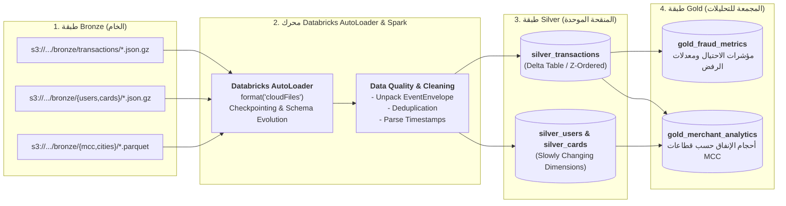

# معالجة بحيرة البيانات في Databricks (Databricks Lakehouse Processing)
## الدليل التقني: الانتقال من Bronze إلى Silver و Gold باستخدام AutoLoader و Delta Lake

---

> [!NOTE]
> **مسار الملف:** `docs/orchestration/databricks-processing.md`  
> **دفاتر الملاحظات المرتبطة:** مجلد [`databricks/stream/`](file:///home/syd/Downloads/archive/databricks/stream/)  
> **مهمة Databricks المجدولة:** Multi-Task Workflow Job ID `815854574980923`

---

## 1. موقع Databricks في معمارية المنصة (The Downstream Role)

تتوقف حدود طبقة الاستيعاب (Ingestion Plane) عند تخزين البيانات الخام كما هي في طبقة **S3 Bronze**.  
من هذه النقطة، تبدأ مسؤلية محرك الحوسبة السحابي **Databricks Lakehouse** لتحويل البيانات الخام غير المنظمة إلى جداول عالية الجودة وموحدة ومجهزة للتحليلات (Medallion Architecture):



---

## 2. تقنية Databricks AutoLoader (`cloudFiles`)

لقراءة آلاف الملفات الصغيرة المتدفقة باستمرار إلى `bronze/transactions/` بكفاءة فائقة ودون الحاجة لعمل مسح كامل لمجلدات S3 (`s3:ListBucket`)، تستخدم دفاتر الملاحظات محرك **AutoLoader**:

```python
# كود AutoLoader النموذجي من دفاتر databricks/stream/
bronze_df = (
    spark.readStream
    .format("cloudFiles")
    .option("cloudFiles.format", "json")
    .option("cloudFiles.schemaLocation", "s3://sic-pipeline-storage/checkpoints/schema/transactions")
    .option("cloudFiles.inferColumnTypes", "true")
    .option("cloudFiles.maxFilesPerTrigger", 1000)
    .load("s3://sic-pipeline-storage/bronze/transactions/*/*.json.gz")
)
```

### مزايا AutoLoader في مشروع SIC:
1. **اكتشاف الملفات الجديد تلقائياً وبسرعة:** يستمع لإشعارات S3 أو يفحص الدلائل بأسلوب تصاعدي ذكي.
2. **استنتاج وتطور الهيكل (Schema Evolution):** إذا تمت إضافة حقول جديدة في غلاف الحدث أو كروت المستخدمين، يستوعبها المحرك تلقائياً دون تعطل خط سير العمل.
3. **التحكم في نقاط التفتيش (Checkpoints):** يحفظ المحرك حالة التقدم بدقة ذرية، بحيث لو تعطلت مهمة Databricks، تستأنف القراءة من آخر ملف تمت معالجته بدقة.

---

## 3. تنظيف البيانات والتحويل إلى طبقة Silver (Bronze to Silver Pipeline)

خلال مرحلة التحويل، تطبق دفاتر الملاحظات قواعد هندسية صارمة:
1. **فك غلاف الحدث (Unpacking Event Envelope):**
   * استخراج الحقول المالية من داخل كائن `payload` وتحويلها لأعمدة مستقلة في جدول Delta.
   * تحويل قيم العملة (مثل `"$45.20"`) إلى أرقام عشرية حقيقية (`DECIMAL(12, 2)`).
2. **إزالة التكرار (Deduplication):**
   * تطبيق `dropDuplicates(["event_id"])` أو استخدام استعلامات `MERGE INTO` للتأكد من عدم تكرار أي معاملة حتى لو أعيد إرسالها.
3. **معالجة الأحداث المتأخرة والـ Watermarking:**
   * تحديد نافذة زمنية للأحداث المتأخرة (`withWatermark("event_timestamp", "2 hours")`) لمعالجة سيناريو `late_event`.
4. **الكتابة في Delta Lake مع Z-Ordering:**
   * كتابة البيانات في جدول Delta مع تطبيق الـ Z-Order على أكثر الأعمدة استخداماً في الاستعلامات:
     ```sql
     OPTIMIZE silver_transactions ZORDER BY (user_id, transaction_timestamp);
     ```

---

## 4. طبقة Gold: النماذج التجميعية للتقارير (Business Analytics)

من جداول Silver Delta النظيفة، تقوم مهام مجدولة بإنتاج جداول **Gold Layer**:
* **`gold_fraud_monitoring`:** لوحة مؤشرات فورية تعرض إجمالي المعاملات المحظورة، معدل الإنذارات الكاذبة، وخسائر الاحتيال المتفادية يومياً.
* **`gold_mcc_performance`:** تقارير تحليلية مجمعة تعرض حجم وقيمة المدفوعات ومتوسط الإنفاق لكل قطاع تجاري (Retail, Airlines, Dining) بالربط مع جداول المرجعيات `mcc` و `cities`.
