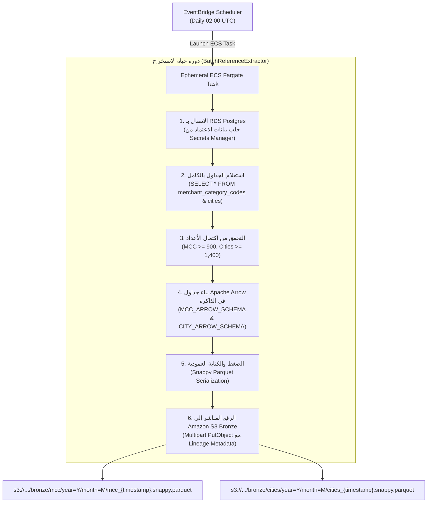

# الاستخراج الدفعي للبيانات المرجعية عبر EventBridge
## الدليل التشغيلي لمسار استخراج المرجعيات اليومية (MCC & Cities) وتخزينها بصيغة Parquet

---

> [!NOTE]
> **مسار الملف:** `docs/orchestration/eventbridge-batch-ingestion.md`  
> **الملفات المصدرية المرتبطة:**  
> - [`src/ingestion/batch_reference_extractor.py`](file:///home/syd/Downloads/archive/src/ingestion/batch_reference_extractor.py)
> - [`scripts/manage_eventbridge_schedules.py`](file:///home/syd/Downloads/archive/scripts/manage_eventbridge_schedules.py)  
> **الخدمات السحابية:** Amazon EventBridge Scheduler, AWS ECS Fargate, Amazon RDS PostgreSQL, Amazon S3

---

## 1. لماذا هذا المسار منفصل عن كافكا؟ (Architectural Decoupling)

البيانات المرجعية في المؤسسات المالية تتكون من جداول ثابتة نسبياً (Slowly Changing Dimensions):
* جدول تصنيف المتاجر (`merchant_category_codes`): يضم 914 كوداً مصنفاً.
* جدول المدن والإحداثيات (`city_reference`): يضم 1,433 مدينة بإحداثياتها.

بث هذه الجداول عبر كافكا بشكل لحظي مستمر يعتبر هدراً لموارد الشبكة وتخزين كافكا دون مبرر.  
لذلك صُمم **المسار الثالث (Path 3)** ليعمل كـ **Serverless Batch Pipeline** مجدول يومياً في الساعات المبكرة من الصباح لاستخراج لقطة كاملة (Full Snapshot) وتحويلها إلى ملفات **Snappy Parquet** فائقة الكفاءة وترقيتها مباشرة إلى بحيرة البيانات على S3 Bronze.

---

## 2. جدول ومحرك الجدولة: Amazon EventBridge Scheduler

تتم إدارة الجدولة عبر قواعد **Amazon EventBridge Scheduler** في منطقة `eu-west-3`:
* **اسم القاعدة:** `sic-batch-reference-daily`
* **تعبير الجدولة:** `cron(0 2 * * ? *)` (يومياً في تمام الساعة 02:00 صباحاً بتوقيت UTC).
* **نوع النافذة الزمنية (Flexible Time Window):** 15 دقيقة (لتفادي طفرات استهلاك الموارد في نفس اللحظة).
* **الهدف (Target):** إطلاق مهمة حوسبة مستقلة سريعة الزوال (Ephemeral ECS Fargate Task) تشغل أمر بايثون:
  ```bash
  python -m ingestion.batch_reference_extractor --dataset all --validate
  ```

### سكريبت إدارة الجداول: `manage_eventbridge_schedules.py`
يتيح هذا السكريبت لمهندسي العمليات فحص وتفعيل أو تعطيل الجدولة بالأوامر:
```bash
# استعراض حالة الجداول ومواعيد تشغيلها
python scripts/manage_eventbridge_schedules.py status

# تفعيل أو تعطيل الجداول السحابية
python scripts/manage_eventbridge_schedules.py enable
python scripts/manage_eventbridge_schedules.py disable
```

---

## 3. دورة حياة الاستخراج: كلاس `BatchReferenceExtractor`



---

## 4. مخططات Apache Arrow وتنسيق Parquet الناتج

يتم تحديد مخطط صارم وثابت للجداول لضمان توافق أنواع البيانات بنسبة 100% مع محركات التحليل في Databricks:

### 4.1 مخطط جدول الـ MCC (`MCC_ARROW_SCHEMA`)
```python
MCC_ARROW_SCHEMA = pa.schema([
    ("mcc", pa.string()),
    ("description", pa.string()),
    ("category", pa.string()),
    ("valid_payment_brands", pa.string()),
    ("required_abbreviation", pa.string()),
    ("extraction_timestamp", pa.string()),
    ("source_system", pa.string()),
])
```

### 4.2 مخطط جدول المدن (`CITY_ARROW_SCHEMA`)
```python
CITY_ARROW_SCHEMA = pa.schema([
    ("city_id", pa.int64()),
    ("city_name", pa.string()),
    ("state_code", pa.string()),
    ("country_code", pa.string()),
    ("latitude", pa.float64()),
    ("longitude", pa.float64()),
    ("coordinate_source", pa.string()),
    ("coordinate_precision", pa.string()),
    ("extraction_timestamp", pa.string()),
    ("source_system", pa.string()),
])
```

---

## 5. استراتيجية التحقق والاعتمادية (Validation & Idempotency)

1. **التحقق من الحدود الدنيا (Record Count Guardrails):**
   * كود الاستخراج يفحص عدد السجلات المسترجعة قبل الكتابة في S3.
   * إذا رجع جدول الـ MCC بأقل من 900 صف أو المدن بأقل من 1,400 صف، يطلق الكود خطأ استثنائياً (`RuntimeError`) ويفشل المهمة فوراً دون استبدال البيانات في S3، مما يحمي بحيرة البيانات من الكتابات الفارغة أو التالفة في حالة حدوث خلل في قاعدة البيانات.
2. **عدم القابلية للتكرار (Idempotency & Versioning):**
   * كل ملف Parquet ينتج يُسمى بختم زمني متفرد بصيغة UTC:  
     `mcc_20261029T020000Z.snappy.parquet`.
   * إعادة تشغيل المهمة في نفس اليوم لا يؤدي لمسح البيانات القديمة بل يولد لقطة جديدة مؤرخة (Point-in-Time Snapshot)، مما يتيح لمحركات Databricks تتبع تطور البيانات المرجعية عبر الزمن.
