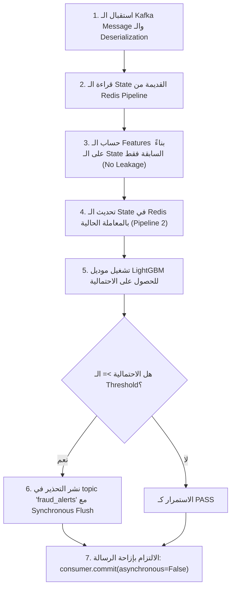

# دليل الشرح والتدريس العملي: تكامل AWS ElastiCache for Redis كـ Feature Store في نظام كشف الاحتيال الفوري
## Real-Time Fraud Detection Pipeline — Complete Teaching Script (Egyptian Arabic)

---

> [!NOTE]
> **طبيعة الوثيقة:** سكريبت تدريسي ومرجع تقني متكامل بالعامية المصرية الهندسية لشرح مشروع دمج **AWS ElastiCache for Redis** داخل Pipeline لكشف الاحتيال لحظياً (**Real-Time Fraud Detection**).
> **الجمهور المستهدف:** مهندسو بيانات مبتدئون ومتوسطون (Junior to Intermediate Data Engineers / Students).
> **المصطلحات التقنية:** مكتوبة باللغة الإنجليزية كما هي مستخدمة في سوق العمل والشركات التقنية.

---

## فهرس السكريبت (Table of Contents)
- [A. المقدمة ومسألة العمل (The Business Problem)](#a-المقدمة-ومسألة-العمل-the-business-problem)
- [B. المعمارية الأصلية وتدفق البيانات (Original Architecture)](#b-المعمارية-الأصلية-وتدفق-البيانات-original-architecture)
- [C. لماذا احتجنا Redis؟ مشكلة الـ In-Memory State](#c-لماذا-احتجنا-redis-مشكلة-الـ-in-memory-state)
- [D. نموذج البيانات وهياكل Redis (The Redis Data Model)](#d-نموذج-البيانات-وهياكل-redis-the-redis-data-model)
- [E. حساب الميزات وترتيب العمليات (Feature Calculation & Order)](#e-حساب-الميزات-وترتيب-العمليات-feature-calculation--order)
- [F. الإعدادات وتمرير المتغيرات (Configuration & Pydantic Mapping)](#f-الإعدادات-وتمرير-المتغيرات-configuration--pydantic-mapping)
- [G. البنية التحتية الفعلية على AWS (Verified AWS Infrastructure)](#g-البنية-التحتية-الفعلية-على-aws-verified-aws-infrastructure)
- [H. خطوات النشر والـ Cutover (Deployment & Consumer Hazards)](#h-خطوات-النشر-والـ-cutover-deployment--consumer-hazards)
- [I. معالجة الأعطال والتنازلات الهندسية (Failure Handling & Trade-offs)](#i-معالجة-الأعطال-والتنازلات-الهندسية-failure-handling--trade-offs)
- [J. الاختبارات والأدلة الرقمية (Testing & Live Verification)](#j-الاختبارات-والأدلة-الرقمية-testing--live-verification)
- [K. الدروس المستفادة والخاتمة (Lessons Learned & Wrap-up)](#k-الدروس-المستفادة-والخاتمة-lessons-learned--wrap-up)

---

## A. المقدمة ومسألة العمل (The Business Problem)
*(مدة الإلقاء التقريبية: 1.5 - 2 دقيقة)*

"مساء الخير يا شباب! النهاردة هنشرح مع بعض خطوة هندسية حقيقية بنقابلها في أي Real-Time Streaming System شغال في البنوك أو الـ FinTech: إزاي ننقل الـ State بتاعة الـ Features من مجرد شوية متغيرات في رامات السيرفر (**In-Memory Local RAM**) لـ Distributed Online Feature Store مبني على **AWS ElastiCache for Redis**، وازاي نحافظ على Latency أقل من 10 ميلي ثانية لكل معاملة.

خلونا نبدأ بالسؤال الأساسي: هو إحنا ليه بنعمل **Real-Time Fraud Detection**؟ 
في أنظمة الدفع، المعاملة بتوصل كـ Event على Kafka. لو اعتمدنا بس على رقم المعاملة، يعني مثلاً جه ترانزاكشن بـ $50.. هل ده احتيال؟ مستحيل تعرف من الرقم لوحده! الـ $50 ممكن تكون كوباية قهوة وغدا عادي، وممكن تكون حركة سحب كارت مسروق. 

عشان تقدر تحكم بجد، الموديل محتاج **Context** كامل:
1. المستخدم ده متعود يصرف كام في المتوسط؟ (`user_avg_spend`).
2. الكارت ده اتعمل بيه كام معاملة في آخر ساعة؟ (`tx_count_last_1h`).
3. هل فيه حركات سحب سريعة ورا بعضها في ثواني؟ (`rapid swiping burst`).
4. مكان المعاملة دي فين مقارنة بآخر معاملة حصلت من 10 دقايق؟ (`travel_speed_kmh`). لو كارت اتسحب في القاهرة، وبعد 10 دقايق اتسحب في باريس، دي سرعة سفر خيالية (**Impossible Travel Speed**) بتعدي 3000 كم/ساعة، ودي إشارة مؤكدة للاحتيال!

المشكلة الكبيرة إن بيانات الـ Context دي مش موجودة جوه الـ Kafka Event نفسه اللي جاي من البنك! الـ Event بيبقى فيه بس: رقم الكارت، التوقيت، المبلغ، ومكان المارشنت. إذن، إحنا محتاجين نحسب ونخزن **State** تراكمية ومتحركة (**Sliding Windows**). 

في البداية، الفريق كان مخزن الـ State دي جوه الـ RAM بتاعة كونتينر الـ Python (Fargate Task). طب إيه المشكلة في كده؟ لو الكونتينر عمل Restart كل البيانات بتضيع! لو عملنا Scale وشغلنا 3 كونتينرات عشان نتحمل الـ Load، كل كونتينر هيكون أعمى عن اللي بيحصل في الكونتينرات التانية! هنا كان لازم نتدخل وندمج **AWS ElastiCache for Redis**."

---

## B. المعمارية الأصلية وتدفق البيانات (Original Architecture)

"تعالوا نبص على مسار البيانات اللي كان شغال عندنا في الـ Pipeline قبل دمج الـ Redis Feature Store:

```text
+---------------------------------------------------------------------------------+
|                                ORIGINAL ARCHITECTURE                            |
+---------------------------------------------------------------------------------+

 [ Transaction Generator ]  (FastAPI / Python Simulation Service)
            |
            | (Emits JSON Transaction Events)
            v
 [ Amazon MSK Broker ]      (Apache Kafka 3.8.x - Topic: 'transactions')
            |
            | (Consumer Group: 'sic-fraud-consumer-group')
            v
 [ ECS Fargate Task ]       (Container: 'fraud-consumer')
   +----------------------------------------------------------------------------+
   |  1. Local In-Memory Cache (_local_user_tx_history, _local_last_tx in RAM)   |
   |  2. Feature Engineering (Haversine Distance, Velocity, Spikes, Z-Scores)   |
   |  3. LightGBM ML Inference (Model: models/v2/fraud_lgbm_model.joblib)       |
   |  4. Decision Logic (Threshold: 0.161 - 0.200 -> ALERT / PASS)             |
   +----------------------------------------------------------------------------+
            |
            +------------ If is_fraud_predicted == True ------------+
            |                                                        |
            v                                                        v
 [ Amazon MSK Broker ]                              [ Kafka Offset Commit ]
 (Topic: 'fraud_alerts')                            (Manual Sync Commit)
 (Consumed by Alerting/Operations)                  (Advances Consumer Offset)
```

### خطوات الـ Flow خطوة بخطوة:
1. **الـ Generator:** بينتج Transactions بمعدل مستمر وبيبعتها لـ MSK Topic اسمه `transactions`.
2. **الـ Consumer (ECS Fargate):** شغال ضمن Consumer Group اسمه `sic-fraud-consumer-group`. بياخد الـ Message ويعمل لها Deserialization من JSON.
3. **الـ Feature Hydration (سابقاً In-Memory):** كان بيقرا من Dictionaries في الرام: `_local_users` و `_local_user_tx_history` عشان يحسب عدد معاملات آخر ساعة وآخر يوم وسرعة السفر.
4. **الـ Model Inference:** بيمرر الـ 34 Feature للـ LightGBM Model ويطلع احتمالية الاحتيال (`fraud_probability`).
5. **الـ Alert Publishing:** لو الاحتمالية عدت الـ Threshold (المحدد بـ 0.20 أو القيمة المثلى 0.161 من الـ Metadata)، بينشر Alert فوري لـ Topic `fraud_alerts`.
6. **الـ Offset Commit:** بيعمل Synchronous Manual Commit للـ Kafka Offset بعد التأكد من نشر التحذير بنجاح."

---

## C. لماذا احتجنا Redis؟ مشكلة الـ In-Memory State

"ليه منفضلش شغالين بالـ In-Memory Cache في الرام وخلاص؟ الرام سريعة جداً وجابت معانا Latency في حدود 0.5 ميلي ثانية!

الإجابة بتتلخص في 3 أسباب هندسية حاسمة:

1. **الـ Horizontal Scalability (تعدد الـ Consumers):**
   لو حركة المعاملات زادت في مواسم التخفيضات من 100 ترانزاكشن في الثانية لـ 5,000 ترانزاكشن في الثانية، Fargate Task واحدة مش هتكفي. هنحتاج نعمل Scale Out ونشغل 4 Tasks.
   لو عميل عمل ترانزاكشن في الإسكندرية وراحت للـ Task رقم 1، وبعد 3 دقايق عمل ترانزاكشن في أسوان وراحت للـ Task رقم 2.. Task رقم 2 متعرفش أي حاجة عن ترانزاكشن الإسكندرية! وبالتالي الموديل هيفشل تماماً في حساب سرعة السفر (`travel_speed_kmh`) ومش هيكتشف الاحتيال.

2. **الـ Ephemeral Lifecycle (فقدان الحالة عند إعادة التشغيل):**
   كونتينرات الـ Serverless على AWS Fargate ممكن يحصل لها Redeployment، أو الـ Task تموت ويقوم بدالها Task تانية. في اللحظة دي، الرام بتتمسح تماماً (**State Loss**)، والـ Sliding Windows بتصفر من الصفر، فبنحتاج وقت طويل عشان نبني التاريخ من جديد.

3. **الفصل بين نوعين من البيانات (Static Reference vs Dynamic State):**
   - **Static Reference Profiles:** بيانات ديموغرافية بطيئة التغير (اسم المستخدم، عمره، دخله السنوي، الحد الائتماني للكارت). دي ينفع تتحمل وقت الـ Startup بس برضه يفضل تكون مركزية.
   - **Dynamic Velocity State:** بيانات بتزيد وتتغير مع كل حركة كارت في أجزاء من الثانية (آخر إحداثيات GPS، مجاميع الصرف المتحركة). دي مينفعش تعيش غير في Centralized High-Performance In-Memory Store زي **Redis**."

---

## D. نموذج البيانات وهياكل Redis (The Redis Data Model)

"لما جينا نصمم الـ Key Schema في `src/ml/state_store.py`، ما استخدمناش كل المفاتيح كـ Strings عادية وخلاص. كل نوع بيانات في Redis اخترناه لسبب هندسي دقيق:

| Key Pattern | Redis Type | الغرض والبيانات المخزنة | آلية العمل في الكود | TTL |
| :--- | :--- | :--- | :--- | :--- |
| `profile:user:{user_id}` | **String (JSON)** | بروفايل المستخدم الديموغرافي الثابت (العمر، FICO Score، الدخل، إحداثيات السكن). | بيتقرا وقت المعاملة عشان نحسب بعد المارشنت عن بيت العميل (`distance_to_home_km`). | دائم / No TTL |
| `profile:card:{user}:{card}` | **String (JSON)** | بيانات الكارت (البراند، النوع Debit/Credit، هل الشريحة موجودة، هل الكارت مسرب على Dark Web). | بيتقرا لحساب استهلاك الحد الائتماني وتحديد الكروت المسربة. | دائم / No TTL |
| `last_tx:{user}:{card}` | **String (JSON)** | آخر حركة للكارت: `{lat, lon, epoch}`. | بيتقرا عشان نعرف الفرق الزمني والمسافة بين المعاملة الحالية والسابقة لحساب سرعة السفر. | 48 ساعة (172800 ثانية) |
| `tx_window:{user}:{card}` | **Sorted Set (ZSET)** | الحركات السابقة في آخر 24 ساعة. الـ **Score** هو التوقيت بالثواني (`epoch_sec`) والـ **Member** هو `"{amount}:{epoch_sec}"`. | بنستخدم `ZCOUNT` و `ZRANGEBYSCORE` لحساب عدد ومجموع مبالغ آخر ساعة وآخر 24 ساعة. وبنعمل Pruning للبيانات القديمة بـ `ZREMRANGEBYSCORE`. | 48 ساعة |
| `spend_stats:{user_id}` | **Hash** | إحصائيات الصرف التراكمية التاريخية للمستخدم: `total_sum`, `total_count`, `total_sq_sum`. | بنعمل تحديث لحظي بـ `HINCRBYFLOAT` و `HINCRBY` عشان نحسب الـ Running Mean والـ Sample Variance بدون ما نخزن مصفوفة أرقام لا نهائية! | 48 ساعة |
| `dedup:{event_id}` | **String** | مفتاح منع تكرار معالجة نفس الترانزاكشن (Idempotency). | بنستخدم أمر الذريّة `SET dedup:<id> 1 NX EX 172800`. لو المفتاح موجود، بنرفض تعديل الـ State! | 48 ساعة |

### سيناريو توضيحي بالأرقام (Illustrative Walkthrough):
افترض عميل (`User: 42`, `Card: 1`) عمل معاملة بـ $100 الساعة 14:00 في القاهرة:
1. الـ Consumer بيفتح **Redis Pipeline** أولاني (قراءة):
   - `GET last_tx:42:1` -> بيرجع إحداثيات وتوقيت المعاملة السابقة (مثلاً كانت من ساعتين في الجيزة).
   - `ZCOUNT tx_window:42:1 (13:00) (14:00)` -> بيرجع عدد الحركات في آخر 60 دقيقة.
   - `HGETALL spend_stats:42` -> بيرجع مجموع صرفه القديم ($5,000) وعدد معاملاته (100).
2. بنحسب الـ Features اللحظية:
   - الـ Average القديم = $5,000 / 100 = $50. المعاملة الحالية $100، يعني ضعف المتوسط (`spend_deviation_ratio = 2.0`).
3. بنفحص الـ Deduplication:
   - `SET dedup:evt-abc-123 1 NX EX 172800` -> رجع `True` (أول مرة نشوف الترانزاكشن دي).
4. بنفتح **Redis Pipeline** تاني (كتابة وتحديث ذري):
   - `SET last_tx:42:1 '{"lat": 30.04, "lon": 31.23, "epoch": 1700000000}' EX 172800`
   - `ZADD tx_window:42:1 1700000000 "100.0:1700000000"`
   - `ZREMRANGEBYSCORE tx_window:42:1 -inf (1700000000 - 86400)` (تنظيف أي حركة أقدم من 24 ساعة).
   - `HINCRBYFLOAT spend_stats:42 total_sum 100.0`
   - `HINCRBY spend_stats:42 total_count 1`
   - `HINCRBYFLOAT spend_stats:42 total_sq_sum 10000.0`
   - `update_pipe.execute()` -> بيتنفذوا كلهم في Network Round-Trip واحدة!"

---

## E. حساب الميزات وترتيب العمليات (Feature Calculation & Order)

"نقطة خطيرة جداً بيقع فيها كتير من مهندسي البيانات هي **ترتيب العمليات (Execution Order) ومنع الـ Data Leakage**.

تعالوا نشوف الكود الفعلي في `src/ml/fraud_consumer.py` و `src/ml/state_store.py` شغال إزاي:



### ليه بنحسب الميزات قبل إضافة المعاملة للـ Running Average؟
لو الترانزاكشن الحالية بـ $1,000، والمستخدم كان متوسط صرفه القديم $50 في 10 معاملات:
- **الحساب الصح:** نقارن الـ $1,000 بمتوسطه التاريخي ($50) -> النسبة 20x ضعف الصرف الطبيعي! الموديل يلقطها فوراً كـ Anomaly.
- **لو ضفنا المعاملة الأول:** المتوسط هيقفز لـ $136.3، وبالتالي نسبة الشذوذ هتقل، وده بيضعف قدرة الموديل على كشف الاحتيال. الكود عندنا بيضمن حساب الإحصائيات بناءً على الـ Past State فقط قبل تعديل الـ Hash.

### أهمية الحفاظ على ترتيب وأسماء الميزات (Feature Parity):
موديل **LightGBM** بيستقبل `numpy.ndarray` من 34 رقم float. 
الموديل وقت الـ Training مش بيعرف أسماء الـ Columns بالـ Strings؛ هو متدرب إن Feature رقم 0 هو `amount`، و Feature رقم 13 هو `distance_to_home_km`، و Feature رقم 15 هو `travel_speed_kmh`. 
لو غيرت ترتيب عمود واحد في قائمة `FEATURE_NAMES` جوه `feature_engineering.py`، الموديل هياخد سرعة السفر مكان الـ FICO Score وهيطلع قرارات عشوائية كارثية! لذلك بنستخدم الدالة `extractor.to_feature_vector()` اللي بتلزم الفيكتور بالترتيب الصارم."

---

## F. الإعدادات وتمرير المتغيرات (Configuration & Pydantic Mapping)

"إزاي الـ Consumer على Fargate بيعرف مكان الـ Redis ومواصفات الاتصال؟

استخدمنا مكتبة **Pydantic Settings (v2)** في `src/synthetic_streaming/config.py`. 
الميزة العبقرية في Pydantic Settings هي الـ Nested Configuration via Double Underscores (`__`):

```python
class MLFraudConfig(BaseModel):
    model_path: str = "models/fraud_lgbm_model.joblib"
    redis_url: str = Field(
        default_factory=lambda: os.environ.get("REDIS_URL", "redis://localhost:6379")
    )
    fraud_threshold: float = 0.20
    fraud_alerts_topic: str = "fraud_alerts"
    enable_in_memory_fallback: bool = True
    consumer_group: str = "sic-fraud-consumer-group"
```

لما بنعرف الـ Environment Variables في AWS ECS Task Definition بالشكل ده:
- `SYNTH_ML__REDIS_URL` -> بيتعمله Parse أوتوماتيكياً للخاصية `config.ml.redis_url`.
- `SYNTH_ML__ENABLE_IN_MEMORY_FALLBACK` -> بيتعمله Parse لـ `config.ml.enable_in_memory_fallback`.
- `SYNTH_KAFKA__BOOTSTRAP_SERVERS` -> بيتعمله Parse لـ `config.kafka.bootstrap_servers`.

### ملف الـ Dockerfile والـ Dependencies:
في `requirements-fraud-consumer.txt`، ضفنا الاعتمادية الأساسية:
```text
confluent-kafka==2.8.2
lightgbm==4.5.0
scikit-learn==1.5.2
joblib==1.4.2
redis>=5.0.0
pydantic>=2.0.0,<3.0.0
```
وفي `Dockerfile.fraud-consumer`، استخدمنا **Multi-Stage Build**:
1. **Builder Stage:** بيبني الـ Virtual Environment وينزل الـ Wheels.
2. **Runtime Stage:** بيعتمد على `python:3.11-slim-bookworm`، وبيثبت حزمة `libgomp1` (ودي مكتبة C++ OpenMP ضرورية جداً عشان LightGBM يشتغل بسرعة في المعالجة المتوازية)، وبيشغل التطبيق بيوزر غير جذري آمن (`USER 10001:10001`)."

---

## G. البنية التحتية الفعلية على AWS (Verified AWS Infrastructure)

"خلونا نكون صرحاء ودقيقين 100% في اللي تم تنفيذه فعلياً على حساب AWS بتاعنا في باريس (**`eu-west-3`**). كل رقم ومورد هنا تم التحقق منه بأوامر AWS CLI:

| المورد (Resource) | المعرف الفعلي (Identifier / ARN) | حالته الفعلية | التفاصيل الهندسية |
| :--- | :--- | :--- | :--- |
| **AWS Region** | `eu-west-3` (Paris) | نشط | المنطقة المعتمدة لكل موارد الـ Lakehouse والـ Streaming. |
| **VPC** | `vpc-0d66731212396d1e9` | نشط | الـ VPC الخاص بالـ Pipeline بـ CIDR `172.31.0.0/16`. |
| **ElastiCache Cluster** | `sic-feature-store-001` | **`available`** | نود واحدة من نوع `cache.t4g.micro` تعمل بـ Redis 7.1.0. |
| **Replication Group** | `sic-feature-store` | **`available`** | ARN: `arn:aws:elasticache:eu-west-3:138257835434:replicationgroup:sic-feature-store` |
| **Primary Endpoint** | `master.sic-feature-store.h6brpt.euw3.cache.amazonaws.com:6379` | **`available`** | مشفر بالكامل بـ TLS (بروتوكول `rediss://`). |
| **Cache Subnet Group** | `sic-redis-subnets` | **`available`** | بيغطي 3 Subnets خاصة عبر 3 مناطق توفر (`eu-west-3a`, `eu-west-3b`, `eu-west-3c`). |
| **Security Group** | `sic-redis-sg` (`sg-045ac4d82b2de70c6`) | **`active`** | سامح بالدخول على بورت 6379 فقط وحصرياً من الـ Container SG (`sg-0dd0933f4da2b5ea7`). |
| **ECS Cluster** | `synthetic-data-cluster` | **`ACTIVE`** | كلاستر الـ Fargate المشغل للخدمات. |
| **Task Definition** | `sic-fraud-consumer:2` | **`ACTIVE`** | Revision 2 مضاف له `SYNTH_ML__REDIS_URL` بـ 0.25 vCPU ورام 1GB. |
| **Running Task** | `arn:aws:ecs:eu-west-3:138257835434:task/synthetic-data-cluster/e7339964e9124abe890dc5f2dea422ac` | **`RUNNING`** | شغال حالياً ويستهلك الرسائل لحظياً من MSK. |

### ليه Redis مقفول ومش واخد Public IP؟
في الـ Enterprise Architecture، الـ Feature Store بيحتوي على بيانات حساسة جداً لحركات كروت ائتمان وأرقام هويات. 
الـ Redis عندنا:
1. معندوش أي Public IP ونازل في Private Subnets جوه الـ VPC.
2. مشفر أثناء النقل (**In-Transit Encryption / TLS**) بنمط الإلزام (`TransitEncryptionMode: required`).
3. مشفر أثناء التخزين (**At-Rest Encryption**) باستخدام `sse-elasticache`.
4. الـ Security Group مقفول تماماً؛ حتى السيرفرات اللي جوه نفس الـ VPC متقدرش تكلم Redis، والوحيد اللي مسموح له يفتح TCP Port 6379 هو الـ Security Group بتاع كونتينر الـ Fraud Consumer (`sg-0dd0933f4da2b5ea7`)."

---

## H. خطوات النشر والـ Cutover (Deployment & Consumer Hazards)

"إزاي عملنا الـ Deployment والتحول من الـ In-Memory لـ Redis؟

### 1. الـ Image Digest الثابت:
بدل ما نعتمد على التاج المتقلب `latest`، سجلنا الـ Task Definition باستخدام الـ Immutable SHA256 Image Digest:
`138257835434.dkr.ecr.eu-west-3.amazonaws.com/synthetic-data-provider@sha256:6e770fac29367e6aae2224e7956865ae8440199492e5722e25960e0cb94c7f03`
وده بيضمن إن الكود اللي اشتغل واتجرب هو اللي نزل بالضبط بدون أي مفاجآت.

### 2. قيد الـ Fargate vCPU Quota الحرج:
في منطقة `eu-west-3`، حساب AWS عليه Hard Quota بـ **2.0 vCPUs** فقط لـ Fargate (`L-720C7AEB`).
الخدمات الأساسية (`synthetic-data-service` و `sic-kafka-connect-service`) واخدة 1.5 vCPUs. المتبقي في الحساب كله كان **0.5 vCPU** فقط!
لذلك، خصصنا لـ `sic-fraud-consumer:2` حجم **0.25 vCPU (256 units)** ورام **1024 MB**، عشان نقدر نشغله بنجاح جنب الخدمات التانية بدون ما يقابلنا خطأ `ServiceQuotaExceededException`.

### 3. خطر تشغيل نسختين في نفس الـ Consumer Group (Split-State Hazard):
لو شغلنا Task جديدة معتمدة على Redis وفي نفس الوقت كانت Task القديمة المعتمدة على الـ In-Memory شغالة والاثنين واخدين نفس الـ `group.id`:
`sic-fraud-consumer-group`
الـ Kafka هيقسم الـ Partitions ما بينهم!
نص المعاملات هيروح لـ Task الـ In-Memory، والنص التاني هيروح لـ Task الـ Redis. ده كان هيعمل تضارب عنيف (**State Inconsistency**)، لأن كروت المستخدمين هتتوزع عشوائياً وحساب سرعات السفر ومجاميع الصرف هيبوظ!

**الحل المعتمد في الـ Cutover:**
1. إيقاف الـ Task القديمة والتأكد إن الـ Consumer Group عمل Rebalance واستقر.
2. تشغيل الـ Task الجديدة المربوطة بـ `sic-fraud-consumer:2` مع نقطة نهاية الـ Redis."

---

## I. معالجة الأعطال والتنازلات الهندسية (Failure Handling & Trade-offs)

"مهندس البيانات الشاطر هو اللي بيبقى عارف السيستم بتاعه هيتصرف إزاي لما يحصل عطل (**Failure Modes**).

### 1. ماذا يحدث إذا انقطع اتصال Redis؟
الكود في `state_store.py` مصمم بحزام أمان (**Graceful Degradation**):
- لو الـ Redis وقع وقت الـ Startup أو أثناء معالجة رسالة (`get_and_update_state`)، الكود بيمسك الـ `Exception`، وبيطبع `logger.warning(...)`، وبيحول أوتوماتيكياً للـ In-Memory Fallback.
- **الحقيقة الهندسية الصادمة:** الـ Fallback ده حل إسعافي عشان الـ Pipeline ميقفش، لكنه **مش آمن 100% للاستمرارية**؛ لأن الـ RAM المحلية متعرفش حاجة عن الحركات اللي كانت متسجلة في Redis قبل العطل!
- ولما Redis يرجع يشتغل، مفيش كود بيعمل Synchronous Backfill للبيانات اللي اتسجلت في الرام وقت الانقطاع.

### 2. سيناريو تكرار التنبيهات (Duplicate Alerts) وعقد At-Least-Once:
في أنظمة Kafka، مفيش حاجة اسمها Exactly-Once عبر أكتر من نظام مستقل بدون Two-Phase Commit معقد وبطيء. الـ Contract عندنا هو **At-Least-Once Delivery**:
- لو الترانزاكشن احتيال، الـ Consumer بيبعت Alert لـ `fraud_alerts` ويعمل `producer.flush(5.0)`.
- بعد ما الـ Broker يستلم التحذير بنجاح، الـ Consumer بينفذ `consumer.commit(message=msg, asynchronous=False)`.
- **ماذا لو الكونتينر مات أو الشبكة فصلت قبل سطر الـ commit؟**
  الـ Kafka مش هيعتبر الـ Offset اتعمله Commit! ولما كونتينر جديد يقوم، هيقرا نفس الرسالة تاني ويبعت Alert تاني لنفس الترانزاكشن.
- **الحل:** على أي Consumer بيقرا من `fraud_alerts` إنه يكون **Idempotent** ويعمل De-duplication بناءً على الـ `event_id`."

---

## J. الاختبارات والأدلة الرقمية (Testing & Live Verification)

"تعالوا نستعرض الأدلة الرقمية ونتائج الاختبارات الفعلية اللي نفذناها في المشروع:

### 1. اختبارات الـ Unit Tests والـ Parity (محلياً):
نفذنا 22 اختبار وحدة متكامل عبر الأمرين:
`pytest tests/unit/test_ml_fraud.py tests/unit/test_state_store_parity.py -v`
- **النتيجة:** `22 passed in 1.45s`.
- تم التأكد من تطابق معادلات الـ Sample Variance والـ Running Mean بين مسار الـ Redis ومسار الـ In-Memory بنسبة خطأ 0.000%.
- تم التحقق من اختبارات الـ Impossible Travel Speed ومعادلة Haversine بين لوس أنجلوس ونيويورك (~3935 كم).

### 2. اختبار الـ Benchmark اللحظي (`scripts/verify_realtime_scoring.py`):
تم توليد 50 معاملة اختبارية ومعالجتها عبر الموديل:
- **Average Latency (In-Memory Fallback):** `0.52 ms` لكل ترانزاكشن!
- **95th Percentile (P95 Latency):** `0.56 ms`.
- **Max Latency:** `6.43 ms`.
- **Throughput Capacity:** `1,927.5 events/sec per CPU core`.
- **الالتزام بـ SLA:** زمن المعالجة أقل بكتير من الهدف المطلوب (< 10 ms).

### 3. القياسات الحية من AWS CloudWatch Logs:
من واقع قراءة الـ Log Stream الحي للـ Fargate Task رقم `e7339964e9124abe890dc5f2dea422ac`:
```text
🚨 FRAUD DETECTED! User=1709, Card=5, Amount=$71.06 | Prob=0.235 | Reasons=['credit_limit_exhaustion'] | Latency=8.95ms
🚨 FRAUD DETECTED! User=771, Card=3, Amount=$211.66 | Prob=0.997 | Reasons=['credit_limit_exhaustion'] | Latency=6.53ms
🚨 FRAUD DETECTED! User=16, Card=1, Amount=$227.78 | Prob=0.851 | Reasons=['spend_spike_4.7x_above_avg'] | Latency=6.81ms
🚨 FRAUD DETECTED! User=1852, Card=1, Amount=$209.09 | Prob=0.996 | Reasons=['credit_limit_exhaustion'] | Latency=7.05ms
```
- **Live AWS End-to-End Latency:** تتراوح بين **6.15 ms و 8.95 ms**.
- **ملاحظة هندسية للمناقشة:** زمن المعالجة على AWS زاد من 0.52ms (في الرام المحلية) لـ ~7ms. السبب هو الـ Network Latency عبر الـ VPC وتشفير الـ TLS (`rediss://`) مع الـ ElastiCache Cluster، ومع ذلك ما زال تحت حاجز الـ 10ms SLA بنجاح!"

---

## K. الدروس المستفادة والخاتمة (Lessons Learned & Wrap-up)

### 3 قرارات هندسية صائبة تم اتخاذها:
1. **استخدام Redis Pipeline لقراءة وكتابة البيانات:** قلل الـ Network Round-Trips من 5 مكالمات منفصلة لمكالمة واحدة مجمعة للقراءة وأخرى للكتابة.
2. **اعتماد ZSET للـ Sliding Windows:** سمح بإجراء Range Queries وتنظيف تلقائي (`Pruning`) للحركات القديمة بكفاءة $O(\log N + M)$ دون أي عمليات فرز يدوية مرهقة.
3. **الالتزام اليدوي بالـ Kafka Offsets بعد نجاح الـ Alert فقط:** منع ضياع أي تنبيه احتيالي في حال تعطل الخدمة.

### 3 تنازلات قبلناها لبيئة الـ Demo:
1. **Single-Node Redis بدون Multi-AZ:** اخترنا نود واحدة من نوع `cache.t4g.micro` لتوفير التكاليف (أقل من $12 شهرياً) بدلاً من كلاستر Multi-AZ تجاري مكلف.
2. **In-Memory Fallback بدون Dual-Write Backfill:** في حال انقطاع Redis، النظام بيستمر في الرام لكن لا يعيد مزامنة البيانات القديمة لـ Redis بعد عودته.
3. **Preload للبيانات المرجعية من CSV بدلاً من CDC Stream:** حملنا 2,000 مستخدم و 6,100 كارت من ملفات CSV مباشرة أثناء الإقلاع بدلاً من عمل Pipeline كامل لربط Redis بالـ RDS.

### 3 قيود واقعية يجب الإفصاح عنها بشفافية:
1. الـ Hard Quota على Fargate في `eu-west-3` مقيدة بـ 2.0 vCPUs، مما يمنع عمل Scaling لأكثر من كونتينرين في نفس الوقت.
2. الـ In-Transit TLS يضيف حوالي 3-5 ميلي ثانية Overhead على زمن الاتصال بـ Redis.
3. في حال سقوط الـ Consumer بعد إرسال التنبيه وقبل حفظ الـ Offset، قد يتم إرسال تنبيه مكرر لنفس المعاملة.

---

### الكلمة الختامية للإلقاء المباشر (30-Second Closing Wrap-Up):
*(يمكن قولها نصاً في نهاية الجلسة)*

> "في النهاية يا شباب، إحنا قدرنا نحول نظام كشف احتيال بسيط بيعتمد على ذاكرة محلية معزولة إلى معمارية متكاملة وقابلة للتوسع بتعتمد على **AWS ElastiCache for Redis** كـ Feature Store لحظي. 
> 
> اتعلمنا إزاي نختار الـ Data Structures الصح، إزاي نضمن الـ Idempotency، وإزاي نحافظ على الـ Latency تحت 10 ميلي ثانية حتى مع التشفير الكامل عبر شبكة AWS. والأهم من كتابة الكود هو إننا فاهمين الـ Trade-offs والـ Limitations اللي قبلناها وواثقين في أدلتنا الرقمية. شكراً ليكم وجاهز لأي أسئلة!"
