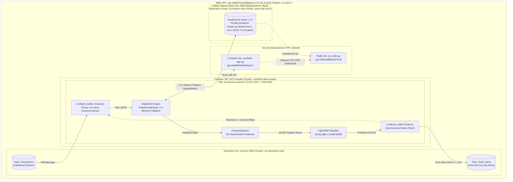
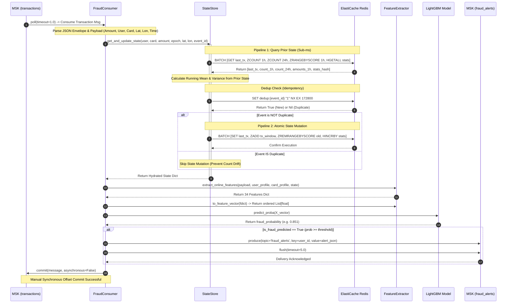
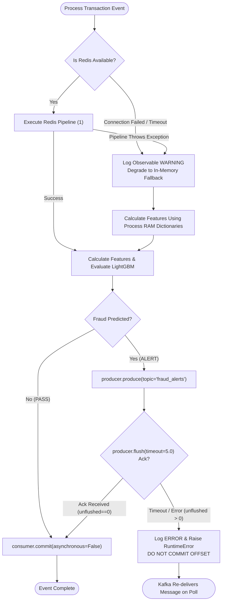

# Deep Dive Technical Architecture: AWS ElastiCache for Redis Online Feature Store
## Real-Time Transaction Scoring & Fraud Detection Pipeline

---

## 1. System Overview and Topology

The fraud detection streaming engine processes real-time financial transaction events emitted from the synthetic transaction provider. The core latency requirement for real-time inference is **< 10ms per transaction**, encompassing Kafka payload ingestion, online feature hydration, LightGBM model evaluation, alert dispatch, and manual offset commitment.



---

## 2. End-to-End Transaction Processing Sequence

The sequence diagram below models the exact transaction processing lifecycle implemented in [`src/ml/fraud_consumer.py`](file:///home/syd/Downloads/archive/src/ml/fraud_consumer.py) and [`src/ml/state_store.py`](file:///home/syd/Downloads/archive/src/ml/state_store.py).



---

## 3. Redis Key Schema and Data Modeling

| Key Pattern | Data Structure | Encoding / Fields | Purpose in Fraud Engine | TTL Policy | Memory Overhead |
| :--- | :--- | :--- | :--- | :--- | :--- |
| `profile:user:{user_id}` | **String (JSON)** | Demographic fields: `current_age`, `fico_score`, `yearly_income`, `total_debt`, `latitude`, `longitude` | Static customer reference profile used to calculate `distance_to_home_km` and credit risk. | Permanent (No TTL) | ~320 bytes / user |
| `profile:card:{user_id}:{card_idx}` | **String (JSON)** | Card dimensions: `card_brand`, `card_type`, `has_chip`, `credit_limit`, `card_on_dark_web` | Static card dimensions used to evaluate limit utilization and compromised status. | Permanent (No TTL) | ~280 bytes / card |
| `last_tx:{user_id}:{card_idx}` | **String (JSON)** | `{"lat": float, "lon": float, "epoch": float}` | Records preceding GPS fix and timestamp to evaluate Great-Circle velocity (`travel_speed_kmh`). | 48 Hours (`172800s`) | ~120 bytes / card |
| `tx_window:{user_id}:{card_idx}` | **Sorted Set (ZSET)** | **Score:** `epoch_sec` (Float timestamp)<br>**Member:** `"{amount}:{epoch_sec}"` | High-efficiency rolling window. Enables $O(\log N + M)$ queries for 1h/24h counts and sliding spend summation. | 48 Hours (`172800s`) | ~64 bytes / tx entry |
| `spend_stats:{user_id}` | **Hash** | `total_sum`: Float<br>`total_count`: Integer<br>`total_sq_sum`: Float | Maintains running historical totals for online Welford/sample variance and mean calculation without keeping arrays. | 48 Hours (`172800s`) | ~150 bytes / user |
| `dedup:{event_id}` | **String** | Value: `"1"` | Idempotency lock via `SET NX EX`. Prevents duplicated Kafka replays from artificially inflating rolling transaction counts. | 48 Hours (`172800s`) | ~60 bytes / event |

---

## 4. State Lifecycle and Pruning Strategy

### Sliding Window Ingestion and Pruning
To prevent unbounded memory growth in ElastiCache, rolling transaction histories are pruned continuously during the write phase:
1. When a transaction arrives at time $t_{\text{now}}$, the 24-hour cutoff threshold is calculated:
   $$t_{\text{cutoff}} = t_{\text{now}} - 86400.0$$
2. The current event is inserted into the card's Sorted Set:
   `ZADD tx_window:{user}:{card} t_now "{amount}:{t_now}"`
3. All entries with a score strictly below $t_{\text{cutoff}}$ are pruned in the same pipeline execution:
   `ZREMRANGEBYSCORE tx_window:{user}:{card} -inf t_cutoff`
4. The key-level expiration timer is reset to 48 hours:
   `EXPIRE tx_window:{user}:{card} 172800`

### Running Variance and Sample Standard Deviation
Rather than maintaining an unbounded list of prior transaction amounts in Redis, `spend_stats:{user_id}` stores aggregate accumulators:
$$\mu = \frac{\sum x}{N}$$
$$\sigma = \sqrt{\frac{\sum x^2 - \frac{(\sum x)^2}{N}}{N - 1}} \quad (\text{for } N \ge 2)$$

- **Prior-State Invariant:** When transaction $k$ arrives with amount $x_k$, the mean $\mu$ and standard deviation $\sigma$ are calculated from the existing Redis Hash values *before* applying the current transaction.
- **Atomic Hash Increments:**
  - `HINCRBYFLOAT spend_stats:{user_id} total_sum x_k`
  - `HINCRBY spend_stats:{user_id} total_count 1`
  - `HINCRBYFLOAT spend_stats:{user_id} total_sq_sum (x_k * x_k)`

---

## 5. Security Architecture and Network Isolation

```text
       INTERNET
          |
       [ BLOCKED ] (No Public IP, No Internet Gateway Routing to Redis)
          |
+---------v-----------------------------------------------------------------------+
|  AWS VPC: vpc-0d66731212396d1e9 (172.31.0.0/16)                                |
|                                                                                 |
|  +-------------------------------------+   +---------------------------------+  |
|  | Subnet: subnet-003d3891dab36b354   |   | Subnet: subnet-0b18944bde732d1fd |  |
|  | (eu-west-3a - Private Workload)    |   | (eu-west-3b - Private Feature)  |  |
|  |                                     |   |                                 |  |
|  |  [ ECS Fargate Container ]          |   |  [ ElastiCache Redis Node ]     |  |
|  |  Security Group: synthetic-app-sg   |   |  Security Group: sic-redis-sg   |  |
|  |  (sg-0dd0933f4da2b5ea7)             |   |  (sg-045ac4d82b2de70c6)         |  |
|  |                                     |   |                                 |  |
|  |  Role: syntheticTaskRole            |   |  Storage: sse-elasticache       |  |
|  |  Traffic: Outbound TCP 6379 --------+---> Inbound: TCP 6379 (TLS Only)    |  |
|  +-------------------------------------+   +---------------------------------+  |
+---------------------------------------------------------------------------------+
```

### Verified Security Controls:
1. **Network Layer Isolation:**
   - Redis cluster nodes are situated within private subnets (`sic-redis-subnets`). No public DNS records or elastic IPs are assigned.
2. **Security Group Ingress Rule:**
   - Security group `sic-redis-sg` (`sg-045ac4d82b2de70c6`) allows inbound TCP traffic on port `6379` strictly from `sg-0dd0933f4da2b5ea7` (`synthetic-app-sg`). All other IP CIDRs and security groups are dropped.
3. **In-Transit Encryption (TLS):**
   - ElastiCache is configured with `TransitEncryptionMode: required`. Client connections must use the TLS wrapper protocol (`rediss://`). Unencrypted plaintext connections on port 6379 are refused at the TLS handshake level.
4. **At-Rest Encryption:**
   - Storage volume encryption is enabled via `StorageEncryptionType: sse-elasticache` (AES-256).

---

## 6. Failure Modes, Edge Cases, and Recovery Behavior



### Behavior Under Specific Failures:
1. **Redis Unavailable at Cold Start:**
   - If Redis is unreachable during `FraudStreamingConsumer.__init__`, `StateStore._connect()` catches the socket timeout, logs a warning, and sets `_using_fallback = True`. The consumer continues operating entirely within container RAM.
2. **Redis Fails Mid-Stream:**
   - If a Redis read/write pipeline throws a connection drop or timeout during stream processing, the exception is trapped in `state_store.py` (line 330). An observable warning is logged with the event ID, and execution falls back to `_local_user_tx_history` and `_local_user_spend_stats`.
3. **Alert Dispatch Failure vs Offset Commit:**
   - If LightGBM predicts fraud and `producer.produce()` fails or `producer.flush(5.0)` times out, an explicit `RuntimeError` is raised. 
   - `consumer.commit(asynchronous=False)` is **not executed**. The consumer loop pauses for 1.0s and retries on the next poll cycle, guaranteeing that alerts are never silently skipped.

---

## 7. What This Design Does NOT Guarantee

To maintain rigorous technical integrity and prevent unrealistic production assumptions, the following boundaries must be clearly understood:

1. **No Distributed Synchronization Between Fallback and Redis (State Split):**
   - If Redis fails temporarily and the consumer falls back to in-memory mode, any transactions processed during that window are stored exclusively in container RAM. 
   - When Redis recovers, **no dual-write backfill occurs**. State recorded in local RAM is not retroactively committed to Redis, creating a permanent gap in the shared rolling window.
2. **No Exactly-Once Delivery (Duplicate Alerts Can Occur):**
   - Kafka does not support atomic distributed transactions across disparate external systems without two-phase commit overhead.
   - If an alert is published and acknowledged by MSK, but the consumer process crashes before `consumer.commit(...)` finishes, the message will be redelivered upon task restart, emitting a **duplicate alert**. Downstream consumers of `fraud_alerts` must deduplicate by `event_id`.
3. **No High Availability Failover on Current Node (Demo Sizing):**
   - The verified cluster `sic-feature-store-001` is deployed on a single node `cache.t4g.micro` with `MultiAZ: disabled` and `AutomaticFailover: disabled`. If AWS hardware underlying `eu-west-3b` experiences an outage, Redis will be unavailable until manually replaced or rebooted.
4. **No Cross-Region Disaster Recovery:**
   - All resources reside exclusively in Paris (`eu-west-3`). No global replication groups or cross-region replication links are configured.
