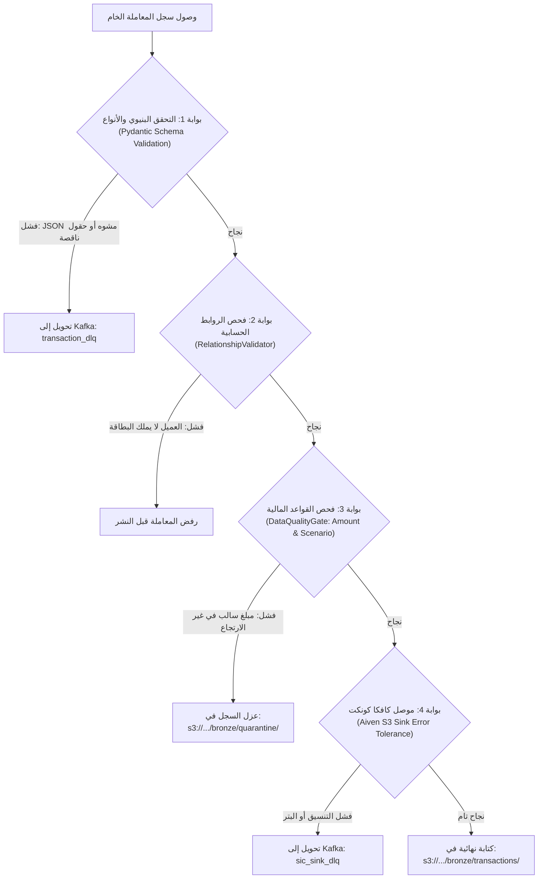

# جودة البيانات وطوابير العزل (Data Quality & Dead Letter Queue)
## الدليل التشغيلي لبوابات التحقق، عزل السجلات التالفة، وطابور المعاملات المشبوهة

---

> [!NOTE]
> **مسار الملف:** `docs/reliability/data-quality-and-dlq.md`  
> **الملفات المصدرية المرتبطة:**  
> - [`src/ingestion/extractor.py`](file:///home/syd/Downloads/archive/src/ingestion/extractor.py) (كلاس `DataQualityGate`)
> - [`src/synthetic_streaming/relationship_validator.py`](file:///home/syd/Downloads/archive/src/synthetic_streaming/relationship_validator.py)
> - [`src/synthetic_streaming/event_schema.py`](file:///home/syd/Downloads/archive/src/synthetic_streaming/event_schema.py)
> - [`docker/kafka-connect/register_connectors.sh`](file:///home/syd/Downloads/archive/docker/kafka-connect/register_connectors.sh)

---

## 1. فلسفة جودة البيانات في خطوط المعالجة المالية

في بيئات البيانات البنكية، لا يمكن الاعتماد على فرضية أن "كافة البيانات الواردة سليمة":
* قد تقع أخطاء في الشبكة تؤدي لبتر رسائل الـ JSON.
* قد يقوم مطور باختبار حقن بيانات فاسدة عمداً لاختبار الأنظمة.
* قد يحدث خلل منطقي يؤدي لتوليد معاملة بمبلغ سالب في غير سيناريو الارتجاع.

**القاعدة الذهبية المطبقة في SIC:**  
> *"البيانات الفاسدة لا يجب أن تسقط الـ Pipeline أبداً، ولا يجب أن تلوث بحيرة البيانات النظيفة؛ بل تُعزل فوراً في بيئة حجر صحي (Quarantine) لدراستها وتصحيحها."*

---

## 2. بوابات التحقق المطبقة في المنظومة (The 4 Validation Gates)



---

## 3. تفصيل قواعد الفحص البرمجية

### 3.1 فحص الحقول الإلزامية ونوع البيانات (`REQUIRED_FIELDS`)
في كلاس [`DataQualityGate`](file:///home/syd/Downloads/archive/src/ingestion/extractor.py#L135-L208)، يتم فحص وجود الحقول الستة الإلزامية:
```python
REQUIRED_FIELDS = {"id", "transaction_id", "user_id", "card_index", "amount", "created_at"}
```
إذا كان أي من هذه الحقول مفقوداً أو قيمته `None`، يُرفض السجل بسبب: `Missing mandatory field(s): {fields}`.

### 3.2 كشف التكرار اللحظي داخل الدفعة (In-Batch Duplicate Detection)
يتتبع الكود معرفات التسلسل داخل الدفعة الحالية عبر `seen_ids = set()`. لو تكرر نفس الـ `id` في نفس الدفعة، يُعزل التكرار لتفادي مضاعفة أرقام المبيعات في بحيرة البيانات.

### 3.3 القاعدة المالية الإلزامية: المبالغ السالبة والارتجاع (Negative Amount Rule)
* **القاعدة:** في المعاملات المالية، لا يُسمح بأي مبلغ سالب إلا إذا كان السيناريو صراحة هو سيناريو استرداد (`refund_return`):
```python
amt = float(item["amount"])
scenario_str = str(item.get("scenario", "")).lower()
if amt < 0 and not scenario_str.startswith("refund"):
    # عزل فوري للسجل
    rejection_reason = f"Negative amount {amt} on non-refund scenario '{scenario_str}'"
```

### 3.4 فحص صحة المستخدم ومؤشر البطاقة (Non-Negativity Checks)
يجب أن يكون `user_id >= 0` و `card_index >= 0`؛ أي أرقام سالبة تؤدي لعزل السجل فوراً.

### 3.5 فحص الاتساق الجغرافي وقناة الدفع
في [`event_schema.py`](file:///home/syd/Downloads/archive/src/synthetic_streaming/event_schema.py#L115-L135):
* التحقق من أن وسيلة الدفع (`Use Chip`) متوافقة مع طريقة الإدخال (`Transaction Entry Method`): لا يمكن أن تكون المعاملة `Online Transaction` مع وسيلة `chip`!
* التحقق من الإحداثيات الجغرافية: يجب أن يكون خط العرض بين [-90, 90] وخط الطول بين [-180, 180]، ويجب أن يتواجدا معاً أو يغيبا معاً.

---

## 4. مسار العزل وطوابير الـ DLQ بالتفصيل

### 4.1 عزل S3 Quarantine (`bronze/quarantine/`)
عندما يعثر `DataQualityGate` على سجلات معيبة، يكتبها في ملف JSONL مستقل:
* **المسار:** `s3://sic-pipeline-storage/bronze/quarantine/transactions/year={Y}/month={M}/day={D}/quarantine_{run_id}.jsonl`
* **محتوى السجل المعزول:**
```json
{
  "raw_record": {
    "id": 998811,
    "transaction_id": "tx-corrupt-001",
    "user_id": 42,
    "card_index": 0,
    "amount": -550.00,
    "scenario": "normal_spend",
    "created_at": "2026-10-29T19:30:00+00:00"
  },
  "rejection_reason": "Negative amount -550.0 on non-refund scenario 'normal_spend'",
  "quarantined_at": "2026-10-29T19:30:05.123456+00:00"
}
```

### 4.2 موضوع كافكا كونكت المعزول: `sic_sink_dlq`
إذا واجه موصل Aiven S3 Sink رسالة لا يمكن فك شفرتها من كافكا:
* يحولها تلقائياً لموضوع `sic_sink_dlq`.
* يرفق ترويسات سياق الخطأ (`context.headers`):
  * `__x_opt_kafka_connect_error_message`: تفاصيل الاستثناء.
  * `__x_opt_kafka_connect_topic`: الموضوع الأصلي.
  * `__x_opt_kafka_connect_partition`: رقم البارتشن الأصلي.
  * `__x_opt_kafka_connect_offset`: الإزاحة الأصلية للرسالة المعطوبة.

---

## 5. دليل التصحيح وإعادة المعالجة (Replay & Remediation Runbook)

عندما يكتشف مهندسو البيانات وجود ملفات في `quarantine/`:
1. **تشخيص الخطأ:** قراءة حقل `rejection_reason` لمعرفة السبب المشترك (هل هو كود تجاري جديد غير مسجل في جدول الـ MCC؟ هل هو عطل في إصدار المولد القديم؟).
2. **التصحيح:** تشغيل سكريبت تصحيحي يقوم بضبط القيم المشوهة.
3. **إعادة الضخ (Replay):** إعادة قراءة الملفات من Quarantine وضخها كأحداث مصححة جديدة إلى كافكا لتسلك مسار المعالجة الطبيعي، مع حذف الملف المعزول بعد نجاح المعالجة.
