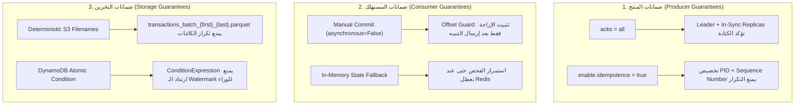

# التسامح مع الأعطال وضمانات تسليم البيانات (Fault Tolerance & Guarantees)
## الدليل التشريحي لمستويات الأمان، استراتيجيات التعافي، ومصفوفة المخاطر المتبقية

---

> [!NOTE]
> **مسار الملف:** `docs/reliability/fault-tolerance-and-delivery-guarantees.md`  
> **الهدف:** توثيق كل سيناريو عطل محتمل في المنظومة: كيف يكتشفه النظام، كيف يتعامل معه ذاتياً، وكيف يحافظ على ضمانات التسليم (At-Least-Once Delivery) دون فقدان أي بايت.

---

## 1. ضمانات التسليم في النظام الموزع (Delivery Semantics)

تعتمد منصة SIC معيار تسليم صارم: **التسليم لمرة واحدة على الأقل (At-Least-Once Delivery)** مع جعل عمليات التخزين في بحيرة البيانات ومستودع الخصائص **حيادية الأثر عند التكرار (Idempotent Processing)**.

---

## 2. مصفوفة سيناريوهات الأعطال الشاملة (Fault-Tolerance Matrix)

| سيناريو العطل (Failure Scenario) | آلية الاكتشاف (Detection) | السلوك التلقائي للنظام (System Behavior) | إجراء التعافي الذاتي (Recovery) | الخطر المتبقي (Residual Risk) |
| :--- | :--- | :--- | :--- | :--- |
| **1. سقوط وسيط كافكا (MSK Broker Crash)** | محرك `librdkafka` يكتشف انقطاع الاتصال خلال 100ms. | ينتقل المنتج تلقائياً للوسيط البديل بفضل عامل التكرار `Replication Factor = 2`. | إعادة إرسال الرسائل العالقة بالـ Buffer بحد أقصى 5 محاولات. | زيادة طفيفة في الـ Latency أثناء انتخاب Leader جديد. |
| **2. انقطاع اتصال Redis بمسار الاحتيال** | كلاس `StateStore` يطلق استثناء `ConnectionError` أو `Timeout`. | التحول اللحظي لوضع الـ Fallback في ذاكرة الرام المحلية (`_using_fallback = True`). | استمرار تقييم المعاملات بالبيانات المحلية وتنبيه الـ Logs فورياً. | فقدان تاريخ النوافذ السابقة للعميل حتى يعود اتصال Redis. |
| **3. انهيار حاوية مستهلك الاحتيال** | خادم كافكا يرصد انقطاع الـ Heartbeat بعد انتهاء `session.timeout.ms`. | لا يتم تثبيت الـ Offset لآخر معاملة (Offset Guard). | يعاد تشغيل الحاوية في Fargate وتقرأ نفس المعاملة مجدداً وتصدر التنبيه. | تكرار معالجة معاملة واحدة فقط (Duplicate Processing)، وهو آمن. |
| **4. توقف موصل Debezium CDC** | توقف نشر أحداث `users` و `cards` في كافكا. | يحتفظ خادم PostgreSQL بسجلات الـ WAL داخل `debezium_cdc_slot`. | عند إعادة تشغيل الموصل، يستأنف القراءة من آخر LSN مثبت بدقة. | استهلاك تدريجي لمساحة قرص RDS إذا استمر التوقف لأيام. |
| **5. فشل رفع ملف إلى S3** | كود الرفع يطلق استثناء `boto3 ClientError`. | إلغاء تحديث علامة الإزاحة في DynamoDB وتراجع خطوة الاستخراج. | يعيد Airflow تشغيل المهمة بعد دقيقة لقراءة نفس الدفعة وإعادة رفعها. | لا يوجد خطر؛ أسماء الملفات مبنية على الإزاحات فتستبدل الملف التالف. |
| **6. انهيار خادم PostgreSQL RDS** | الـ Health Probes ترجع بـ `HTTP 503` فورياً. | تتوقف خدمة استخراج المرجعيات التزايدية، بينما يستمر بث المعاملات لكافكا! | يقوم AWS RDS بتفعيل الـ Multi-AZ Failover تلقائياً خلال دقيقة. | تعليق مؤقت لإضافة عملاء جدد في المسار الثاني. |
| **7. وصول حدث مالي مشوه أو مكسور** | بوابة `DataQualityGate` ترصد فقدان حقول إلزامية. | عزل الحدث فوراً في مجلد `quarantine/` دون إيقاف باقي الدفعة. | متابعة المعاملات السليمة بشكل طبيعي دون أي تأخير لخط الإنتاج. | لا يوجد أي خطر على استقرار المنظومة. |

---

## 3. تفصيل الحماية من التكرار (Idempotency in Action)

### 3.1 في كافكا (Kafka Idempotent Producer):
عندما يرسل المولد معاملة، قد تصل للوسيط ويكتبها في السجل، ولكن ينقطع اتصال الشبكة قبل أن يستلم المولد تأكيد الـ ACK. في الأنظمة العادية، يعيد المولد إرسال الرسالة فتتكرر في الكشف.  
بفضل ضبط `enable_idempotence = True`:
1. يمنح وسيط كافكا لكل ناشر معرفاً فريداً (`Producer ID - PID`).
2. يرفق الناشر رقماً متسلسلاً رتيباً (`Sequence Number`) لكل رسالة.
3. إذا استلم الوسيط رسالة تحمل نفس الـ PID والـ Sequence Number مرتين، يكتب الأولى فقط ويرجع تأكيد نجاح للثانية دون تكرارها في السجل!

### 3.2 في بحيرة البيانات (Deterministic File Key Generation):
في كود [`src/ingestion/extractor.py`](file:///home/syd/Downloads/archive/src/ingestion/extractor.py#L480-L495):
* لا تعتمد أسماء ملفات S3 على التوقيت الحالي للرفع (`timestamp`)، لأن إعادة تشغيل المهمة في توقيت لاحق كان سينشئ ملفاً جديداً باسم مختلف يكرر البيانات!
* بدلاً من ذلك، يُسمى الملف برقم أول وآخر سجل في الدفعة:  
  `transactions_batch_{first_id}_{last_id}.parquet`.
* إذا فشلت المهمة في منتصف الطريق وأعاد Airflow تشغيلها، يُكتب الملف الجديد فوق الملف القديم بنفس الاسم تماماً (Overwritten Idempotently)، مما يضمن عدم تكرار أي صف في بحيرة البيانات.
