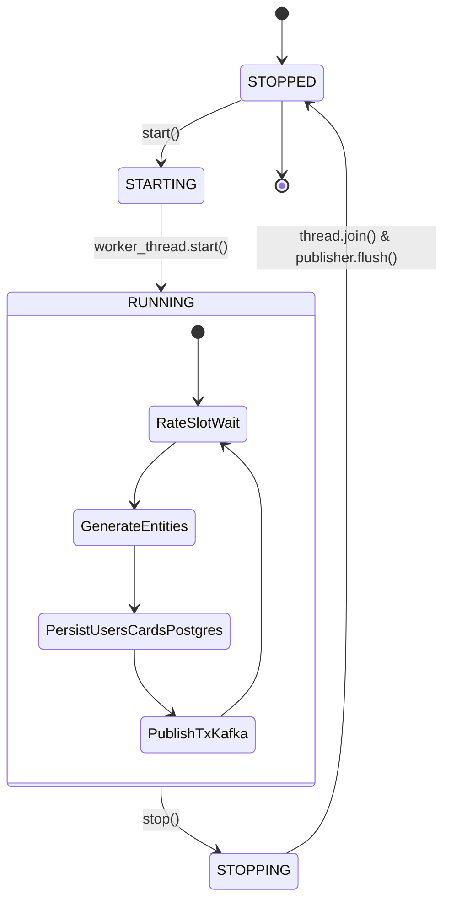

# خدمة توليد البيانات التخليقية (Generator Service Engine)
## الدليل التشريحي لمحرك التوليد، الجدولة الزمنية، وسيناريوهات المعاملات

---

> [!NOTE]
> **مسار الملف:** `docs/services/generator-service.md`  
> **الملفات المصدرية المرتبطة:**  
> - [`src/synthetic_streaming/generator_service.py`](file:///home/syd/Downloads/archive/src/synthetic_streaming/generator_service.py)
> - [`src/synthetic_streaming/rate_controller.py`](file:///home/syd/Downloads/archive/src/synthetic_streaming/rate_controller.py)
> - [`src/synthetic_streaming/scenario_engine.py`](file:///home/syd/Downloads/archive/src/synthetic_streaming/scenario_engine.py)
> - [`src/synthetic_streaming/transactions_generator.py`](file:///home/syd/Downloads/archive/src/synthetic_streaming/transactions_generator.py)
> - [`src/synthetic_streaming/source_simulator.py`](file:///home/syd/Downloads/archive/src/synthetic_streaming/source_simulator.py)

---

## 1. نظرة عامة والمسؤولية الهندسية (Service Responsibilities)

تعتبر خدمة **Generator Service** هي القلب النابض لطبقة التوليد في منصة SIC؛ مسؤوليتها تتلخص في:
1. توليد تيار متصل ومنتظم من المعاملات المالية التخليقية يحاكي الواقع البنكي بدقة.
2. التحكم الصارم في معدل التدفق (Transactions Per Second - TPS) دون حدوث انحراف زمني أو طفرات انفجارية (Burst-free Pacing).
3. تطبيق قواعد السيناريوهات المالية الثمانية ومحاكاة مبالغها وأخطائها المنطقية.
4. توزيع قنوات الدفع (POS Terminals, E-Commerce, Wallets, ATMs) بأوزان إحصائية واقعية.
5. إدارة دورة حياة الخيط الخلفي (Background Worker Thread) وتأمين التعديل الآمن في الذاكرة (Thread-Safety).
6. نشر الأحداث مباشرة إلى وسيط الرسائل كافكا مع الالتزام الصارم بمبدأ **Zero-DB-Inserts**.

---

## 2. دورة حياة الخدمة وحالات التشغيل (Service Lifecycle & Concurrency)

تدار حالة الخدمة كآلة حالات محدودة (Finite State Machine) عبر الـ Enum المسمى `ServiceState`:



### 2.1 مراحل الإقلاع والإيقاف الآمن (Graceful Shutdown)
1. **بدء التشغيل (`start()`):**
   * يفحص جاهزية الناشر (`publisher.health()`) للتأكد من قدرته على الاتصال بالوسيط.
   * يقوم بتصفير أحداث الإيقاف (`_stop_event.clear()`) ويبدأ عداد المنظم الزمني (`rate_controller.start()`).
   * ينشئ خيطاً خلفياً مخصصاً (`threading.Thread(name="GeneratorWorkerThread", daemon=True)`).
   * يغير الحالة إلى `RUNNING` ويبدأ في تنفيذ حلقة `_generation_loop`.
2. **الإيقاف النظيف (`stop()`):**
   * يغير الحالة إلى `STOPPING` ويطلق إشارة `_stop_event.set()`.
   * يوقف منظم المعدلات `rate_controller.stop()`.
   * ينتظر الخيط حتى يكتمل (`_worker_thread.join(timeout=10.0)`).
   * **تفريغ الناشر:** يستدعي `self.publisher.flush(timeout=10.0)` لانتظار تأكيدات التسليم (Broker ACKs) لجميع الرسائل العالقة في الذاكرة المؤقتة. لو تبقت رسائل عالقة، يسجل تحذيراً بعددها قبل الانتقال لحالة `STOPPED`.

---

## 3. محرك التحكم في معدل التدفق: `RateController`

### 3.1 آلية الجدولة بالوقت الرتيب (Monotonic Slot Scheduling)
لا يستخدم `RateController` خوارزمية سلة الرموز (Token Bucket) التقليدية المعرضة للانجراف الزمني بسبب تجميع الرموز أثناء التوقف، بل يعتمد على **الجدولة الزمنية بالمؤقت الرتيب (`time.monotonic()`)**:

```python
# كود الجدولة الفعلي من src/synthetic_streaming/rate_controller.py
now = time.monotonic()
interval = 1.0 / self._target_tps

if self._next_event_time <= now:
    # منع الطفرات الانفجارية: إذا تأخر المولد بأكثر من فترة كاملة، يتم إعادة تعيين الموعد القادم
    if now - self._next_event_time > interval:
        self._next_event_time = now + interval
    else:
        self._next_event_time += interval
```

* **منع الطفرات (Burst Prevention):** لو حدث توقف عابر بسبب Garbage Collection أو ضغط الـ CPU، لا يحاول المحرك تعويض الفائت بضخ مئات الرسائل دفعة واحدة؛ بل يعيد ضبط الموعد القادم فوراً.
* **تعديل الـ TPS أثناء التشغيل (Runtime Dynamic Pacing):** عند استدعاء `set_target_tps(new_tps)`، يعيد المحرك جدولة الموعد القادم في الذاكرة فوراً ليدخل المعدل الجديد حيز التنفيذ دون الحاجة لإعادة تشغيل الحاوية.

---

## 4. السيناريوهات المالية الثمانية بالتفصيل (`scenario_engine.py`)

يقوم محرك السيناريوهات باختيار سيناريو لكل معاملة بناءً على التوزيع الاحتمالي المحدد في `ScenarioWeights`:

```text
┌────────────────────┬──────────┬────────────────────────┬─────────────────────┬────────────────────────────────────────┐
│ السيناريو          │ الوزن    │ نطاق المبالغ ($)       │ علامة الاحتيال      │ الخصائص وحالات الأخطاء المنطقية        │
├────────────────────┼──────────┼────────────────────────┼─────────────────────┼────────────────────────────────────────┤
│ normal_spend       │ 85.0%    │ $2.50 – $250.00        │ No                  │ عمليات شراء اعتيادية خالية من الأخطاء  │
│ declined_error     │ 4.0%     │ $10.00 – $500.00       │ No                  │ رفض مصرفي (Insufficient Balance, BadPIN)│
│ high_value         │ 3.0%     │ $1,000.00 – $15,000.00 │ No                  │ مبالغ ضخمة لاختبار الحدود الائتمانية   │
│ unusual_location   │ 3.0%     │ $15.00 – $800.00       │ No                  │ مدينة Online / International لاختبار الـ Lat │
│ refund_return      │ 3.0%     │ -$5.00 – -$350.00      │ No                  │ مبالغ سالبة لاختبار الارتجاع في البحيرة│
│ repeated_attempt   │ 1.0%     │ $15.00 – $120.00       │ No                  │ محاولات سريعة متكررة مع احتمال Bad PIN │
│ late_event         │ 0.8%     │ $10.00 – $200.00       │ No                  │ متأخرة زمنياً بـ 2 إلى 7 أيام (Watermark)│
│ fraud_labelled     │ 0.2%     │ $350.00 – $4,500.00    │ Yes                 │ معاملات احتيالية صريحة بمبالغ مرتفعة  │
└────────────────────┴──────────┴────────────────────────┴─────────────────────┴────────────────────────────────────────┘
مجموع الأوزان الإحصائية: 0.85 + 0.04 + 0.03 + 0.03 + 0.03 + 0.01 + 0.008 + 0.002 = 1.000 (100% بالضبط)
```

### 4.1 تفصيل أخطاء السيناريو المرفوض (`declined_error`)
عند اختيار هذا السيناريو، يتم تحديد سبب الرفض وفق مصفوفة أوزان الأخطاء البنكية (`ERROR_WEIGHTS`):
* `Insufficient Balance` (رصيد غير كافي): **55%**
* `Bad PIN` (رقم سري خاطئ): **15%**
* `Technical Glitch` (عطل فني في نقطة البيع): **12%**
* `Bad Card Number` (رقم بطاقة غير صالح): **8%**
* `Bad Expiration` (تاريخ صلاحية منتهي): **4%**
* `Bad CVV` (كود حماية خاطئ): **4%**
* `Bad PIN,Insufficient Balance` (خطأ مركب): **2%**

### 4.2 حقن أخطاء جودة البيانات الاختياري (`invalid_test_record`)
إذا تم تفعيل الخاصية `inject_invalid_events = True` بمعدل افتراضي `invalid_event_rate = 0.01` (1%)، يقوم المحرك بتجاوز السيناريوهات الطبيعية وحقن سجل تالف عمداً:
* **المبلغ:** `-999999.99$` (مبلغ سالب هائل في غير سيناريو الارتجاع).
* **الأخطاء:** `Malformed Data Quality Test`.
* **البيانات الإضافية:** `MCC: -1` و `Use Chip: "Invalid_Method"`.
* **الهدف الهندسي:** اختبار قدرة بوابات جودة البيانات ([`DataQualityGate`](file:///home/syd/Downloads/archive/src/ingestion/extractor.py#L135-L208)) على عزل السجل فوراً في مجلد الـ Quarantine أو موضوع الـ DLQ دون إسقاط خط المعالجة.

---

## 5. محاكاة قنوات الدفع: `SourceSimulator`

تتوزع المعاملات بين 6 قنوات دفع بأوزان محددة في [`SourceSystemWeights`](file:///home/syd/Downloads/archive/src/synthetic_streaming/config.py#L32-L47):
* **`pos_terminal` (50%):** ماكينات الدفع المباشرة في المتاجر؛ ترتبط بـ `Swipe Transaction` و `Chip Transaction`.
* **`ecommerce_gateway` (30%):** بوابات الشراء الرقمية؛ ترتبط دائماً بـ `Online Transaction` ويكون اسم المدينة `Online / International` مع إحداثيات فارغة.
* **`digital_wallet` (10%):** الدفع بالهواتف والمحافظ الذكية (Apple Pay / Google Wallet).
* **`atm_network` (5%):** سحب وإيداع ماكينات الصراف الآلي؛ ترتبط بأكواد MCC النقدية.
* **`issuer_processor` (3%):** معالجات الإصدار المباشرة والتحويلات المصرفية.
* **`recurring_billing` (2%):** الاشتراكات الشهرية والفواتير المجدولة الدورية.

---

## 6. بناء وتنسيق غلاف الحدث: `EventEnvelope`

كل معاملة تنتج في الذاكرة تمر بعملية تغليف قياسية قبل إرسالها لشبكة كافكا:

```json
{
  "event_id": "c8a4b3d1-5f2e-4b6a-9c7d-8e1f2a3b4c5d",
  "event_type": "transaction.created",
  "schema_version": 1,
  "event_timestamp": "2026-10-29T19:20:00.123456+00:00",
  "source_system": "pos_terminal",
  "run_id": "run-0-1761765600",
  "scenario": "normal_spend",
  "payload": {
    "User": 1042,
    "Card": 0,
    "Year": 2026,
    "Month": 10,
    "Day": 29,
    "Time": "19:20",
    "Amount": "$45.20",
    "Use Chip": "Chip Transaction",
    "Merchant Name": 458921389012,
    "Merchant City": "Paris",
    "Merchant State": "IL",
    "Zip": "61944",
    "MCC": 5411,
    "Errors?": null,
    "Is Fraud?": "No",
    "Transaction Entry Method": "chip",
    "Merchant Latitude": 39.6111,
    "Merchant Longitude": -87.6961
  }
}
```

---

## 7. المقاييس التشغيلية وعدادات الحالة (Runtime Counters)

تحتفظ خدمة `GeneratorService` بعدادات حية بالذاكرة يمكن قراءتها عبر الـ API:
* `total_tx_generated`: إجمالي المعاملات المالية التي ولدت بنجاح.
* `total_prereq_events_generated`: إجمالي المستخدمين والبطاقات الجدد الذين أضيفوا للـ DB لتغذية Debezium.
* `total_tx_delivered`: المعاملات التي تم تأكيد وصولها لوسيط كافكا بنجاح من خلال الـ Delivery Callbacks.
* `total_tx_failed`: المعاملات التي فشل نشرها بعد استنفاد محاولات إعادة الإرسال.
* `actual_tps`: معدل التوليد الفعلي الحقيقي المقاس بنافذة انزلاقية زمنية.
