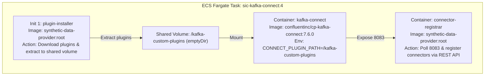

# Kafka Connect & Debezium CDC Specification
## SIC — Synthetic Financial Transaction Data Platform

**Service:** Distributed Apache Kafka Connect & Debezium PostgreSQL CDC  
**ECS Service:** `sic-kafka-connect-service` (Cluster: `synthetic-data-cluster`)  
**Task Definition:** `sic-kafka-connect:4` (CPU: 1024, RAM: 2048 MB)  
**REST Endpoint:** `http://172.31.10.236:8083` (VPC Internal)  

---

## 1. Container Pod Architecture

To run distributed Kafka Connect with custom plugins on serverless AWS ECS Fargate without maintaining a custom Docker image registry, a multi-container pod pattern is implemented:



1. **`plugin-installer` (Init Container):** Executes as `root`, downloads Debezium PostgreSQL connector (`2.5.4.Final`) and Aiven S3 Sink connector (`2.15.0`) from S3, extracts them into `/kafka-custom-plugins`, and grants `chmod -R 777` permissions.
2. **`kafka-connect` (Essential Service):** Runs Apache Kafka Connect distributed runtime. Configured via environment variables to bootstrap against Amazon MSK (`b-1.sicstreamingmsk...:9092,b-2...:9092`).
3. **`connector-registrar` (Sidecar):** Polls `http://localhost:8083/connectors` until HTTP 200, then issues idempotent `PUT /connectors/{name}/config` requests to register both connectors.

---

## 2. PostgreSQL RDS Logical Replication Setup

PostgreSQL 18.3 on Amazon RDS (`containerdb`) was configured to support native write-ahead log logical replication:

### 2.1. Parameter Group Association
- **Parameter Group:** `synthetic-pg18-cdc` (family: `postgres18`)
- **Parameters:**
  - `rds.logical_replication = 1`
  - `wal_level = logical`
  - `max_replication_slots = 10`
  - `max_wal_senders = 10`

### 2.2. Publication & Replication Slot DDL
```sql
-- 1. Create publication for CDC target tables
CREATE PUBLICATION debezium_publication FOR TABLE public.users, public.cards;

-- 2. Verify publication
SELECT pubname, puballtables FROM pg_publication WHERE pubname = 'debezium_publication';

-- 3. Verify active replication slot
SELECT slot_name, plugin, active, restart_lsn, confirmed_flush_lsn 
FROM pg_replication_slots 
WHERE slot_name = 'debezium_cdc_slot';
```

---

## 3. Debezium Source Connector Configuration

Registered under connector name `debezium-postgres-source`:

```json
{
  "connector.class": "io.debezium.connector.postgresql.PostgresConnector",
  "tasks.max": "1",
  "plugin.name": "pgoutput",
  "database.hostname": "containerdb.cjm6iag8qrwi.eu-west-3.rds.amazonaws.com",
  "database.port": "5432",
  "database.user": "dbadmin",
  "database.password": "******",
  "database.dbname": "postgres",
  "database.server.name": "sic",
  "database.sslmode": "require",
  "topic.prefix": "sic",
  "table.include.list": "public.users,public.cards",
  "publication.name": "debezium_publication",
  "slot.name": "debezium_cdc_slot",
  "snapshot.mode": "initial",
  "tombstones.on.delete": "false",
  "decimal.handling.mode": "double",
  "time.precision.mode": "connect",
  "transforms": "reroute",
  "transforms.reroute.type": "org.apache.kafka.connect.transforms.RegexRouter",
  "transforms.reroute.regex": "(?:.*\\.public\\.)?(.*)",
  "transforms.reroute.replacement": "$1",
  "key.converter": "org.apache.kafka.connect.json.JsonConverter",
  "key.converter.schemas.enable": "false",
  "value.converter": "org.apache.kafka.connect.json.JsonConverter",
  "value.converter.schemas.enable": "false"
}
```

### Critical Implementation Details:
- **`RegexRouter` Topic Remapping:** Native Debezium creates topics in the format `<topic.prefix>.<schema>.<table>` (e.g., `sic.public.users`). The regex `(?:.*\.public\.)?(.*)` with replacement `$1` transforms `sic.public.users` into `users` and `sic.public.cards` into `cards`, while safely preserving non-table metadata topics.
- **`snapshot.mode: initial`:** On initial connector startup, Debezium streams all existing table records (3,126 users, 9,551 cards) to MSK before tailing real-time WAL changes.
