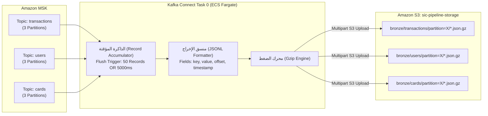

# موصلات كافكا كونكت والتخزين السحابي (Kafka Connect & S3 Sink)
## الدليل التشغيلي لموصل Aiven S3 Sink وتفريغ الأحداث في بحيرة البيانات

---

> [!NOTE]
> **مسار الملف:** `docs/streaming/kafka-connect-and-s3-sink.md`  
> **الملفات المصدرية المرتبطة:**  
> - [`docker/kafka-connect/register_connectors.sh`](file:///home/syd/Downloads/archive/docker/kafka-connect/register_connectors.sh)
> - [`docs/services/s3-sink.md`](file:///home/syd/Downloads/archive/docs/services/s3-sink.md)  
> **الفئة البرمجية:** `io.aiven.kafka.connect.s3.AivenKafkaConnectS3SinkConnector`

---

## 1. دور كافكا كونكت في المعمارية (Role of Kafka Connect)

يمثل **Apache Kafka Connect** إطار العمل الموزع القياسي (Distributed Integration Runtime) لنقل البيانات بين Apache Kafka وأنظمة التخزين الخارجية دون كتابة كود مخصص.  
في منصة SIC، يعمل موصل **Aiven S3 Sink Connector** كبوابة التوصيل النهائية لجميع مسارات البث الحي (`transactions`, `users`, `cards`) لتحويل الرسائل اللحظية إلى ملفات متسلسلة ومضغوطة داخل بحيرة البيانات على **Amazon S3 (Bronze Lakehouse)**.



---

## 2. الإعدادات الإنتاجية لموصل التخزين (Production Connector Configuration)

يتم تسجيل الموصل عبر طلب HTTP PUT إلى المنفذ `8083` بالإعدادات الدقيقة التالية:

```json
{
  "connector.class": "io.aiven.kafka.connect.s3.AivenKafkaConnectS3SinkConnector",
  "tasks.max": "1",
  "topics": "transactions,users,cards",
  "aws.s3.bucket.name": "sic-pipeline-storage",
  "aws.s3.region": "eu-west-3",
  "format.output.type": "jsonl",
  "format.output.fields": "key,value,offset,timestamp",
  "key.converter": "org.apache.kafka.connect.storage.StringConverter",
  "value.converter": "org.apache.kafka.connect.json.JsonConverter",
  "value.converter.schemas.enable": "false",
  "file.name.template": "bronze/{{topic}}/partition={{partition}}/{{start_offset:padding=true}}.json.gz",
  "file.compression.type": "gzip",
  "file.max.records": "50",
  "flush.timeout.ms": "5000",
  "errors.tolerance": "all",
  "errors.deadletterqueue.topic.name": "sic_sink_dlq",
  "errors.deadletterqueue.topic.replication.factor": "2",
  "errors.deadletterqueue.context.headers.enable": "true",
  "errors.log.enable": "true",
  "errors.log.include.messages": "true"
}
```

---

## 3. آليات التدوير وتفريغ الدفعات (File Rotation & Flush Triggers)

لكي يتفادى الموصل إغراق بحيرة البيانات بملفات صغيرة جداً (Small Files Problem) أو حجز البيانات لفترات طويلة في الذاكرة، تم ضبط **محفزين مزدوجين للتفريغ (Dual Flush Triggers)**:
1. **المحفز العددي (`file.max.records = 50`):** بمجرد أن يستقبل الموصل 50 سجلاً من نفس البارتشن، يقوم فوراً بضغط السجلات وكتابة ملف جديد في S3.
2. **المحفز الزمني (`flush.timeout.ms = 5000`):** إذا كان معدل التوليد منخفضاً (مثل أوقات الركود أو الليل)، لا ينتظر الموصل إلى ما لا نهاية لتجميع الـ 50 سجلاً؛ بل يقوم بإغلاق وتفريغ الملف كل 5 ثوانٍ كحد أقصى، مما يضمن أن البيانات تتاح في بحيرة البيانات في زمن تأخير (Latency) لا يتجاوز 5 ثوانٍ!

### 3.1 استراتيجية تسمية الملفات وتقسيم البارتشنز (File Naming Template)
تعتمد التسمية على القالب:
`bronze/{{topic}}/partition={{partition}}/{{start_offset:padding=true}}.json.gz`
* **`start_offset:padding=true`:** يُكتب رقم الإزاحة الأولى في الملف مسبوقاً بأصفار (Padding يصل لـ 20 خانة: e.g. `00000000000000000050.json.gz`).
* **الفائدة المعمارية:** ترتيب الملفات داخل المجلد في S3 يكون متطابقاً 100% مع الترتيب الأبجدي والرقمي الصارم، مما يجعل عمليات المسح والقراءة المتسلسلة في محركات Spark سريعة وخالية من الالتباس.

---

## 4. تتبع رحلة حدث واحد من كافكا إلى ملف S3 (Event Tracing)

لنتتبع ما يحدث لمعاملة واحدة (`transaction_id = tx-9988`) منذ لحظة نشرها:

```text
1. [Generator] يرسل الحدث إلى موضوع 'transactions' على MSK.
   ↓
2. [Broker MSK] الرسالة تهبط في Partition 1 عند الإزاحة رقم Offset = 150.
   ↓
3. [Kafka Connect Task 0] الموصل يقرأ الرسالة من Partition 1 ويحتفظ بها في الـ Accumulator.
   ↓
4. [Condition Trigger] وصل عدد الرسائل المتراكمة في Partition 1 إلى 50 رسالة (من Offset 150 حتى 199).
   ↓
5. [Serialization] الموصل ينسق السجلات الـ 50 كـ JSON Lines (كل سجل في سطر مستقل).
   ↓
6. [Compression] ضغط الكتلة بالكامل بمحرك Gzip بنسبة توفير تزيد عن 80%.
   ↓
7. [S3 PutObject] رفع الملف المضغوط إلى المسار:
   s3://sic-pipeline-storage/bronze/transactions/partition=1/00000000000000000150.json.gz
   ↓
8. [Commit Offset] الموصل يثبت إزاحة كافكا عند 200 (Committed Offset = 200).
```

---

## 5. إدارة الأخطاء وطابور المعاملات المعزولة (Error Handling & DLQ)

* **التسامح مع الأخطاء (`errors.tolerance = "all"`):** لو وصلت رسالة تالفة أو غير متوافقة مع محول الـ JSON، لا ينهار الموصل ويتوقف عن العمل، بل يواصل معالجة باقي التدفق.
* **إعادة التوجيه لـ DLQ (`errors.deadletterqueue.topic.name = "sic_sink_dlq"`):** تُحول الرسالة التالفة تلقائياً لموضوع الـ DLQ.
* **إرفاق ترويسات السياق (`context.headers.enable = "true"`):** يرفق الموصل في ترويسات الرسالة المعزولة: اسم الموضوع الأصلي، رقم البارتشن، الإزاحة الأصلية، وتفاصيل الخطأ الاستثنائي الكامل (Exception Stack Trace)، مما يتيح لمهندسي البيانات تشخيص سبب المشكلة وتصحيحها بسهولة.
