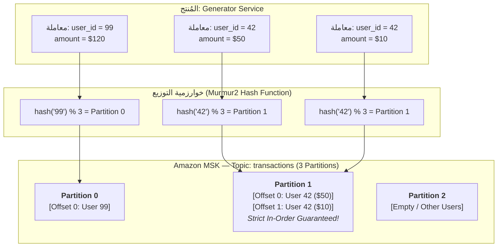
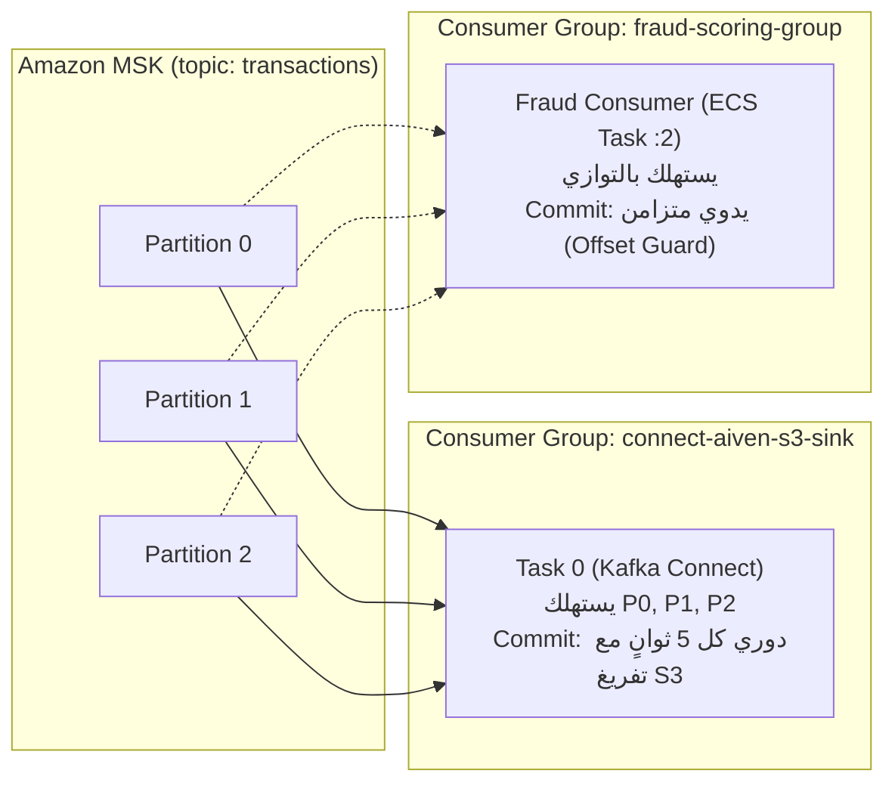

# أساسيات كافكا وتطبيقها في منصة SIC (Kafka Fundamentals)
## الدليل العملي لمهندسي البيانات: كيف نوظف Apache Kafka و Amazon MSK في الإنتاج

---

> [!NOTE]
> **مسار الملف:** `docs/streaming/kafka-fundamentals-in-this-project.md`  
> **الملفات المصدرية المرتبطة:**  
> - [`src/synthetic_streaming/kafka_publisher.py`](file:///home/syd/Downloads/archive/src/synthetic_streaming/kafka_publisher.py)
> - [`src/synthetic_streaming/config.py`](file:///home/syd/Downloads/archive/src/synthetic_streaming/config.py)
> - [`src/ml/fraud_consumer.py`](file:///home/syd/Downloads/archive/src/ml/fraud_consumer.py)

---

## 1. لماذا كافكا في هذا المشروع؟ (Kafka Architectural Role)

في منصة SIC، لا نستخدم Apache Kafka كمجرد طابور رسائل (Message Queue) تقليدي، بل يمثل **سجل التعديلات الموزع المركزي (Distributed Immutable Commit Log)** الذي يحقق 4 فوائد معمارية حاسمة:
1. **استهلاك متعدد غير تنافسي (Independent Fan-Out Consumption):** نفس تيار المعاملات في موضوع `transactions` يُقرأ في نفس اللحظة بواسطة موصل **Aiven S3 Sink** لحفظه في بحيرة البيانات، وبواسطة **Fraud Streaming Consumer** لتقييم مخاطر الاحتيال، دون أن يؤثر أحدهما على سرعة أو إزاحة (Offset) الآخر.
2. **عزل الضغط والسرعات (Backpressure Buffer):** لو توقفت خدمة تقييم الاحتيال لمدة 10 دقائق لإعادة النشر أو الصيانة، تستمر خدمة التوليد في ضخ المعاملات في كافكا بأمان كامل، وعند عودة خدمة الاحتيال، تستأنف القراءة من آخر نقطة توقفت عندها دون فقدان أي حدث.
3. **ضمانات الترتيب المتسلسل (Per-Key Ordering Guarantees):** بفضل تجزئة البيانات بواسطة `user_id`، نضمن وصول كل معاملات نفس المستخدم بالترتيب الزمني الصارم، وهو شرط لا غنى عنه لحساب النوافذ المتحركة في الـ Feature Store.

---

## 2. عناصر البنية التحتية في Amazon MSK

تعمل المنظومة على عنقود **Amazon Managed Streaming for Apache Kafka (Amazon MSK)** بالإعدادات التالية:
* **عدد الوسطاء (Brokers):** اثنان (`b-1`, `b-2`) موزعان على منطقتي توفر (Multi-AZ in `eu-west-3`).
* **إصدار كافكا:** Apache Kafka 3.6+ / Kraft or ZooKeeper-backed.
* **المنفذ والمصادقة:** المنفذ الداخلي `9092` (Plaintext داخل الـ VPC)، ويدعم التشفير عبر SASL/SCRAM أو TLS عند التفعيل.
* **عامل التكرار (Replication Factor):** مضبوط على `2`، مما يضمن أن كل رسالة تُنسخ فورياً على كلا الوسيطين، بحيث لو انهار وسيط بالكامل، يظل الوسيط الآخر قادراً على خدمة القراءة والكتابة دون توقف.

---

## 3. التجزئة والتوزيع ومفاتيح الرسائل (Partitions & Key Routing)



* **عدد الـ Partitions:** تم ضبط كل من `transactions`, `users`, `cards` بـ **3 Partitions**.
* **مفتاح التوزيع (Partition Key):** يتم إرسال `user_id` كـ Key في كل رسالة.
* **النتيجة الهندسية:** خوارزمية التوزيع القياسية في كافكا (`Murmur2`) تضمن أن أي مفتاح يحمل نفس القيمة سيوجه حتماً لنفس الـ Partition دائماً. وبما أن كل Partition هو FIFO Queue أحادي الاتجاه، فإن الترتيب الزمني لحركات العميل يظل مضموناً 100%.

---

## 4. تشريح إعدادات الناشر الموثوق (Producer Reliability Configuration)

في الملف [`src/synthetic_streaming/kafka_publisher.py`](file:///home/syd/Downloads/archive/src/synthetic_streaming/kafka_publisher.py#L86-L100)، تم ضبط محرك `librdkafka` بأعلى معايير سلامة البيانات:

```python
conf = {
    # 1. عنوان وسيط كافكا
    "bootstrap.servers": config.bootstrap_servers,
    
    # 2. ضمانات التأكيد القصوى (Zero Data Loss)
    "acks": "all",  # لن يعتبر المنتج الرسالة ناجحة إلا بعد كتابتها في Leader وجميع الـ In-Sync Replicas
    
    # 3. منع التكرار (Idempotent Delivery)
    "enable.idempotence": True,  # يخصص Broker رقم PID وتسلسل Sequence Number لكل رسالة لمنع تكرارها عند إعادة الإرسال
    
    # 4. الحفاظ على الترتيب أثناء الـ In-Flight Requests
    "max.in.flight.requests.per.connection": 5,  # أقصى عدد طلبات معلقة بالتوازي دون كسر الترتيب بفضل الـ Idempotence
    
    # 5. استراتيجية إعادة المحاولة
    "retries": 5,
    "retry.backoff.ms": 100,
    "delivery.timeout.ms": 15000,
    
    # 6. إدارة الذاكرة المؤقتة والتجميع الذكي (Micro-batching)
    "queue.buffering.max.messages": 50000,
    "queue.buffering.max.kbytes": 1048576,  # 1GB كحد أقصى للـ Buffer المحلي
    "batch.num.messages": 1000,
    "linger.ms": 10,  # ينتظر المنتج حتى 10ms لتجميع رسائل أخرى في نفس الـ Batch لتقليل استدعاءات الشبكة
}
```

---

## 5. مجموعات الاستهلاك وإدارة الإزاحات (Consumer Groups & Offsets)

يعمل في المنظومة مجموعتا استهلاك مستقلتان تماماً:



### 5.1 آلية الـ Offset Commit في مسار الاحتيال (The Offset Guard)
في كود [`src/ml/fraud_consumer.py`](file:///home/syd/Downloads/archive/src/ml/fraud_consumer.py):
* **تعطيل الـ Auto-Commit:** يتم ضبط `enable.auto.commit = False` لمنع كافكا من حفظ الإزاحة تلقائياً في الخلفية.
* **الالتزام المتزامن الصارم (Synchronous Commit):**
  1. يسحب المستهلك الرسالة ويقيمها عبر LightGBM.
  2. لو كانت احتيالية، يرسل تنبيهاً لموضوع `fraud_alerts`.
  3. **فقط بعد أن يؤكد وسيط كافكا استلام التنبيه**، يستدعي المستهلك: `consumer.commit(asynchronous=False)`.
  4. إذا تعطل المستهلك قبل نشر التنبيه، يعاد تشغيل الحاوية وتقرأ نفس المعاملة مجدداً وتصدر التنبيه دون فقدان أي حدث (At-Least-Once Processing Guarantee).

---

## 6. مراقبة الـ Consumer Lag واستكشاف الأعطال

* **ما هو الـ Consumer Lag؟** هو الفارق بين آخر إزاحة كتبها المولد في البارتشن (`High Watermark Offset`) وآخر إزاحة قرأها المستهلك وثبتها (`Committed Offset`).
* **المعدل الطبيعي في SIC:**
  * لموصل S3 Sink: يتراوح بين 0 و 50 رسالة (بسبب تجميع الـ Micro-batch).
  * لمستهلك الاحتيال: يتراوح بين 0 و 5 رسائل فقط (لأن زمن المعالجة 6-8ms).
* **إذا تزايد الـ Lag بالآلاف:** يعني ذلك أن مستهلك الاحتيال يواجه بطء في استجابة Redis أو أن المولد يضخ بـ TPS يفوق قدرة خيط المعالجة الفردي، والحل يكون بزيادة عدد الـ Partitions وإضافة مهام مستهلكين أخرى لمجموعة الاستهلاك (Horizontal Scaling).
