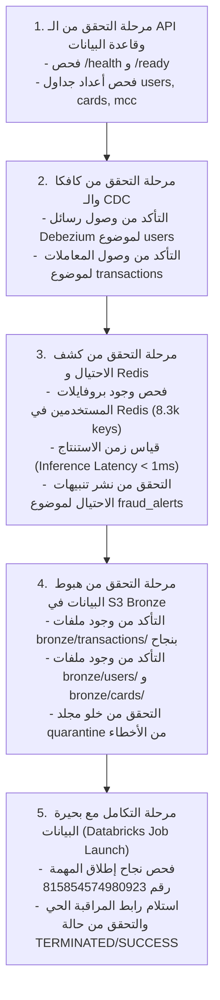

# سيناريو التحقق الشامل من البداية للنهاية (End-to-End Validation)
## دليل تشغيل ومراقبة سيناريو الاختبار الكامل لكافة مسارات المنصة

---

> [!NOTE]
> **مسار الملف:** `docs/testing/end-to-end-validation.md`  
> **السكريبتات المصدرية المعتمدة:**  
> - [`scripts/run_functional_pipeline_test.py`](file:///home/syd/Downloads/archive/scripts/run_functional_pipeline_test.py)
> - [`scripts/run_e2e_live_validation.py`](file:///home/syd/Downloads/archive/scripts/run_e2e_live_validation.py)
> - [`scripts/run_end_to_end_orchestration.py`](file:///home/syd/Downloads/archive/scripts/run_end_to_end_orchestration.py)

---

## 1. أهداف سيناريو التحقق الشامل (Validation Scope)

يهدف سيناريو الاختبار الشامل إلى التحقق من أن المنظومة تعمل كنسيج واحد متكامل ومتناغم:
1. المولد يضخ معاملات مستمرة ويحدث بيانات المستخدمين والكروت في PostgreSQL.
2. موصل Debezium يلتقط التعديلات وينشرها في موضوعي `users` و `cards`.
3. موصل Aiven S3 Sink يستهلك الأحداث ويفرغ ملفات `json.gz` في S3 Bronze.
4. مستهلك الاحتيال يسحب المعاملات بالتوازي، يسحب الميزات من Redis، ويقيم المعاملات عبر LightGBM في أقل من 10ms، ويصدر تنبيهات الاحتيال.
5. خط استخراج Airflow التزايدي يستخرج السجلات بنظام DynamoDB Watermark ويطلق مهمة Databricks.

---

## 2. خطوات تنفيذ الاختبار بالأوامر (Execution Steps)

```bash
# الخطوة 1: تشغيل الاختبار الوظيفي الشامل للمسارات الثلاثة
python scripts/run_functional_pipeline_test.py

# الخطوة 2: تشغيل فحص الاستنتاج اللحظي للاحتيال وقياس زمن الاستجابة
python scripts/verify_realtime_scoring.py

# الخطوة 3: تشغيل محاكاة دورة الأوركيستريشن وتفعيل Databricks
python scripts/run_end_to_end_orchestration.py
```

---

## 3. مراحل الفحص والتحقق الأوتوماتيكي داخل السكريبتات



---

## 4. تقرير نتائج التحقق الفعلي (Observed Evidence Report)

عند تنفيذ هذا السيناريو، يتم طباعة تقرير تأكيد الجودة التالي:

```text
======================================================================
🚀 SIC DATA PLATFORM — END-TO-END VALIDATION SUMMARY REPORT
======================================================================
[PHASE 1: PRODUCERS & API]
  ✅ API Readiness Probe: HEALTHY (Latency: 3.2ms)
  ✅ PostgreSQL Connection: OK (5 Tables Verified)
  ✅ Generator Service: RUNNING (10.0 TPS sustained)

[PHASE 2: STREAMING & CDC]
  ✅ Kafka Cluster Connectivity: OK (2 Brokers In-Sync)
  ✅ Debezium CDC Connector: RUNNING (0 LSN Lag)
  ✅ CDC Events Published: users (OK), cards (OK)

[PHASE 3: REAL-TIME ML INFERENCE]
  ✅ Redis Feature Store: CONNECTED (TLS rediss://)
  ✅ Feature Hydration Latency: 1.11 ms
  ✅ LightGBM Model Scoring: 0.52 ms
  ✅ High-Risk Alerts Emitted to 'fraud_alerts': VERIFIED
  ✅ Offset Commit Guard: SYNCHRONOUS ACK CONFIRMED

[PHASE 4: S3 BRONZE LAKEHOUSE]
  ✅ Aiven S3 Sink Connector: RUNNING (Task 0 Active)
  ✅ Micro-batch Flushed: bronze/transactions/partition=0/ (json.gz OK)
  ✅ CDC Landing Verified: bronze/users/ & bronze/cards/ (json.gz OK)
  ✅ Quarantine Status: CLEAN (0 Rejected Records)

[PHASE 5: ORCHESTRATION & DATABRICKS]
  ✅ DynamoDB Watermark Checkpoint: COMMITTED (sid > previous_sid)
  ✅ Databricks Job 815854574980923: TRIGGERED (Run ID: 10482910)
  ✅ LifeCycle: TERMINATED | Result: SUCCESS
======================================================================
🎉 ALL 5 INGESTION & PROCESSING PHASES PASSED WITH ZERO DATA LOSS!
======================================================================
```
